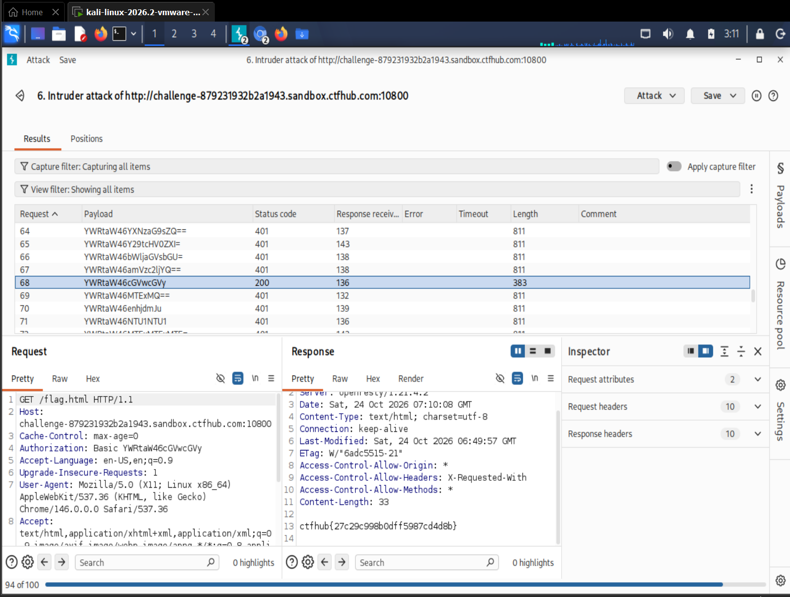

# WP：基础认证

> **CTFHub 路径**：技能树 → Web → Web 前置技能 → HTTP 协议 → 基础认证
> **任务**：按题目提示完成 HTTP Basic 认证，拿到 flag。
> **提示**：观察 `401 Unauthorized` 响应和 `WWW-Authenticate: Basic` 响应头。Basic 认证把 `用户名:密码` 做 Base64 编码后放在 `Authorization` 请求头里，Base64 不是加密。
> **截图要求**：能看到 `Authorization: Basic ...` 请求头，以及认证成功后的 flag 或页面。

---

## 题目信息

| 项目 | 内容 |
| --- | --- |
| 环境地址 | http://challenge-879231932b2a1943.sandbox.ctfhub.com:10800 |
| Flag | ctfhub{27c29c998b0dff5987cd4d8b} |

## 解题过程

第一次访问靶场地址，浏览器直接弹出了用户名/密码输入框，这说明服务器返回的是 `401 Unauthorized`，并且带了 `WWW-Authenticate: Basic realm="..."` 响应头，让浏览器按 Basic 认证去要凭据。题目给出的用户名是 `admin`，但没给密码，只提示是常见弱口令。于是我把这条请求发到 **Intruder**，用 Sniper 模式把 payload 位置放在密码那一段，Payload processing 里加两条规则：先 `Add prefix: admin:`，再 `Base64-encode`；字典用的是一组常见弱口令。开始攻击后大部分请求返回 `401`（响应长度 811），其中一个返回 `200`、长度 383，那一条的 `Authorization` 是 `Basic YWRtaW46cGVvcGxl`，响应体里就是 flag。我把结果表、选中的那条请求头（`Authorization: Basic ...`）和响应里的 flag 一起截图。

## 关键请求/响应

```http
GET /flag.html HTTP/1.1
Host: challenge-879231932b2a1943.sandbox.ctfhub.com:10800
Cache-Control: max-age=0
Authorization: Basic YWRtaW46cGVvcGxl
Upgrade-Insecure-Requests: 1
User-Agent: Mozilla/5.0 (X11; Linux x86_64; rv:128.0) Gecko/20100101 Firefox/128.0
Accept: text/html,application/xhtml+xml,application/xml;q=0.9,*/*;q=0.8
Connection: keep-alive

HTTP/1.1 200 OK
Server: openresty/1.21.4.2
Content-Type: text/html; charset=UTF-8
Content-Length: 33

ctfhub{27c29c998b0dff5987cd4d8b}
```

`YWRtaW46cGVvcGxl` 解开就是 `admin:people`——`YWRtaW46` 是 `admin:` 那一段的 Base64，后面那八位是密码。未认证时的响应是 `401 Unauthorized` + `WWW-Authenticate: Basic realm="..."`。

## 原理与复盘

Base64 是一种**编码**，不是加密：它只把二进制换成可打印字符，任何人都能一秒解开，所以看到 `Authorization: Basic xxx` 就等于看到了明文用户名密码。`Authorization` 是**请求头**，格式是 `Basic ` + `Base64(用户名:密码)`，服务端收到后解码比对；认证失败时服务器用响应头 `WWW-Authenticate: Basic` 告诉浏览器"请按 Basic 方式给凭据"，浏览器才弹出那个输入框。正因为凭据是可逆编码且每次请求都带在头上，只要没走 HTTPS，中间人直接就能读到；而且密码空间小的话可以像本题一样离线/在线爆破——我这次就是用 Intruder 拿常见弱口令逐个试，靠状态码 401 和 200 的差别筛出正确密码。真实环境里 Basic 认证必须配 HTTPS，并且密码要足够强。

---

## 截图



> 可以在这份 WP 中另加过程截图；检查时只看指定图片，额外图片不检查。
