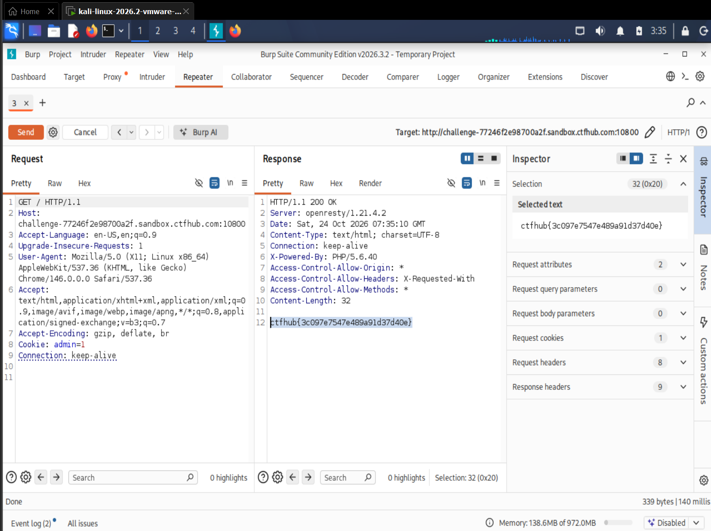

# WP：Cookie

> **CTFHub 路径**：技能树 → Web → Web 前置技能 → HTTP 协议 → Cookie
> **任务**：按题目提示修改 Cookie，拿到 flag。
> **提示**：在 DevTools 的 Application/Storage → Cookies 中查看 Cookie，或在 Burp 的请求头中查看。修改后重放请求，观察页面变化。
> **截图要求**：能看到修改后的 Cookie 请求头，以及服务器返回的 flag 或成功页面。

---

## 题目信息

| 项目 | 内容 |
| --- | --- |
| 环境地址 | http://challenge-77246f2e98700a2f.sandbox.ctfhub.com:10800 |
| Flag | ctfhub{3c097e7547e489a91d37d40e} |

## 解题过程

打开首页，页面提示只有管理员才能拿到 flag，而我显然不是。打开 DevTools 的 Network 面板刷新一次，在请求头里看到服务器之前通过 `Set-Cookie` 给我下发了一个 `admin=0`，说明身份是用 Cookie 里的这个字段判断的。于是我把浏览器请求走 Burp，在 **Repeater** 里把请求头 `Cookie:` 的值由 `admin=0` 改成 `admin=1`，其余部分不动，点 Send。响应变成 `200 OK`，响应体直接返回了 flag，页面也不再是"你不是管理员"的提示。最后把改后的 `Cookie: admin=1` 请求头和响应体里的 flag 一起截图。

## 关键请求/响应

```http
GET / HTTP/1.1
Host: challenge-77246f2e98700a2f.sandbox.ctfhub.com:10800
User-Agent: Mozilla/5.0 (X11; Linux x86_64; rv:128.0) Gecko/20100101 Firefox/128.0
Accept: text/html,application/xhtml+xml,application/xml;q=0.9,*/*;q=0.8
Connection: keep-alive
Cookie: admin=1

HTTP/1.1 200 OK
Server: openresty/1.21.4.2
Content-Type: text/html; charset=UTF-8
Content-Length: 32
X-Powered-By: PHP/5.6.40

ctfhub{3c097e7547e489a91d37d40e}
```

改动只有一处：`Cookie: admin=0` → `Cookie: admin=1`。原来的 `admin=0` 是服务器首次访问时自动下发的，不是我编的。

## 原理与复盘

Cookie 放在 **HTTP 请求头**里，由服务器用 `Set-Cookie` 响应头下发，浏览器保存后每次请求同一域名都自动回传，是跨请求保持状态的主要手段。服务器读到 `admin=1` 就认为我是管理员——问题在于这个值存在客户端，用户可以在 DevTools 里直接改，也可以用 Burp 拦截后随意重放，服务器没有任何办法验证它的真实性。所以**权限判断绝不能只依赖 Cookie 里的一个布尔值**：真实的会话应该存服务端，Cookie 里只放一个不可预测的 Session ID，服务端凭 ID 查自己的记录来判断身份。这道题是把"客户端数据不可信"这条原则做得最直白的一次示范。

---

## 截图



> 可以在这份 WP 中另加过程截图；检查时只看指定图片，额外图片不检查。
