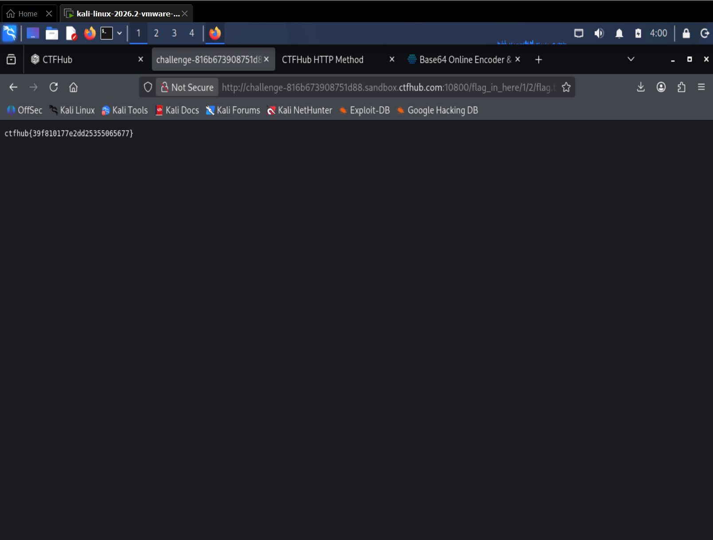

# WP：目录遍历

> **CTFHub 路径**：技能树 → Web → 信息泄露 → 目录遍历
> **任务**：按题目页面提示找到 flag。
> **提示**：注意页面给出的路径和 URL；目录列表本身就是一种信息泄露。只在题目环境内点击和访问，不要使用扫描器扫描其他地址。
> **截图要求**：能看到题目环境地址（或题目名称）、你访问的目录/路径，以及最终的 flag。

---

## 题目信息

| 项目 | 内容 |
| --- | --- |
| 环境地址 | http://challenge-816b673908751d88.sandbox.ctfhub.com:10800 |
| Flag | ctfhub{39f810177e2dd25355065677} |

## 解题过程

打开靶场地址后，首页上只有一个 `flag_in_here` 目录链接，点进去看到的是 Web 服务器自动生成的目录列表，里面放着 `1`、`2` 两个子目录。我顺着链接一层层点：先进入 `/flag_in_here/1/`，再进入 `/flag_in_here/1/2/`，这时目录列表里出现了一个叫 `flag` 的文件。点开这个文件后，页面直接显示出 flag。整个过程没有改过任何请求，只是在浏览器地址栏里沿着页面给出的目录往下走；最后我把地址栏里完整的 `/flag_in_here/1/2/flag.txt` 和页面上的 flag 一起截图。

## 关键请求/响应

```http
GET /flag_in_here/1/2/flag.txt HTTP/1.1
Host: challenge-816b673908751d88.sandbox.ctfhub.com:10800
User-Agent: Mozilla/5.0 (X11; Linux x86_64; rv:128.0) Gecko/20100101 Firefox/128.0
Accept: text/html,application/xhtml+xml,application/xml;q=0.9,*/*;q=0.8
Connection: keep-alive

HTTP/1.1 200 OK
Content-Type: text/html; charset=UTF-8

ctfhub{39f810177e2dd25355065677}
```

本题不需要修改请求，用浏览器直接访问目录和文件就能拿到结果；上面的响应片段是页面实际返回的内容。

## 原理与复盘

这道题对应 HTTP 报文的**请求行里的路径（URL path）**和**响应体**：路径决定访问哪个资源，服务器找到文件后把内容原样放进响应体返回。目录列表（autoindex）是 Web 服务器的一项配置，打开后会把目录下的文件名全部列出来，等于把"这里有哪些文件"的清单直接交给访问者。正常情况下这些文件既没有链接也没有人知道名字，攻击者只能靠猜；一旦目录可列，备份文件、源码、配置文件、本不该被访问的 flag 文件就全部暴露了。所以目录遍历的危险不在于"能读某一个文件"，而在于**文件名本身被打包泄露**，后面的利用才有目标。

---

## 截图



> 可以在这份 WP 中另加过程截图；检查时只看指定图片，额外图片不检查。
