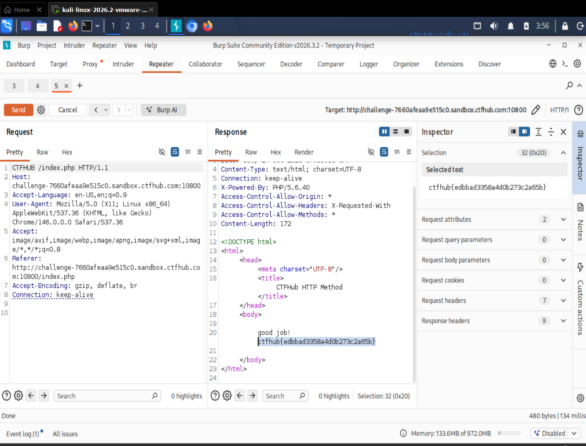

# WP：请求方式

> **CTFHub 路径**：技能树 → Web → Web 前置技能 → HTTP 协议 → 请求方式
> **任务**：按题目要求使用指定的 HTTP 方法访问目标，拿到 flag。
> **提示**：浏览器地址栏默认发送 GET 请求。用 Burp Repeater 修改请求行中的方法，或者用 `curl -X` 复现。
> **截图要求**：优先使用 Burp Repeater，截图中要能看到修改后的请求行（方法 + 路径）和响应中的 flag；如果 Burp 无法启动，可以用 `curl -X` 的方法修改截图代替，并在 WP 中说明原因。只有浏览器普通 GET 访问不算完成。

---

## 题目信息

| 项目 | 内容 |
| --- | --- |
| 环境地址 | http://challenge-7660afeaa9e515c0.sandbox.ctfhub.com:10800 |
| Flag | ctfhub{edbbad3358a4d0b273c2a65b} |

## 解题过程

用浏览器打开靶场地址，页面提示要求使用 `CTFHUB` 方法，直接用地址栏访问（也就是 GET）只会返回那句提示，拿不到 flag。我让 Kali 里的浏览器走 Burp 代理，把这条请求从 Proxy → HTTP history 里右键发到 **Repeater**，然后在请求面板第一行把 `GET /index.php HTTP/1.1` 改成 `CTFHUB /index.php HTTP/1.1`，其它请求头保持不动。点 Send 之后，右侧 Response 里出现了 `good job!` 和 flag，响应头里的 `X-Powered-By: PHP/5.6.40` 说明服务端确实是 PHP 在处理。最后把 Repeater 的请求行和响应体一起截图。

## 关键请求/响应

```http
CTFHUB /index.php HTTP/1.1
Host: challenge-7660afeaa9e515c0.sandbox.ctfhub.com:10800
User-Agent: Mozilla/5.0 (X11; Linux x86_64; rv:128.0) Gecko/20100101 Firefox/128.0
Accept: text/html,application/xhtml+xml,application/xml;q=0.9,*/*;q=0.8
Connection: keep-alive

HTTP/1.1 200 OK
Content-Type: text/html; charset=UTF-8
X-Powered-By: PHP/5.6.40
Connection: keep-alive

<!DOCTYPE html>
<html>
<head><meta charset="UTF-8"><title>CTFHub HTTP Method</title></head>
<body>
good job!
ctfhub{edbbad3358a4d0b273c2a65b}
</body>
</html>
```

关键改动只有一处：请求行最前面的方法从 `GET` 换成了 `CTFHUB`。

## 原理与复盘

请求行由三部分组成：**请求方法 + 请求目标（路径）+ HTTP 版本**，方法就在最前面、第一个空格之前的位置，例如 `CTFHUB /index.php HTTP/1.1`。方法本质上只是这一行里的一个字符串，服务器读它来决定按什么语义处理请求（GET 取资源、POST 提交数据、HEAD 只要头）。浏览器地址栏只能发 GET，所以只要服务端要求别的方法，就必须用代理或命令行手改请求行——这道题的意义就是让人意识到"方法"不是你点按钮决定的，而是可以自己写的。顺带说明：服务端愿意接受 `CTFHUB` 这种自定义方法，说明它对方法的校验很随意，这在真实场景里也可能带来越权或绕过。

---

## 截图



> 可以在这份 WP 中另加过程截图；检查时只看指定图片，额外图片不检查。
