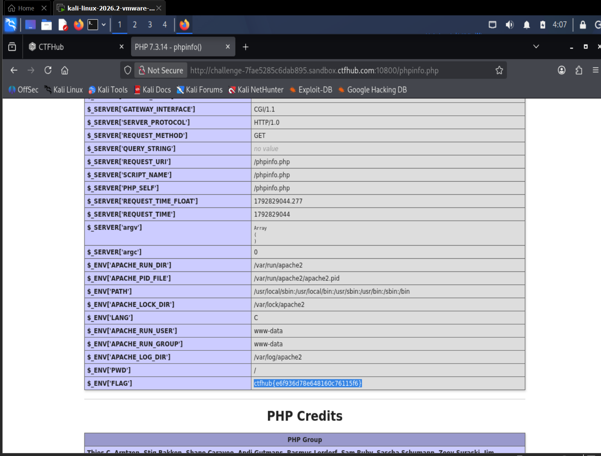

# WP：PHPINFO

> **CTFHub 路径**：技能树 → Web → 信息泄露 → PHPINFO
> **任务**：在 phpinfo 页面中找到 flag，并观察它泄露了哪些信息。
> **提示**：phpinfo 会输出大量 PHP 和服务器配置。用浏览器的查找功能搜索关键字，同时留意页面暴露的路径、版本、环境变量等信息。
> **截图要求**：能看到 phpinfo 页面、你搜索/定位到的 flag，以及至少一处敏感信息。

---

## 题目信息

| 项目 | 内容 |
| --- | --- |
| 环境地址 | http://challenge-7fae5285c6dab895.sandbox.ctfhub.com:10800 |
| Flag | ctfhub{e6f936d78e648160c76115f6} |

## 解题过程

访问靶场后页面直接就是一个完整的 phpinfo 输出，标题是 `PHP Version 7.3.14`，往下是几百行配置表格。我先按提示用 `Ctrl + F` 在页面里搜 `flag`，浏览器跳到的位置是 `$_SERVER` 和 `$_ENV` 那一段，其中 `$_ENV['FLAG']` 这一行的值就是 flag，被浏览器高亮了。除了 flag，同屏还能看到不少敏感信息：`$_SERVER['REQUEST_URI']`、`$_SERVER['SCRIPT_NAME']` 暴露了网站路径，`$_ENV['APACHE_RUN_USER']` 是 `www-data`、`$_ENV['APACHE_LOG_DIR']` 是 `/var/log/apache2`，`$_ENV['PATH']` 列出了系统命令目录，页面上方还有 PHP 版本和编译参数。我把 flag 和这些配置项放在同一屏里截图。

## 关键请求/响应

```http
GET /phpinfo.php HTTP/1.1
Host: challenge-7fae5285c6dab895.sandbox.ctfhub.com:10800
User-Agent: Mozilla/5.0 (X11; Linux x86_64; rv:128.0) Gecko/20100101 Firefox/128.0

HTTP/1.1 200 OK
Content-Type: text/html; charset=UTF-8

（响应体是 phpinfo() 生成的大表格，关键两行如下）
$_ENV['APACHE_RUN_USER']   www-data
$_ENV['FLAG']              ctfhub{e6f936d78e648160c76115f6}
```

本题不需要修改请求，flag 就在响应体里，用浏览器的页面查找就能定位。

## 原理与复盘

flag 出现在**响应体**里，属于服务端把内部配置当作正常网页内容回给了客户端。phpinfo() 是 PHP 自带的调试函数，本来用于排查环境问题，它会输出 PHP 版本、编译参数、已加载扩展、`php.ini` 路径、环境变量、`$_SERVER` 全部键值、数据库连接串等。对攻击者来说这些信息的价值在于：版本号可以直接对应到已知 CVE；绝对路径（如 `/var/www/html`、日志目录）是文件包含、文件上传、日志投毒的必备前置；环境变量里常常直接躺着数据库口令和本题这样的 flag。所以生产环境上残留一个可访问的 `phpinfo.php`，本身就是一处高危信息泄露。

---

## 截图



> 可以在这份 WP 中另加过程截图；检查时只看指定图片，额外图片不检查。
