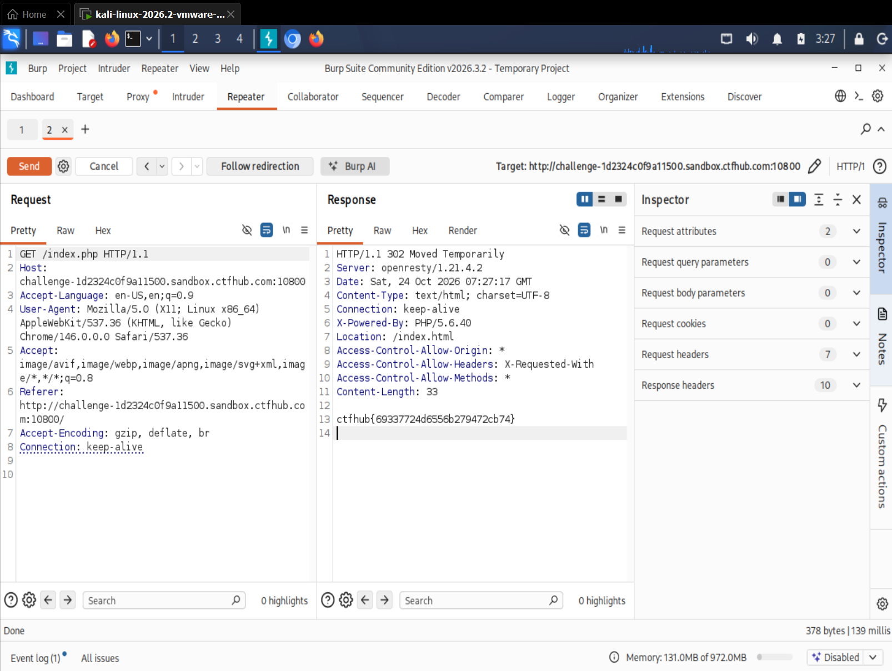

# WP：302 跳转

> **CTFHub 路径**：技能树 → Web → Web 前置技能 → HTTP 协议 → 302 跳转
> **任务**：观察 302 重定向，按题目提示找到 flag。
> **提示**：浏览器通常会自动跟随 302，所以你可能只看到最终页面。打开 DevTools 的 Network 面板（勾选 Preserve log）或 Burp，查看原始响应中的 `302` 状态码和 `Location` 响应头。
> **截图要求**：能看到 302 状态码和/或 `Location` 响应头，以及最终的 flag。只截最终页面、没有 302 证据的截图不合格。

---

## 题目信息

| 项目 | 内容 |
| --- | --- |
| 环境地址 | http://challenge-1d2324c0f9a11500.sandbox.ctfhub.com:10800 |
| Flag | ctfhub{69337724d6556b279472cb74} |

## 解题过程

第一次用浏览器访问 `/index.php`，页面哗一下就变成了另一个页面，地址栏也是最终页面的地址，中间什么都没有看到，页面上也没有 flag 的痕迹。这说明浏览器自动跟了一次跳转，把原始响应吃掉了。于是我把浏览器请求走 Burp，在 **Repeater** 里对 `/index.php` 重新发一次请求，看原始响应：状态行是 `HTTP/1.1 302 Moved Temporarily`，响应头里有 `Location: /index.html`，而 302 的**响应体里直接就是 flag**（`Content-Length: 33`，正好是 flag 的长度）。我不需要点 Follow redirection，看到 302 和 Location 这两个证据再加响应体里的 flag 就截图了。

## 关键请求/响应

```http
GET /index.php HTTP/1.1
Host: challenge-1d2324c0f9a11500.sandbox.ctfhub.com:10800
User-Agent: Mozilla/5.0 (X11; Linux x86_64; rv:128.0) Gecko/20100101 Firefox/128.0
Accept: text/html,application/xhtml+xml,application/xml;q=0.9,*/*;q=0.8
Connection: keep-alive

HTTP/1.1 302 Moved Temporarily
Server: openresty/1.21.4.2
Date: Sat, 24 Oct 2026 07:27:17 GMT
Content-Type: text/html; charset=UTF-8
Content-Length: 33
Location: /index.html
X-Powered-By: PHP/5.6.40

ctfhub{69337724d6556b279472cb74}
```

请求本身没有改动，关键是**不要跟随跳转**，看的是那个 302 响应本身（Burp Repeater 默认不跟随，所以能直接看到）。

## 原理与复盘

200 表示"这就是你要的东西"，响应体就是最终内容；302 表示"东西不在这儿，去别处拿"，响应头用 `Location` 指出新地址，响应体通常是空的或者一段提示。浏览器为了用户体验会自动再发一次请求到 `Location`，于是你在页面上只能看到最终结果，中间那次 302 被透明化处理了——这道题恰恰把 flag 放在被跳过的那次 302 响应里，所以用浏览器怎么刷新都看不到。要观察它，就必须在客户端自己发请求：Burp 的 Repeater 不会自动跟随，`curl -i` 默认也不跟随（加 `-L` 才会）。顺便注意区分：302 是临时重定向，301 是永久重定向，两者在缓存行为上不一样，但都靠 `Location` 指路。

---

## 截图



> 可以在这份 WP 中另加过程截图；检查时只看指定图片，额外图片不检查。
