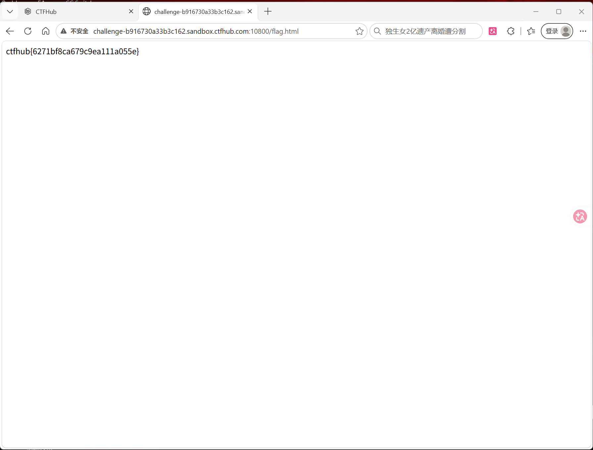

# WP：基础认证

> **CTFHub 路径**：技能树 → Web → Web 前置技能 → HTTP 协议 → 基础认证
> **任务**：按题目提示完成 HTTP Basic 认证，拿到 flag。
> **提示**：观察 `401 Unauthorized` 响应和 `WWW-Authenticate: Basic` 响应头。Basic 认证把 `用户名:密码` 做 Base64 编码后放在 `Authorization` 请求头里，Base64 不是加密。
> **截图要求**：能看到 `Authorization: Basic ...` 请求头，以及认证成功后的 flag 或页面。

---

## 题目信息

| 项目 | 内容 |
| --- | --- |
| 环境地址 | http://challenge-b916730a33b3c162.sandbox.ctfhub.com:10800 |
| Flag | ctfhub{6271bf8ca679c9ea111a055e} |

## 解题过程

第一次访问时看不到网页内容，浏览器直接弹出"需要输入用户名和密码"的登录框，这说明服务器回了 `401 Unauthorized`，并用 `WWW-Authenticate: Basic` 告诉浏览器该用 Basic 认证、由浏览器负责弹框收集凭据。题目页面给了用户名 `admin`，还给了一份常见密码表，所以这题实际上是要把密码试出来。我的做法是先用浏览器认证框手输，密码不对时框会重新弹出来（还是 401）；为了看得更清楚，我改用终端 `curl -u admin:密码` 逐条试，每条都能直接看到响应码，试到正确密码时状态码变成 200，页面跳到 `/flag.html`，页面上就是 `ctfhub{6271bf8ca679c9ea111a055e}`。整个过程没有任何加密：凭据只是被 Base64 换了个样子放在请求头里传送。

## 关键请求/响应

认证通过后，浏览器（或 `curl -u`）会在每个请求里自动加上 `Authorization` 头，格式是 `Basic` 加一个空格，再加 `用户名:密码` 的 Base64：

```http
GET /flag.html HTTP/1.1
Host: challenge-b916730a33b3c162.sandbox.ctfhub.com:10800
Authorization: Basic base64(admin:密码)
```

```text
HTTP/1.1 200 OK

ctfhub{6271bf8ca679c9ea111a055e}
```

要点：`Authorization` 这一行的值不是加密后的密文，把它做一次 Base64 解码就能直接看到 `admin:密码` 的明文；所以密码强度（能不能被字典试出来）就是这题唯一的门槛。用 `curl -u admin:密码 环境地址` 可以复现同样的请求，`-v` 还能在请求头里看到实际发出去的 `Authorization` 值。

## 原理与复盘

凭据在**请求头的 `Authorization` 字段**里，格式固定为 `Basic <Base64(用户名:密码)>`，服务器解码后比对，对不上就回 `401` 并带 `WWW-Authenticate: Basic` 让客户端重试。因为 Base64 只是编码、不是加密，凭据等于半明文传输，一旦被代理或中间人抓到就能直接还原，所以真实系统必须叠加 HTTPS 才安全。这题也提醒我：认证能不能被绕过，取决于密码本身抗不抗字典，而不是认证机制的名字。

---

## 截图



> 可以在这份 WP 中另加过程截图；检查时只看指定图片，额外图片不检查。
