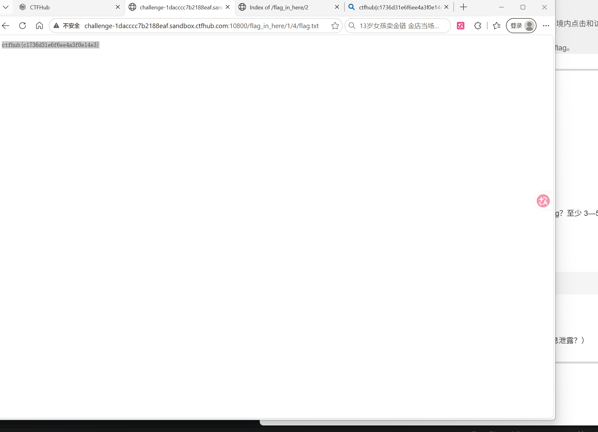

# WP：目录遍历

> **CTFHub 路径**：技能树 → Web → 信息泄露 → 目录遍历
> **任务**：按题目页面提示找到 flag。
> **提示**：注意页面给出的路径和 URL；目录列表本身就是一种信息泄露。只在题目环境内点击和访问，不要使用扫描器扫描其他地址。
> **截图要求**：能看到题目环境地址（或题目名称）、你访问的目录/路径，以及最终的 flag。

---

## 题目信息

| 项目 | 内容 |
| --- | --- |
| 环境地址 | http://challenge-1dacccc7b2188eaf.sandbox.ctfhub.com:10800 |
| Flag | ctfhub{c1736d31e6f6ee4a3f0e14e3} |

## 解题过程

打开首页后，返回的不是一个正常设计的网页，而是一个 Apache 风格的目录列表（页面标题是 `Index of /`），说明这台服务器没有关闭目录浏览功能。列表里能看到 `flag_in_here` 目录，点进去以后下面又列出了 `1`、`2`、`3`、`4` 四个子目录，我就是顺着这个列表一层一层点下去的。`2`、`3`、`4` 点进去没有直接给东西，只有 `1` 还能继续往下点出下一层，于是我回到 `1` 里继续点进了 `4`。最后在 `/flag_in_here/1/4/` 里看到一个 `flag.txt`，直接点开就是一个纯文本页面，内容是 `ctfhub{c1736d31e6f6ee4a3f0e14e3}`。整个过程我没有改过任何请求，也没有用扫描器，全靠页面上给出的目录列表点出来——如果不点，这些目录和文件根本不会出现在任何链接里。

## 关键请求/响应

本题不需要修改请求，只是跟着目录列表一层层点。最后取到 flag 的那一次请求和响应如下：

```http
GET /flag_in_here/1/4/flag.txt HTTP/1.1
Host: challenge-1dacccc7b2188eaf.sandbox.ctfhub.com:10800

HTTP/1.1 200 OK

ctfhub{c1736d31e6f6ee4a3f0e14e3}
```

## 原理与复盘

目录遍历对应的位置是**请求行里的 URL 路径**：浏览器请求哪个路径，服务器就去那个路径下面找文件返回，服务器既没有把路径限制在网站根目录里，也没有关掉目录列表，于是整个目录结构连同文件名都被列了出来。目录列表本身是一种信息泄露，它把本来不该被发现的备份文件、源码、配置甚至 flag 文件的名字直接暴露给访问者。防御上就是关掉目录浏览（如 Apache 的 `Options -Indexes`），并且对路径参数做规范化校验，禁止 `../` 和绝对路径。

---

## 截图



> 可以在这份 WP 中另加过程截图；检查时只看指定图片，额外图片不检查。
