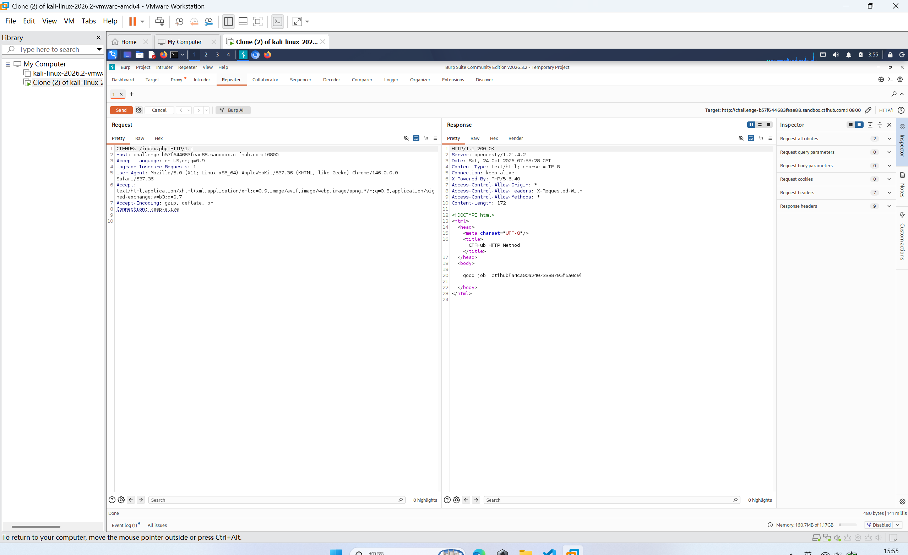

# WP：请求方式

> **CTFHub 路径**：技能树 → Web → Web 前置技能 → HTTP 协议 → 请求方式
> **任务**：按题目要求使用指定的 HTTP 方法访问目标，拿到 flag。
> **提示**：浏览器地址栏默认发送 GET 请求。用 Burp Repeater 修改请求行中的方法，或者用 `curl -X` 复现。
> **截图要求**：优先使用 Burp Repeater，截图中要能看到修改后的请求行（方法 + 路径）和响应中的 flag；如果 Burp 无法启动，可以用 `curl -X` 的方法修改截图代替，并在 WP 中说明原因。只有浏览器普通 GET 访问不算完成。

---

## 题目信息

| 项目 | 内容 |
| --- | --- |
| 环境地址 | http://challenge-b57f644683feae88.sandbox.ctfhub.com:10800/index.php |
| Flag | ctfhub{a4ca00a24073339795f6a0c9} |

## 解题过程

用浏览器直接访问 `/index.php` 时，页面只提示需要用题目指定的请求方法访问，拿不到 flag——因为地址栏和点链接发的都是 GET，改不了方法名。所以我在 Kali 里打开 Burp Suite，把浏览器代理指向 `127.0.0.1:8080`，在 Proxy → HTTP history 里找到这条 `/index.php` 的请求，右键 Send to Repeater。在 Repeater 里我只动了请求行的第一个单词：把 `GET /index.php HTTP/1.1` 改成 `CTFHUB /index.php HTTP/1.1`，Host、User-Agent 等请求头保持原样，然后点 Send。响应的状态行变成了 `HTTP/1.1 200 OK`，响应体标题是 `CTFHub HTTP Method`，下面出现 `good job:)` 和 flag `ctfhub{a4ca00a24073339795f6a0c9}`。这说明服务端是按请求行里的方法名来做判断的，方法名合法与否跟 URL 无关。

## 关键请求/响应

请求（Repeater 里修改后的请求行，方法从 `GET` 换成 `CTFHUB`）：

```http
CTFHUB /index.php HTTP/1.1
Host: challenge-b57f644683feae88.sandbox.ctfhub.com:10800
Accept-Language: zh-CN,zh;q=0.9,en;q=0.8
User-Agent: Mozilla/5.0 (X11; Linux x86_64) AppleWebKit/537.36 (KHTML, like Gecko) Chrome/146.0.0.0 Safari/537.36
Accept-Encoding: gzip, deflate
Connection: keep-alive
```

响应：

```http
HTTP/1.1 200 OK
Server: gunicorn/20.1.0
Content-Type: text/html; charset=utf-8
Connection: keep-alive
Content-Length: 172
```

响应体（关键部分）：

```html
<html>
  <head>
    <meta charset="UTF-8">
    <title>CTFHub HTTP Method</title>
  </head>
  <body>
    good job:)
    ctfhub{a4ca00a24073339795f6a0c9}
  </body>
</html>
```

## 原理与复盘

请求行由三部分组成：**方法 + 请求路径 + HTTP 版本**，例如 `CTFHUB /index.php HTTP/1.1`，方法就是这一行的第一个单词，既不在 URL 里也不在请求头里，所以只能改报文本身，浏览器帮不上忙。服务端只对特定方法返回内容、对 GET 返回提示，说明它把方法名当成了访问控制条件，而方法名是客户端任意可控的——这种校验方式本身不可靠。下次遇到类似题目，除了 Burp Repeater，也可以直接 `curl -X CTFHUB` 复现。

---

## 截图



> 可以在这份 WP 中另加过程截图；检查时只看指定图片，额外图片不检查。
