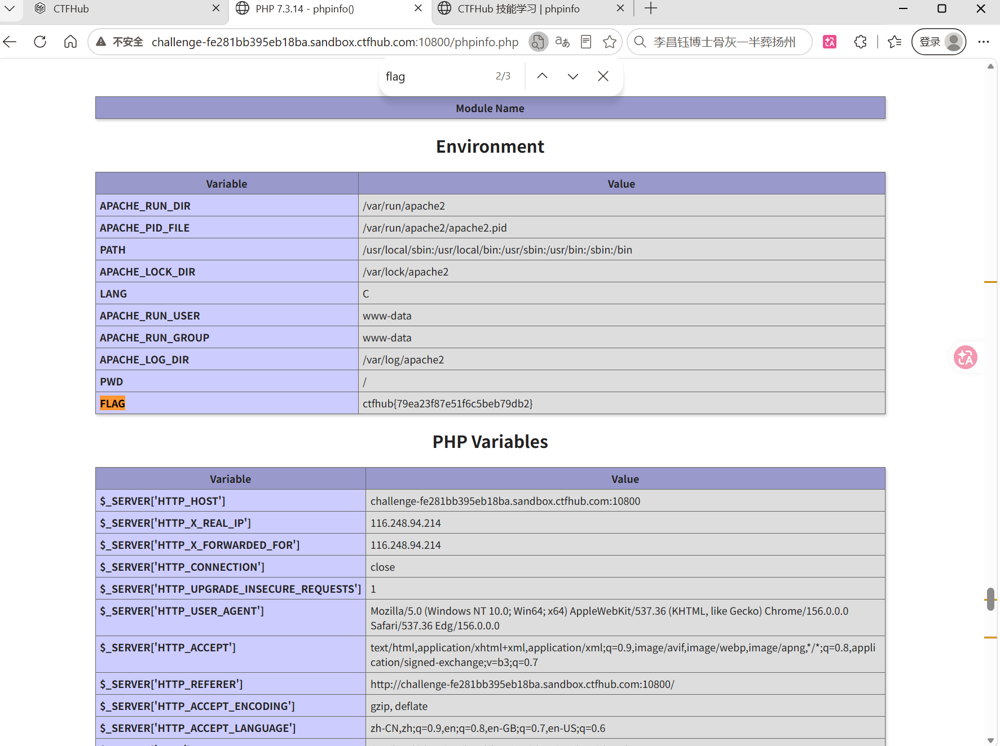

# WP：PHPINFO

> **CTFHub 路径**：技能树 → Web → 信息泄露 → PHPINFO
> **任务**：在 phpinfo 页面中找到 flag，并观察它泄露了哪些信息。
> **提示**：phpinfo 会输出大量 PHP 和服务器配置。用浏览器的查找功能搜索关键字，同时留意页面暴露的路径、版本、环境变量等信息。
> **截图要求**：能看到 phpinfo 页面、你搜索/定位到的 flag，以及至少一处敏感信息。

---

## 题目信息

| 项目 | 内容 |
| --- | --- |
| 环境地址 | http://challenge-fe281bb395eb18ba.sandbox.ctfhub.com:10800 |
| Flag | ctfhub{79ea23f87e51f6c5beb79db2} |

## 解题过程

打开地址后拿到的不是题目首页，而是 `phpinfo.php` 的完整输出，一整页都是紫色表头的配置表格（PHP Version、Environment、PHP Variables 等），信息量非常大，靠肉眼一行行看很难找。我先按 `Ctrl + F` 搜索关键字 `flag`，浏览器显示命中 3 处（提示 2/3），往前翻一个就落在 Environment 表的最后一行：变量名是 `FLAG`，值就是 `ctfhub{79ea23f87e51f6c5beb79db2}`。找到 flag 之后我顺便看了同一张表里的其他内容，比如 `APACHE_RUN_DIR`、`APACHE_LOG_DIR`、`PATH`、`PWD` 这些服务器绝对路径，以及下面 PHP Variables 里的 `HTTP_HOST`、`HTTP_USER_AGENT`、`HTTP_ACCEPT` 等请求信息。也就是说这个页面对攻击者等于一份服务器说明书：路径、版本、运行用户（`www-data`）都能直接读出来。

## 关键请求/响应

```http
GET /phpinfo.php HTTP/1.1
Host: challenge-fe281bb395eb18ba.sandbox.ctfhub.com:10800

HTTP/1.1 200 OK
Content-Type: text/html; charset=UTF-8
```

响应体（Environment 表里的关键两行）：

```text
APACHE_RUN_DIR   /var/run/apache2
FLAG             ctfhub{79ea23f87e51f6c5beb79db2}
```

## 原理与复盘

phpinfo 泄露的位置是**响应体**：服务器把 PHP 版本、编译参数、已加载模块、环境变量、`$_SERVER` 里的请求信息全部渲染成 HTML 返回给访问者，这些内容本来只应该给管理员看。对攻击者来说，版本号可以对应到已知漏洞，绝对路径可以用于文件包含或写入，运行用户和可写目录决定了后续提权空间。所以生产环境必须在发布前删除 `phpinfo.php` 这类调试页面，或者用访问控制把它限制在内网/本机。

---

## 截图



> 可以在这份 WP 中另加过程截图；检查时只看指定图片，额外图片不检查。
