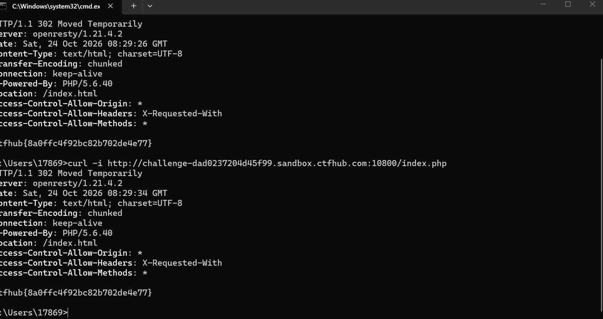

# WP：302 跳转

> **CTFHub 路径**：技能树 → Web → Web 前置技能 → HTTP 协议 → 302 跳转
> **任务**：观察 302 重定向，按题目提示找到 flag。
> **提示**：浏览器通常会自动跟随 302，所以你可能只看到最终页面。打开 DevTools 的 Network 面板（勾选 Preserve log）或 Burp，查看原始响应中的 `302` 状态码和 `Location` 响应头。
> **截图要求**：能看到 302 状态码和/或 `Location` 响应头，以及最终的 flag。只截最终页面、没有 302 证据的截图不合格。

---

## 题目信息

| 项目 | 内容 |
| --- | --- |
| 环境地址 | http://challenge-dad0237204d45f99.sandbox.ctfhub.com:10800 |
| Flag | ctfhub{8a0ffc4f92bc82b702de4e77} |

## 解题过程

用浏览器访问首页时页面一闪就变了，地址栏和内容都跳到别的地方，看不出中间发生了什么，因为浏览器遇到 302 会自动去请求 `Location` 指向的地址，我在界面上只看到最后那个 200 的页面。为了看原始报文，我改用 `curl -i` 直接请求 `index.php`，`-i` 会把响应头一起打印出来，不会被自动跳转吃掉。输出第一行就是 `HTTP/1.1 302 Moved Temporarily`，响应头里有 `Server: openresty/1.21.4.2`、`X-Powered-By: PHP/5.6.40` 和 `Location: /index.html`，确认这是一个临时重定向；意外的是 302 的响应体里已经直接写着 flag `ctfhub{8a0ffc4f92bc82b702de4e77}`。我又执行了一次，两次响应完全一致（`Date` 不同），说明 flag 就挂在重定向响应本身里，不需要真的去跟 `Location`。

## 关键请求/响应

```bash
curl -i http://challenge-dad0237204d45f99.sandbox.ctfhub.com:10800/index.php
```

```http
HTTP/1.1 302 Moved Temporarily
Server: openresty/1.21.4.2
Date: Sat, 24 Oct 2026 08:29:26 GMT
Content-Type: text/html; charset=UTF-8
Transfer-Encoding: chunked
Connection: keep-alive
X-Powered-By: PHP/5.6.40
Location: /index.html
Access-Control-Allow-Origin: *
Access-Control-Allow-Headers: X-Requested-With
Access-Control-Allow-Methods: *

ctfhub{8a0ffc4f92bc82b702de4e77}
```

## 原理与复盘

两者在报文上的区别就在**状态行和响应头**：200 表示本次请求直接带回了内容，302 表示"内容不在这，去 `Location` 那里拿"，浏览器看到 302 会自己再发一次请求，所以你在界面上看到的往往是第二个 200 的页面。这题的 flag 反而藏在 302 的响应体里，说明只看"最终页面"会漏东西，用 `curl -i`、Burp 或 DevTools 勾选 Preserve log 才能看到完整的跳转链条。顺带一提，`Location` 的值如果来自用户参数，还可能变成开放重定向漏洞。

---

## 截图



> 可以在这份 WP 中另加过程截图；检查时只看指定图片，额外图片不检查。
