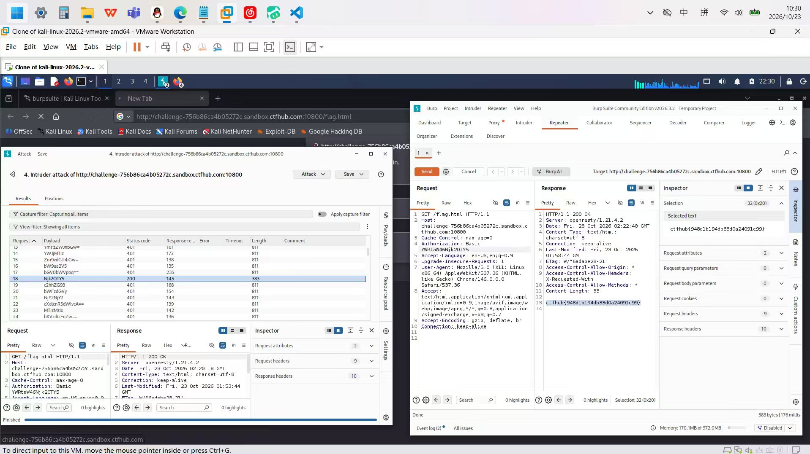

# WP：基础认证

> **CTFHub 路径**：技能树 → Web → Web 前置技能 → HTTP 协议 → 基础认证
> **任务**：按题目提示完成 HTTP Basic 认证，拿到 flag。
> **提示**：观察 `401 Unauthorized` 响应和 `WWW-Authenticate: Basic` 响应头。Basic 认证把 `用户名:密码` 做 Base64 编码后放在 `Authorization` 请求头里，Base64 不是加密。
> **截图要求**：能看到 `Authorization: Basic ...` 请求头，以及认证成功后的 flag 或页面。

---

## 题目信息

| 项目 | 内容 |
| --- | --- |
| 环境地址 | http://challenge-756b86ca4b05272c.sandbox.ctfhub.com:10800/ |
| Flag | ctfhub{948d1b194db33d0a24091c99} |

## 解题过程

打开靶场时浏览器直接弹出了用户名/密码输入框，关掉后看请求，`/flag.html` 返回 `401 Unauthorized`，响应头带 `WWW-Authenticate: Basic`，这说明它用的是 HTTP Basic 认证，凭据要放在 `Authorization: Basic <Base64>` 里。题目给了密码字典，用户名是 `admin`，所以我把请求发到 Burp Intruder，把 payload 位置放在 `Authorization` 头 Basic 后面那一段，用字典逐个试。结果列表里第 21 条返回 `200`、长度 33，明显和其他 401 不一样，对应密码是 `62d969`。随后在 Repeater 里用 `admin:62d969` 重新发一次，确认响应体里就是 flag。

## 关键请求/响应

```http
GET /flag.html HTTP/1.1
Host: challenge-756b86ca4b05272c.sandbox.ctfhub.com:10800
Cache-Control: max-age=0
Authorization: Basic YWRtaW46NjJkOTY5

HTTP/1.1 200 OK
Server: openresty/1.21.4.2
Content-Type: text/html; charset=utf-8
Last-Modified: Fri, 23 Oct 2026 01:53:44 GMT
ETag: W/"6adabe28-21"
Content-Length: 33

ctfhub{948d1b194db33d0a24091c99}
```

`YWRtaW46NjJkOTY5` 做 Base64 解码就是 `admin:62d969`。

## 原理与复盘

`Authorization` 是**请求头**，Basic 认证只是把 `用户名:密码` 用 Base64 拼成一串字符放进去，Base64 是可逆编码而不是加密，任何人拿到这串字符都能立刻还原出明文密码。也就是说 Basic 认证本身不提供保密性，安全性完全依赖 HTTPS，而且服务器每次请求都要重新校验一遍，密码一旦泄露就等于永久失守。另外这道题也说明“有认证”不等于“安全”：密码用弱字典、又没有失败次数限制，爆破几十次就能中。

---

## 截图



> 可以在这份 WP 中另加过程截图；检查时只看指定图片，额外图片不检查。
