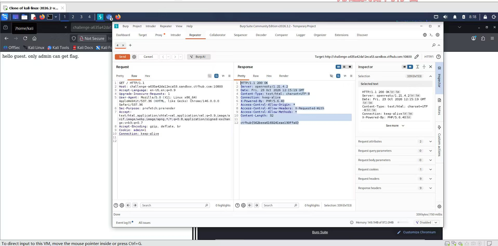

# WP：Cookie

> **CTFHub 路径**：技能树 → Web → Web 前置技能 → HTTP 协议 → Cookie
> **任务**：按题目提示修改 Cookie，拿到 flag。
> **提示**：在 DevTools 的 Application/Storage → Cookies 中查看 Cookie，或在 Burp 的请求头中查看。修改后重放请求，观察页面变化。
> **截图要求**：能看到修改后的 Cookie 请求头，以及服务器返回的 flag 或成功页面。

---

## 题目信息

| 项目 | 内容 |
| --- | --- |
| 环境地址 | http://challenge-a635a42da12eca53.sandbox.ctfhub.com:10800/ |
| Flag | ctfhub{562beea6169241eae130ffa0} |

## 解题过程

打开首页，页面只显示 `hello guest. only admin can get flag.`，说明服务器是靠 Cookie 里的身份标记来判断我是谁的，现在这个标记让我处于 guest 身份。我先在 DevTools 的 Application → Cookies 里确认了 Cookie 的名字是 `admin`，值不是 `1`，所以服务器一直当我是访客。然后我把请求挂到 Burp，在 Repeater 里把请求头的 `Cookie` 改成 `admin=1` 再 Send，页面不再提示 guest，响应体直接返回了 flag。整个过程只改了一个请求头的值，其他请求和路径都没变。

## 关键请求/响应

```http
GET / HTTP/1.1
Host: challenge-a635a42da12eca53.sandbox.ctfhub.com:10800
Cookie: admin=1
User-Agent: Mozilla/5.0 (X11; Linux x86_64) AppleWebKit/537.36 (KHTML, like Gecko) Chrome/146.0.0.0 Safari/537.36

HTTP/1.1 200 OK
Server: openresty/1.21.4.2
Content-Type: text/html; charset=UTF-8
Content-Length: 32
X-Powered-By: PHP/5.6.40

ctfhub{562beea6169241eae130ffa0}
```

## 原理与复盘

Cookie 放在 **HTTP 请求头**里，浏览器每次访问同一域名都会自动把该站点的 Cookie 一起带上，服务器读完就知道“这条请求是谁发的”，再决定返回 guest 页面还是 admin 页面。问题在于 Cookie 保存在客户端、用户可以随手改，把权限判断只做成 `admin=1` 这种明文标记，改一个字符就能提权。真实系统应该把身份放在服务端可校验的 Session 或签名 Token 里，Cookie 只存不可伪造的会话标识。

---

## 截图



> 可以在这份 WP 中另加过程截图；检查时只看指定图片，额外图片不检查。
