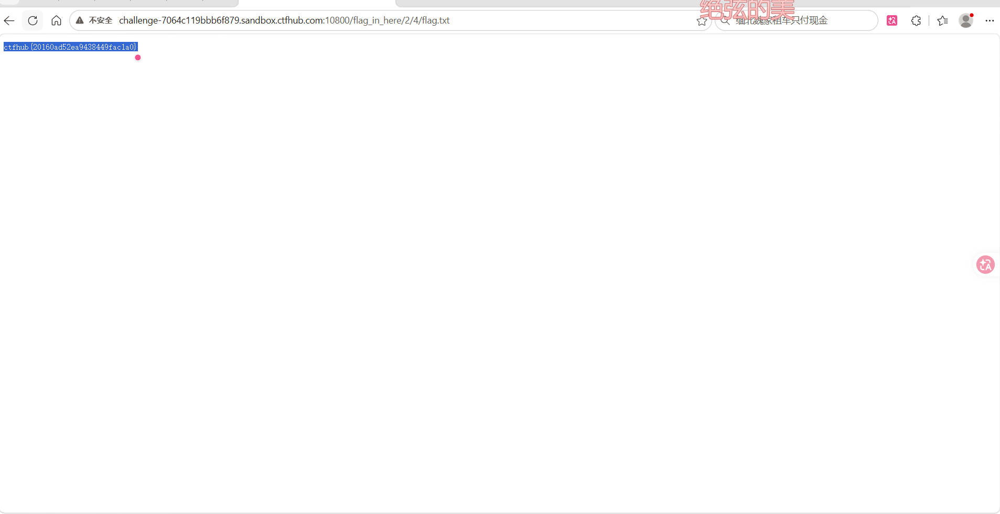

# WP：目录遍历

> **CTFHub 路径**：技能树 → Web → 信息泄露 → 目录遍历
> **任务**：按题目页面提示找到 flag。
> **提示**：注意页面给出的路径和 URL；目录列表本身就是一种信息泄露。只在题目环境内点击和访问，不要使用扫描器扫描其他地址。
> **截图要求**：能看到题目环境地址（或题目名称）、你访问的目录/路径，以及最终的 flag。

---

## 题目信息

| 项目 | 内容 |
| --- | --- |
| 环境地址 | http://challenge-7064c119bbb6f879.sandbox.ctfhub.com:10800/ |
| Flag | ctfhub{20160ad52ea9438449fac1a0} |

## 解题过程

在 Kali 的浏览器里打开靶场根地址后，看到的不是正常首页，而是一列可以点击的文件名，说明 Web 服务器把当前目录下的文件全列出来了，其中一个目录叫 `flag_in_here`。点进 `flag_in_here` 之后又是一层目录列表，里面是 `1`、`2`、`3`、`4` 这样的数字目录。我按 `2 → 4` 一直点下去，最后一层看到一个 `flag.txt`，打开后页面只有一行内容，就是 flag。整个过程没有改任何请求，只是在 URL 路径上一层层往里走，最后地址栏停在 `/flag_in_here/2/4/flag.txt`。

## 关键请求/响应

```http
GET /flag_in_here/2/4/flag.txt HTTP/1.1
Host: challenge-7064c119bbb6f879.sandbox.ctfhub.com:10800

HTTP/1.1 200 OK
Content-Type: text/plain

ctfhub{20160ad52ea9438449fac1a0}
```

## 原理与复盘

这道题落在 HTTP 请求行的**请求 URI（路径）**上：服务器按 `/flag_in_here/2/4/flag.txt` 这个路径去磁盘上找文件，路径本身不带任何权限判断，能点到就能读。目录列表（Apache 的目录索引）把本来不该公开的文件名直接列给访问者，攻击者不用猜文件名，顺着目录树走就能找到备份、源码、配置甚至 flag，所以它是典型的信息泄露。防御上应当关闭目录索引，并保证敏感文件不放在 Web 根目录。

---

## 截图



> 可以在这份 WP 中另加过程截图；检查时只看指定图片，额外图片不检查。
