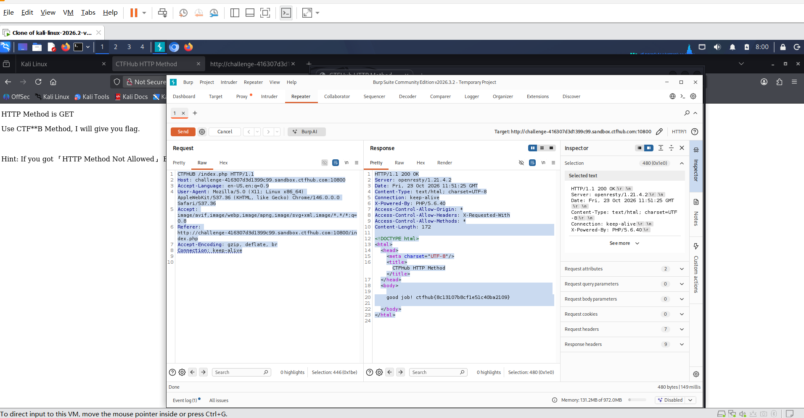

# WP：请求方式

> **CTFHub 路径**：技能树 → Web → Web 前置技能 → HTTP 协议 → 请求方式
> **任务**：按题目要求使用指定的 HTTP 方法访问目标，拿到 flag。
> **提示**：浏览器地址栏默认发送 GET 请求。用 Burp Repeater 修改请求行中的方法，或者用 `curl -X` 复现。
> **截图要求**：优先使用 Burp Repeater，截图中要能看到修改后的请求行（方法 + 路径）和响应中的 flag；如果 Burp 无法启动，可以用 `curl -X` 的方法修改截图代替，并在 WP 中说明原因。只有浏览器普通 GET 访问不算完成。

---

## 题目信息

| 项目 | 内容 |
| --- | --- |
| 环境地址 | http://challenge-416307d3d1399c99.sandbox.ctfhub.com:10800/ |
| Flag | ctfhub{8c13107b8cf1e51c40ba2109} |

## 解题过程

用浏览器打开靶场首页，页面写着 `HTTP Method is GET，Use CTF**B Method, I will give you flag.`，也就是要求换成 CTFHub 自己规定的 `CTFHUB` 方法，页面下方还提示如果用别的方法会返回 `HTTP Method Not Allowed`。浏览器地址栏只会发 GET，发不出自定义方法，所以我把请求放进 Burp，在 Proxy 的 HTTP history 里找到 `GET /index.php` 这一条，右键 **Send to Repeater**。在 Repeater 里只改请求行，把 `GET /index.php HTTP/1.1` 改成 `CTFHub /index.php HTTP/1.1`，其余请求头不动，点 Send 之后返回 `200 OK`，响应体里是 HTML，正文写着 `good job!` 加上 flag。

## 关键请求/响应

```http
CTFHub /index.php HTTP/1.1
Host: challenge-416307d3d1399c99.sandbox.ctfhub.com:10800
Accept-Language: en-US,en;q=0.9
User-Agent: Mozilla/5.0 (X11; Linux x86_64) AppleWebKit/537.36 (KHTML, like Gecko) Chrome/146.0.0.0 Safari/537.36

HTTP/1.1 200 OK
Server: openresty/1.21.4.2
X-Powered-By: PHP/5.6.40
Content-Type: text/html; charset=utf-8
Content-Length: 122

<html>
<body>
    good job! ctfhub{8c13107b8cf1e51c40ba2109}
</body>
</html>
```

## 原理与复盘

请求行由三部分组成：**方法 + 请求 URI + HTTP 版本**，方法固定在最前面，所以改方法只需要动请求行的第一个词。服务器按方法决定走哪段处理逻辑：GET 通常只做读取，而这个靶场专门写了“只有 `CTFHUB` 方法才给 flag”的分支，其他方法统一返回 405 / `HTTP Method Not Allowed`。这也说明方法不是浏览器说了算的，只要能自己拼请求（Burp、curl），任何合法的方法名都可以发出去。

---

## 截图



> 可以在这份 WP 中另加过程截图；检查时只看指定图片，额外图片不检查。
