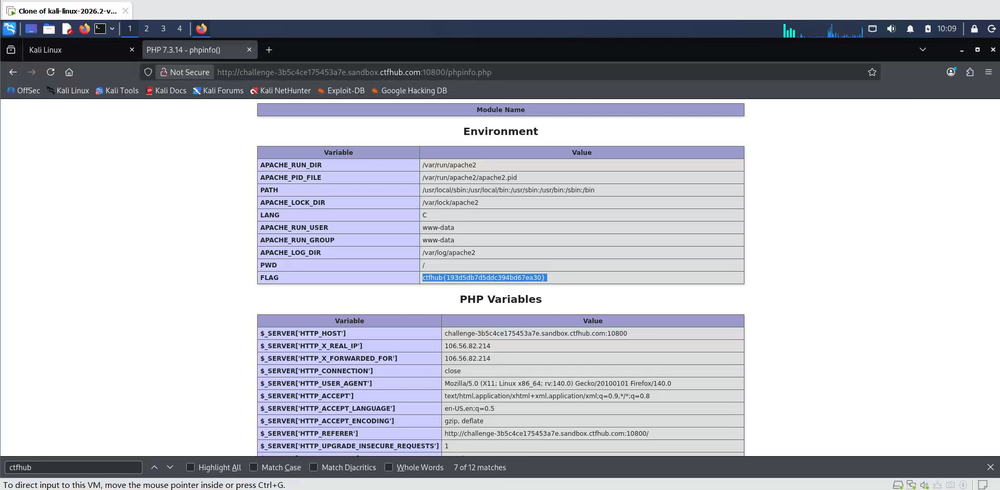

# WP：PHPINFO

> **CTFHub 路径**：技能树 → Web → 信息泄露 → PHPINFO
> **任务**：在 phpinfo 页面中找到 flag，并观察它泄露了哪些信息。
> **提示**：phpinfo 会输出大量 PHP 和服务器配置。用浏览器的查找功能搜索关键字，同时留意页面暴露的路径、版本、环境变量等信息。
> **截图要求**：能看到 phpinfo 页面、你搜索/定位到的 flag，以及至少一处敏感信息。

---

## 题目信息

| 项目 | 内容 |
| --- | --- |
| 环境地址 | http://challenge-3b5c4ce175453a7e.sandbox.ctfhub.com:10800/phpinfo.php |
| Flag | ctfhub{193d5db7d5ddc394bd67ea30} |

## 解题过程

开启题目后访问 `/phpinfo.php`，页面标题是 `PHP 7.3.14 - phpinfo()`，往下是一屏接一屏的配置表，最先看到的是 `Environment` 环境变量表。页面太长没法逐行看，我直接按 `Ctrl+F` 搜 `ctfhub`，浏览器显示共 7 处匹配，跳到的第一处就是 `Environment` 表里的 `FLAG` 变量，值就是 flag。顺手还能看到同一张表泄露了 `APACHE_RUN_DIR = /var/run/apache2`、`APACHE_LOG_DIR = /var/log/apache2`、`PWD = /` 这些服务器路径，以及下面 `PHP Variables` 里的 `$_SERVER['HTTP_X_REAL_IP']`、`HTTP_USER_AGENT` 等信息。

## 关键请求/响应

```http
GET /phpinfo.php HTTP/1.1
Host: challenge-3b5c4ce175453a7e.sandbox.ctfhub.com:10800

HTTP/1.1 200 OK
Content-Type: text/html; charset=UTF-8
```

响应体里的 Environment 表片段：

```text
Variable              Value
APACHE_RUN_DIR        /var/run/apache2
APACHE_LOG_DIR        /var/log/apache2
PWD                   /
FLAG                  ctfhub{193d5db7d5ddc394bd67ea30}
```

## 原理与复盘

flag 藏在**响应体**里，和普通网页内容一样被 HTTP 返回，只是混在几百行配置表中，需要搜索才能定位。phpinfo 会输出 PHP 版本、编译参数、已加载模块、环境变量、绝对路径和 `$_SERVER` 变量，等于给攻击者一份资产清单：可以据此挑对应版本的已知漏洞、找到可写目录传 webshell、定位配置和日志路径。所以生产环境不应该把 phpinfo 页面留在可访问的位置。

---

## 截图



> 可以在这份 WP 中另加过程截图；检查时只看指定图片，额外图片不检查。
