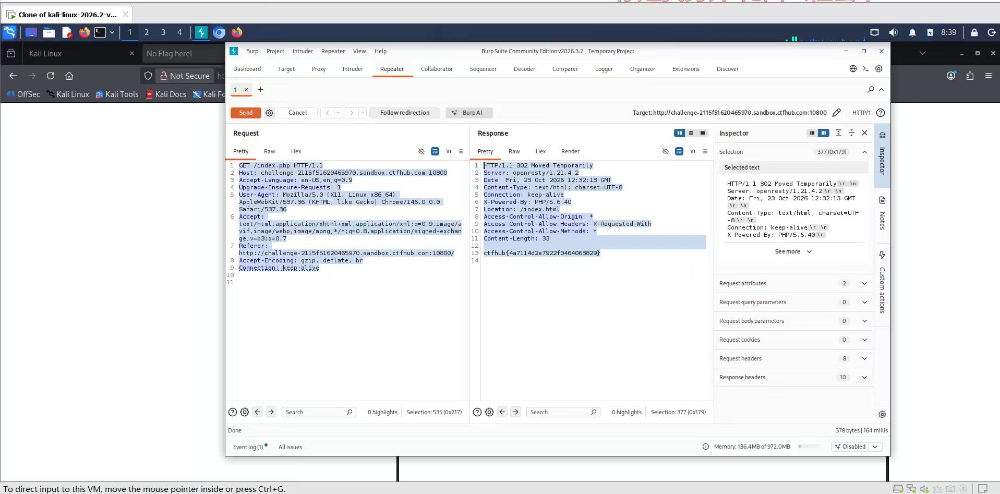

# WP：302 跳转

> **CTFHub 路径**：技能树 → Web → Web 前置技能 → HTTP 协议 → 302 跳转
> **任务**：观察 302 重定向，按题目提示找到 flag。
> **提示**：浏览器通常会自动跟随 302，所以你可能只看到最终页面。打开 DevTools 的 Network 面板（勾选 Preserve log）或 Burp，查看原始响应中的 `302` 状态码和 `Location` 响应头。
> **截图要求**：能看到 302 状态码和/或 `Location` 响应头，以及最终的 flag。只截最终页面、没有 302 证据的截图不合格。

---

## 题目信息

| 项目 | 内容 |
| --- | --- |
| 环境地址 | http://challenge-2115f51620465970.sandbox.ctfhub.com:10800/ |
| Flag | ctfhub{4a7114d2e7922f0464063829} |

## 解题过程

第一次在浏览器里访问首页，只看到一个写着 `No flag here!` 的页面，地址栏也已经从 `/` 变成了 `/index.html`，说明浏览器自己跟了一次跳转。为看清楚中间发生了什么，我把请求挂到 Burp，重放 `GET /index.php`，在 Repeater 里看到原始响应是 `HTTP/1.1 302 Moved Temporarily`，响应头里有 `Location: /index.html`，而 flag 就写在这次 302 响应的响应体里（`Content-Length: 33`）。因为浏览器会自动跳到 `Location` 指向的页面，第一遍就把这段带 flag 的响应体跳过去了，所以只要不跟随跳转（Burp 或 `curl -i` 不加 `-L`）就能看到。

## 关键请求/响应

```http
GET /index.php HTTP/1.1
Host: challenge-2115f51620465970.sandbox.ctfhub.com:10800

HTTP/1.1 302 Moved Temporarily
Server: openresty/1.21.4.2
Date: Fri, 23 Oct 2026 12:32:13 GMT
Content-Type: text/html; charset=UTF-8
Connection: keep-alive
X-Powered-By: PHP/5.6.40
Location: /index.html
Access-Control-Allow-Origin: *
Content-Length: 33

ctfhub{4a7114d2e7922f0464063829}
```

## 原理与复盘

区别在**状态行**：200 表示“内容就在这次响应里”，浏览器直接把响应体渲染出来；302 表示“你要的东西不在这，去 `Location` 指的地方再请求一次”，浏览器看到 302 会立刻发起第二个请求，所以用户只看到最终页面。关键在于 302 的响应体同样可以携带内容，一旦被自动跟随就被丢掉了。判断跳转是否发生，要看状态行和 `Location` 响应头，而不是只看最后停在哪个页面。

---

## 截图



> 可以在这份 WP 中另加过程截图；检查时只看指定图片，额外图片不检查。
