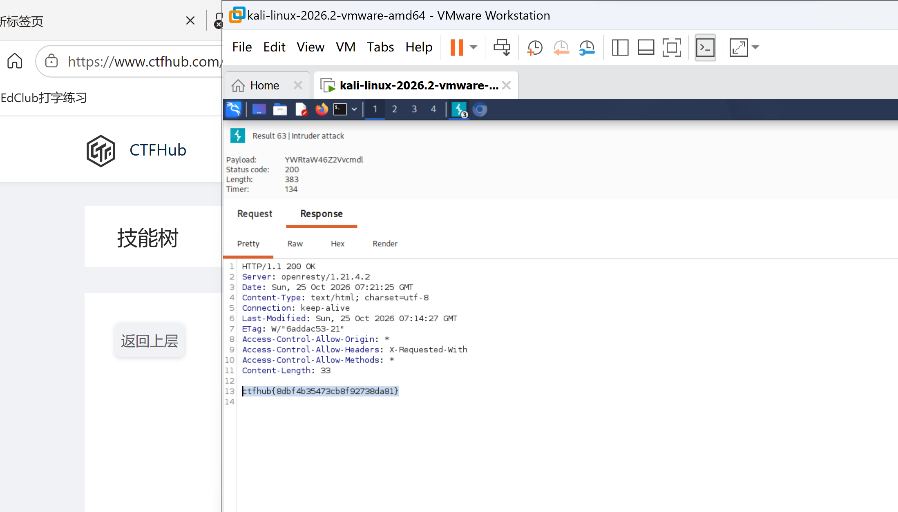

# WP：基础认证

> **CTFHub 路径**：技能树 → Web → Web 前置技能 → HTTP 协议 → 基础认证
> **任务**：按题目提示完成 HTTP Basic 认证，拿到 flag。
> **提示**：观察 `401 Unauthorized` 响应和 `WWW-Authenticate: Basic` 响应头。Basic 认证把 `用户名:密码` 做 Base64 编码后放在 `Authorization` 请求头里，Base64 不是加密。
> **截图要求**：能看到 `Authorization: Basic ...` 请求头，以及认证成功后的 flag 或页面。

---

## 题目信息

| 项目 | 内容 |
| --- | --- |
| 环境地址 | http://challenge-****.sandbox.ctfhub.com:10800/（截图只拍到 Burp 窗口，未包含地址栏，靶场已关闭） |
| Flag | ctfhub{8dbf4b35473cb8f92738da81} |

## 解题过程

第一次访问靶场，浏览器直接弹出用户名/密码输入框，抓包看到响应是 `401 Unauthorized`，并且带一个 `WWW-Authenticate: Basic realm="..."` 响应头——这告诉我服务器用的是 HTTP Basic 认证。题目提示用户名是 `admin`、密码是弱口令，我随手试了 `admin/admin`、`admin/123456` 都不对。

于是转去爆破：在 Burp 里把这个请求发到 **Intruder**，只把 `Authorization: Basic ...` 后面的那段 Base64 设成 payload 位置，加载一份常用密码字典，在 **Payloads → Payload processing** 里先加前缀 `admin:`，再选 **Base64-encode**，这样每个候选密码都会变成 `Base64("admin:密码")`。开始攻击后按 Length 排序，只有第 63 条请求的状态码是 `200`、Length 383（Intruder 列表里的 Length 是整个响应报文的长度，其中响应体的 `Content-Length` 只有 33），明显和其他 401 的响应不一样，响应体里就是 flag。

事后把这条 payload 解出来：`echo YWRtaW46Z2Vvcmdl | base64 -d` 得到 `admin:george`，密码就是 `george`。

## 关键请求/响应

未认证时的响应：

```http
HTTP/1.1 401 Unauthorized
WWW-Authenticate: Basic realm="..."
Content-Type: text/html; charset=UTF-8
```

Intruder 中命中那一条请求（`Authorization` 的值是 `Base64("admin:george")` = `YWRtaW46Z2Vvcmdl`）：

```http
GET / HTTP/1.1
Host: challenge-****.sandbox.ctfhub.com:10800
Authorization: Basic YWRtaW46Z2Vvcmdl
User-Agent: Mozilla/5.0 (X11; Linux x86_64) AppleWebKit/537.36 (KHTML, like Gecko) Chrome/146.0.0.0 Safari/537.36
Accept: */*
Connection: keep-alive
```

```http
HTTP/1.1 200 OK
Server: openresty/1.21.4.2
Date: Sun, 25 Oct 2026 07:21:25 GMT
Content-Type: text/html; charset=utf-8
Connection: keep-alive
Last-Modified: Sun, 25 Oct 2026 07:14:27 GMT
ETag: W/"6addac53-21"
Access-Control-Allow-Origin: *
Access-Control-Allow-Headers: X-Requested-With
Access-Control-Allow-Methods: *
Content-Length: 33

ctfhub{8dbf4b35473cb8f92738da81}
```

不用 Burp 时一行命令就能完成同样的认证：

```bash
curl -i -u admin:george http://challenge-****.sandbox.ctfhub.com:10800/
echo YWRtaW46Z2Vvcmdl | base64 -d      # admin:george
```

## 原理与复盘

Base64 只是**编码**，不是加密：它把任意二进制映射成可打印字符，任何人都能一步还原，所以 `Authorization: Basic YWRtaW46Z2Vvcmdl` 等于把 `admin:george` 明文挂在请求头里。`Authorization` 属于请求头，每次请求都要带一次。

Basic 认证的两个问题在这道题里都出现了：一是 Base64 可逆，抓包就能看到密码；二是密码是弱口令，用字典几千次请求就能爆破出来（Intruder 的 Length 差异就是突破口）。所以 Basic 认证必须跑在 HTTPS 上，并且密码要足够强；更稳妥的做法是换成表单登录 + Session 或 Token。

---

## 截图



> 可以在这份 WP 中另加过程截图；检查时只看指定图片，额外图片不检查。
