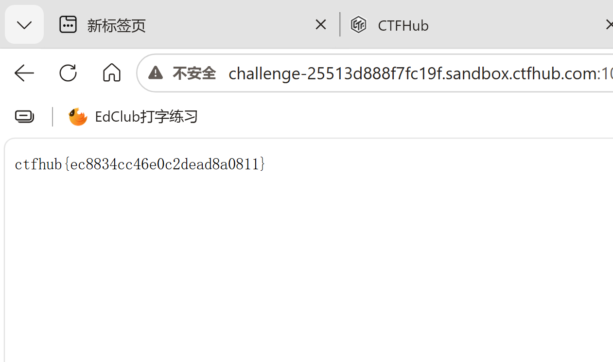

# WP：目录遍历

> **CTFHub 路径**：技能树 → Web → 信息泄露 → 目录遍历
> **任务**：按题目页面提示找到 flag。
> **提示**：注意页面给出的路径和 URL；目录列表本身就是一种信息泄露。只在题目环境内点击和访问，不要使用扫描器扫描其他地址。
> **截图要求**：能看到题目环境地址（或题目名称）、你访问的目录/路径，以及最终的 flag。

---

## 题目信息

| 项目 | 内容 |
| --- | --- |
| 环境地址 | http://challenge-00dd1c0426051c92.sandbox.ctfhub.com:10800/ |
| Flag | ctfhub{0d8aa0a03b3f0e23c8e70ca0} |

## 解题过程

开启题目后打开靶场首页，页面几乎是空白的，只提示这里没有 flag，让我去“别的地方”找。既然提示和目录有关，我就把注意力放在地址栏的路径上：在 URL 末尾依次追加子目录名 `1/`、`2/`、`3/`、`4/`（每层目录名都是数字），每进入一层都能看到一个 Apache 自动生成的目录索引页，页面上写着 “Index of /…”，把该目录下的子目录和文件名一条条列了出来。

一直点到最里层，目录里出现了一个纯文本文件，点开后浏览器左上角只有一个 flag 值、没有别的页面元素，把它提交到平台就通过了。整个过程中我只在题目环境里点链接、改地址栏路径，没有用扫描器去跑字典，也没有访问题目以外的地址。

## 关键请求/响应

第一层目录的请求和响应（响应体里的目录/文件名列表太长，这里只保留标题行）：

```http
GET /1/ HTTP/1.1
Host: challenge-00dd1c0426051c92.sandbox.ctfhub.com:10800

HTTP/1.1 200 OK
Content-Type: text/html; charset=UTF-8

<title>Index of /1</title>
```

沿着索引里列出的子目录继续往下访问（`/1/2/` → `/1/2/3/` → `/1/2/3/4/`），最后打开的文件返回的是纯文本，响应体就是 flag：

```http
GET /1/2/3/4/flag HTTP/1.1
Host: challenge-00dd1c0426051c92.sandbox.ctfhub.com:10800

HTTP/1.1 200 OK
Content-Type: text/plain

ctfhub{0d8aa0a03b3f0e23c8e70ca0}
```

## 原理与复盘

这道题改的只是请求行里的 URL 路径，服务器按路径去文件系统里取文件，响应体里返回的就是那个目录的索引列表——也就是说漏洞点在“URL 路径 + 响应体”。

目录列表本身不是漏洞，但它把服务器的文件结构直接画了出来：攻击者不需要猜文件名，就能顺着索引找到备份文件、源码、配置文件甚至 flag，这是很典型的“信息泄露”。如果 Web 服务器关闭了目录索引（如 Apache 的 `Options -Indexes`），至少不会主动把目录内容列给访问者。

---

## 截图



> 可以在这份 WP 中另加过程截图；检查时只看指定图片，额外图片不检查。
