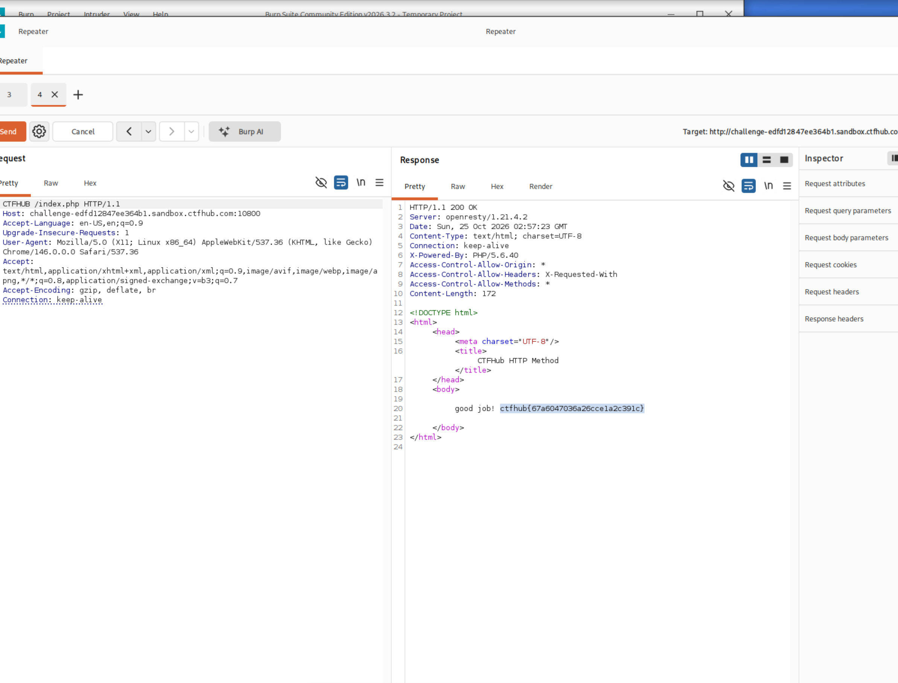

# WP：请求方式

> **CTFHub 路径**：技能树 → Web → Web 前置技能 → HTTP 协议 → 请求方式
> **任务**：按题目要求使用指定的 HTTP 方法访问目标，拿到 flag。
> **提示**：浏览器地址栏默认发送 GET 请求。用 Burp Repeater 修改请求行中的方法，或者用 `curl -X` 复现。
> **截图要求**：优先使用 Burp Repeater，截图中要能看到修改后的请求行（方法 + 路径）和响应中的 flag；如果 Burp 无法启动，可以用 `curl -X` 的方法修改截图代替，并在 WP 中说明原因。只有浏览器普通 GET 访问不算完成。

---

## 题目信息

| 项目 | 内容 |
| --- | --- |
| 环境地址 | http://challenge-edfd12847ee364b1.sandbox.ctfhub.com:10800/ |
| Flag | ctfhub{67a6047036a26cce1a2c391c} |

## 解题过程

用浏览器打开靶场，页面提示要用 **CTFHUB** 这种方式来请求（浏览器地址栏只能用 GET，所以肯定拿不到）。我在 Kali 里开着 Burp 的 Proxy，让浏览器走 `127.0.0.1:8080`，刷新页面后在 `Proxy → HTTP history` 里找到这个请求，右键 `Send to Repeater`。

在 Repeater 的 Request 面板里，把请求行的 `GET` 改写成 `CTFHUB`，路径 `/index.php` 和版本 `HTTP/1.1` 保持不变，点 **Send**。响应从原来的“方法不对”的提示变成了 `HTTP/1.1 200 OK`，响应体里写着 `good job:` 加上 flag，把 flag 交到平台即通过。

## 关键请求/响应

修改后的请求行（方法从 `GET` 换成了自定义方法 `CTFHUB`）：

```http
CTFHUB /index.php HTTP/1.1
Host: challenge-edfd12847ee364b1.sandbox.ctfhub.com:10800
User-Agent: Mozilla/5.0 (X11; Linux x86_64) AppleWebKit/537.36 (KHTML, like Gecko) Chrome/146.0.0.0 Safari/537.36
Accept: text/html,application/xhtml+xml,application/xml;q=0.9,image/avif,image/webp,image/apng,*/*;q=0.8,application/signed-exchange;v=b3;q=0.7
Accept-Encoding: gzip, deflate, br
Connection: keep-alive
```

服务器响应：

```http
HTTP/1.1 200 OK
Server: openresty/1.21.4.2
Date: Sun, 25 Oct 2026 02:57:23 GMT
Content-Type: text/html; charset=UTF-8
Connection: keep-alive
X-Powered-By: PHP/5.6.40
Content-Length: 172

<!DOCTYPE html>
<html>
<head>
    <meta charset="UTF-8">
    <title>CTFHub HTTP Method</title>
</head>
<body>
    good job: ctfhub{67a6047036a26cce1a2c391c}
</body>
</html>
```

用 curl 也能复现同一效果：

```bash
curl -i -X CTFHUB http://challenge-edfd12847ee364b1.sandbox.ctfhub.com:10800/index.php
```

## 原理与复盘

请求行由三部分组成：**方法 + 请求目标（路径）+ HTTP 版本**，例如 `CTFHUB /index.php HTTP/1.1`。方法就在请求行的第一个位置，是最先被服务器解析的一段。

HTTP 方法并不只有 GET 和 POST，协议允许使用扩展/自定义方法，很多 Web 服务器和框架都会把不认识的方法照样交给后端脚本处理。所以“只允许某个方法访问”这种逻辑如果只写在页面提示里、没在后端校验，就等于没有校验；反过来，某些 WAF 或权限控制只盯 GET/POST，用奇怪的方法反而能绕过去。

---

## 截图



> 可以在这份 WP 中另加过程截图；检查时只看指定图片，额外图片不检查。
