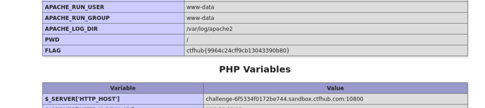

# WP：PHPINFO

> **CTFHub 路径**：技能树 → Web → 信息泄露 → PHPINFO
> **任务**：在 phpinfo 页面中找到 flag，并观察它泄露了哪些信息。
> **提示**：phpinfo 会输出大量 PHP 和服务器配置。用浏览器的查找功能搜索关键字，同时留意页面暴露的路径、版本、环境变量等信息。
> **截图要求**：能看到 phpinfo 页面、你搜索/定位到的 flag，以及至少一处敏感信息。

---

## 题目信息

| 项目 | 内容 |
| --- | --- |
| 环境地址 | http://challenge-6f5334f0172be744.sandbox.ctfhub.com:10800/ |
| Flag | ctfhub{9964c24cff9cb13043390b80} |

## 解题过程

打开靶场地址后，直接看到的是一个标准的长长长……的 phpinfo 页面，标题写着 “PHP Version”，下面按 PHP Version、Configuration、Environment、PHP Variables 等区块把配置一条条列出来，一屏根本看不完。因为页面太长，我没有手工向下翻，而是按 `Ctrl + F` 在页面内搜索 `flag`，浏览器直接跳到了 Environment 区块下面的 `FLAG` 这一行，右侧的值就是 `ctfhub{9964c24cff9cb13043390b80}`。

顺手看了下它泄露的其他信息：`APACHE_RUN_USER` 是 `www-data`、`PWD` 是 `/`、`APACHE_LOG_DIR` 是 `/var/log/apache2`，下方 PHP Variables 里还能看到 `$_SERVER['HTTP_HOST']` —— 也就是我这次请求的 Host 头被页面原样回显了。这些都是本不该给访问者看的内容。

## 关键请求/响应

```http
GET / HTTP/1.1
Host: challenge-6f5334f0172be744.sandbox.ctfhub.com:10800

HTTP/1.1 200 OK
Content-Type: text/html; charset=UTF-8

... Environment（节选）...
APACHE_RUN_USER      www-data
APACHE_RUN_GROUP     www-data
APACHE_LOG_DIR       /var/log/apache2
PWD                  /
FLAG                 ctfhub{9964c24cff9cb13043390b80}

... PHP Variables（节选）...
$_SERVER['HTTP_HOST']   challenge-6f5334f0172be744.sandbox.ctfhub.com:10800
```

```bash
# 环境变量里的 flag 也可以直接在终端里搜出来
curl -s http://challenge-6f5334f0172be744.sandbox.ctfhub.com:10800/ | grep -i flag
```

## 原理与复盘

phpinfo 是 PHP 自带的调试页面，它把运行环境翻了个底朝天：PHP 版本、编译参数、Apache/PHP 的绝对路径与日志路径、环境变量、`$_SERVER` 里的请求头，甚至数据库连接信息都可能出现。这些内容全部都在**响应体**里，只要页面没删，谁访问都能拿到。

对攻击者来说，这些信息是后续攻击的地图：知道版本可以找对应 CVE，知道绝对路径可以判断目录结构、为文件包含或任意文件读取准备路径，知道运行用户和日志位置可以推算日志文件能不能被写入。所以生产环境里绝不能把 phpinfo 页面留在线上，调试完就要删掉。

---

## 截图



> 可以在这份 WP 中另加过程截图；检查时只看指定图片，额外图片不检查。
