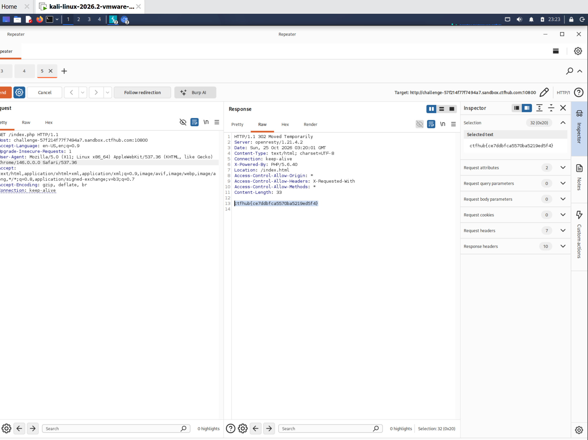

# WP：302 跳转

> **CTFHub 路径**：技能树 → Web → Web 前置技能 → HTTP 协议 → 302 跳转
> **任务**：观察 302 重定向，按题目提示找到 flag。
> **提示**：浏览器通常会自动跟随 302，所以你可能只看到最终页面。打开 DevTools 的 Network 面板（勾选 Preserve log）或 Burp，查看原始响应中的 `302` 状态码和 `Location` 响应头。
> **截图要求**：能看到 302 状态码和/或 `Location` 响应头，以及最终的 flag。只截最终页面、没有 302 证据的截图不合格。

---

## 题目信息

| 项目 | 内容 |
| --- | --- |
| 环境地址 | http://challenge-57214f77f7494a7.sandbox.ctfhub.com:10800/ |
| Flag | ctfhub{ce7ddbfca5570ba5219ed5f4} |

## 解题过程

第一次用浏览器访问靶场地址时，页面“唰”地一下就换成了另一个页面，地址栏的路径也变了——这就是浏览器自动跟随重定向的结果，我在界面上完全看不到中间发生的那次 302。为了看清楚中间这一步，我把 Burp 的 Proxy 打开，让 Kali 浏览器走 `127.0.0.1:8080`，并确认 `Proxy → Proxy settings` 里的 `Follow redirections` 是 `Never`（Burp 默认就不跟随重定向），然后重新访问靶场。

这次在 `HTTP history` 里就能看到原始请求 `GET /index.php`，响应状态行是 `HTTP/1.1 302 Moved Temporarily`，响应头里有 `Location: /index.html`，而响应体里已经直接把 flag 写出来了。把请求发到 Repeater 再 Send 一次，响应同样是 302 + `Location: /index.html` + flag，截图留证。

## 关键请求/响应

```http
GET /index.php HTTP/1.1
Host: challenge-57214f77f7494a7.sandbox.ctfhub.com:10800
User-Agent: Mozilla/5.0 (X11; Linux x86_64) AppleWebKit/537.36 (KHTML, like Gecko) Chrome/146.0.0.0 Safari/537.36
Accept: */*
Accept-Encoding: gzip, deflate, br
Connection: keep-alive
```

```http
HTTP/1.1 302 Moved Temporarily
Server: openresty/1.21.4.2
Date: Sun, 25 Oct 2026 03:20:01 GMT
Content-Type: text/html; charset=UTF-8
X-Powered-By: PHP/5.6.40
Location: /index.html
Content-Length: 33

ctfhub{ce7ddbfca5570ba5219ed5f4}
```

如果在 DevTools 里看，勾上 Network 面板的 **Preserve log** 再访问一次，也能看到第一行请求的状态码是 `302`，Response Headers 里有 `Location: /index.html`，第二条请求才是跳到 `/index.html` 的 `200`。

## 原理与复盘

302 是“临时重定向”：服务器不返回页面内容，只在状态行写明 `302`，再用响应头 `Location` 告诉浏览器“你要的东西在那边”，浏览器收到后自动再发一次请求。所以只看界面的话，302 是“看不见”的，只有抓包或看 DevTools 的 Network 才能发现它。

200 则是“东西就在这里”，响应体才是真正的页面。302 和 200 的区别在于：一个要求浏览器再跑一趟，一个直接把内容给你。这也提醒我，做信息收集时不能只信浏览器渲染出来的最终页面，中间每一跳的状态行和响应头都可能藏着东西。

---

## 截图



> 可以在这份 WP 中另加过程截图；检查时只看指定图片，额外图片不检查。
