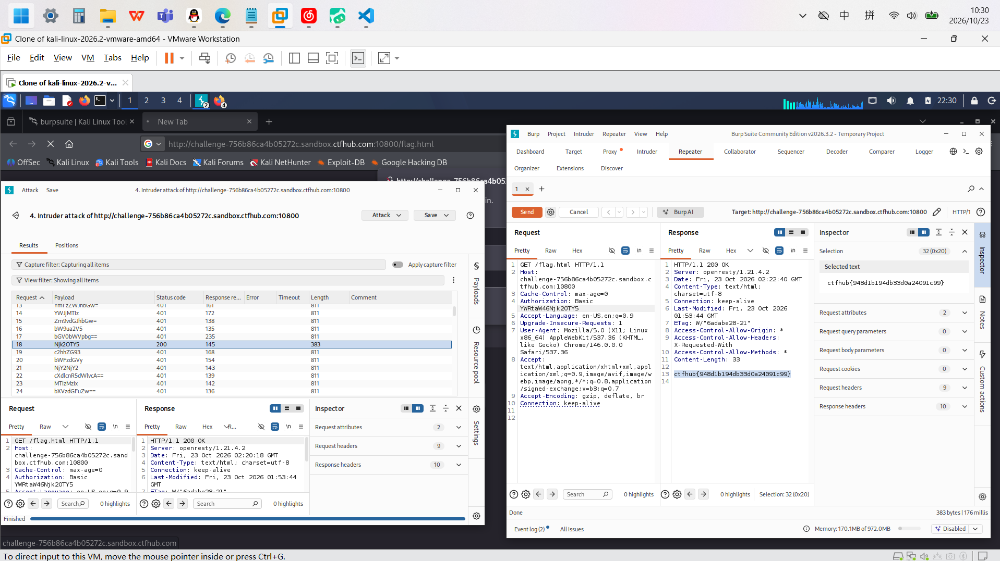

# WP：基础认证

> **CTFHub 路径**：技能树 → Web → Web 前置技能 → HTTP 协议 → 基础认证
> **任务**：按题目提示完成 HTTP Basic 认证，拿到 flag。
> **提示**：观察 `401 Unauthorized` 响应和 `WWW-Authenticate: Basic` 响应头。Basic 认证把 `用户名:密码` 做 Base64 编码后放在 `Authorization` 请求头里，Base64 不是加密。
> **截图要求**：能看到 `Authorization: Basic ...` 请求头，以及认证成功后的 flag 或页面。

---

## 题目信息

| 项目 | 内容 |
| --- | --- |
| 环境地址 |http://challenge-756b86ca4b05272c.sandbox.ctfhub.com:10800/  |
| Flag | ctfhub{948d1b194db33d0a24091c99} |

## 解题过程

第一次访问要求输入用户名和密码，用Mobaterm把密码词典上传到kali,在kali里用burpsuite打开后爆破密码，最后在repeater里找到flag

## 关键请求/响应

```http
请求包：
GET /flag.html HTTP/1.1
Host: challenge-756b86ca4b05272c.sandbox.ctfhub.com:10800
Cache-Control: max-age=0
Authorization: Basic YWRtaW46Njk2OTY5
Accept-Language: en-US,en;q=0.9
Upgrade-Insecure-Requests: 1
User-Agent: Mozilla/5.0 (X11; Linux x86_64) AppleWebKit/537.36 (KHTML, like Gecko) Chrome/146.0.0.0 Safari/537.36
Accept: text/html,application/xhtml+xml,application/xml;q=0.9,image/avif,image/webp,image/apng,*/*;q=0.8,application/signed-exchange;v=b3;q=0.7
Accept-Encoding: gzip, deflate, br
Connection: keep-alive
响应包:
HTTP/1.1 200 OK
Server: openresty/1.21.4.2
Date: Fri, 23 Oct 2026 02:22:40 GMT
Content-Type: text/html; charset=utf-8
Connection: keep-alive
Last-Modified: Fri, 23 Oct 2026 01:53:44 GMT
ETag: W/"6adabe28-21"
Access-Control-Allow-Origin: *
Access-Control-Allow-Headers: X-Requested-With
Access-Control-Allow-Methods: *
Content-Length: 33
ctfhub{948d1b194db33d0a24091c99}

```

## 原理与复盘

Base64 是一种编码方式，Authorization里放的是用户：密码

---

## 截图



> 可以在这份 WP 中另加过程截图；检查时只看指定图片，额外图片不检查。

