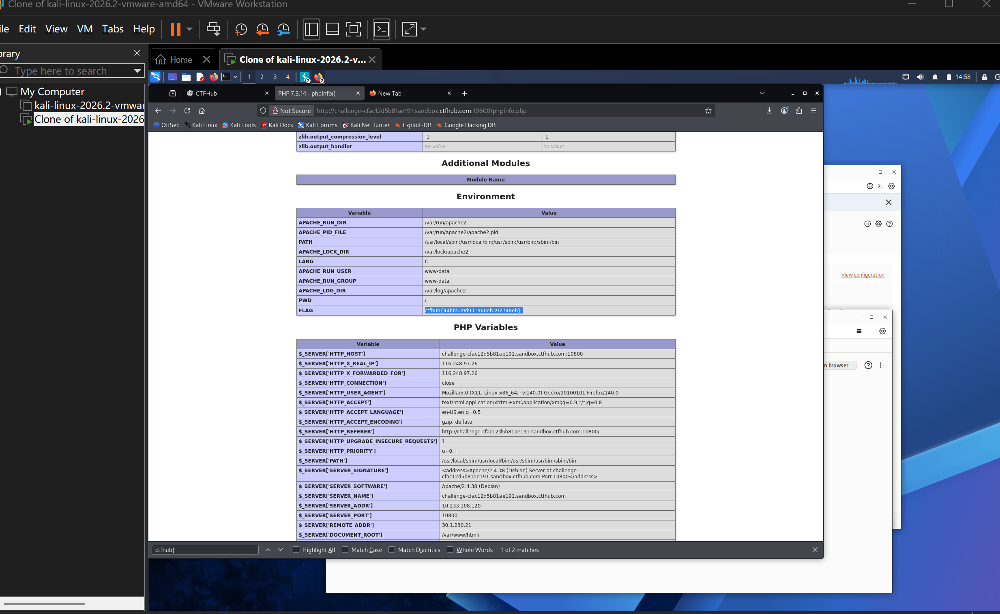

# WP：PHPINFO

> **CTFHub 路径**：技能树 → Web → 信息泄露 → PHPINFO
> **任务**：在 phpinfo 页面中找到 flag，并观察它泄露了哪些信息。
> **提示**：phpinfo 会输出大量 PHP 和服务器配置。用浏览器的查找功能搜索关键字，同时留意页面暴露的路径、版本、环境变量等信息。
> **截图要求**：能看到 phpinfo 页面、你搜索/定位到的 flag，以及至少一处敏感信息。

---

## 题目信息

| 项目 | 内容 |
| --- | --- |
| 环境地址 | http://challenge-cfac12d5b81ae191.sandbox.ctfhub.com:10800/phpinfo.php |
| Flag | ctfhub{44bb539d931960eb397748eb} |

## 解题过程

开启题目后访问 `/phpinfo.php`，页面直接就是 `phpinfo()` 的输出，浏览器标签页标题是 `PHP 7.3.14 - phpinfo()`，正文是一大堆表格。我先用 `Ctrl + F` 搜索 `ctfhub`，没抱太大希望，结果在 **Environment** 表格的最后一行就找到了：变量名是 `FLAG`，值就是 flag，被浏览器高亮标记出来。顺手往上翻，还看到 `APACHE_RUN_DIR`、`PWD`、`APACHE_RUN_USER = www-data` 这些环境变量，往下翻的 **PHP Variables** 表格里又有 `$_SERVER['SERVER_SOFTWARE'] = Apache/2.4.38 (Debian)`、`$_SERVER['DOCUMENT_ROOT'] = /var/www/html/`、`$_SERVER['REMOTE_ADDR']` 等。所以这题不需要任何技巧，页面本身就把答案和一堆配置一起打印出来了。

## 关键请求/响应

```http
GET /phpinfo.php HTTP/1.1
Host: challenge-cfac12d5b81ae191.sandbox.ctfhub.com:10800
User-Agent: Mozilla/5.0 (X11; Linux x86_64) AppleWebKit/537.36 (KHTML, like Gecko) Chrome/146.0.0.0 Safari/537.36
Accept: text/html,application/xhtml+xml,application/xml;q=0.9,*/*;q=0.8

HTTP/1.1 200 OK
Content-Type: text/html; charset=UTF-8
```

响应体中关键的两段（节选）：

```html
<h2>Environment</h2>
<tr><td class="e">APACHE_RUN_USER</td><td class="v">www-data</td></tr>
<tr><td class="e">PWD</td><td class="v">/</td></tr>
<tr><td class="e">FLAG</td><td class="v">ctfhub{44bb539d931960eb397748eb}</td></tr>

<h2>PHP Variables</h2>
<tr><td class="e">$_SERVER['SERVER_SOFTWARE']</td><td class="v">Apache/2.4.38 (Debian)</td></tr>
<tr><td class="e">$_SERVER['DOCUMENT_ROOT']</td><td class="v">/var/www/html/</td></tr>
```

## 原理与复盘

phpinfo 这个页面落在 HTTP 报文的**响应体**里：请求本身是完全普通的 `GET /phpinfo.php`，没有任何特殊之处，泄露全部发生在服务器返回的 HTML 中。它一般会暴露 PHP 版本与编译参数、加载的扩展、`disable_functions` 等安全配置、网站根目录的绝对路径、环境变量（常常包含数据库账号口令）以及请求头里的客户端 IP。这些信息对攻击者来说是一张地图：知道版本就能去找对应的已知漏洞，知道绝对路径就能配合文件包含或目录遍历读文件，知道环境变量甚至能直接拿到凭据。所以生产环境必须删掉 `phpinfo()` 页面或限制内网访问。

---

## 截图



> 可以在这份 WP 中另加过程截图；检查时只看指定图片，额外图片不检查。
