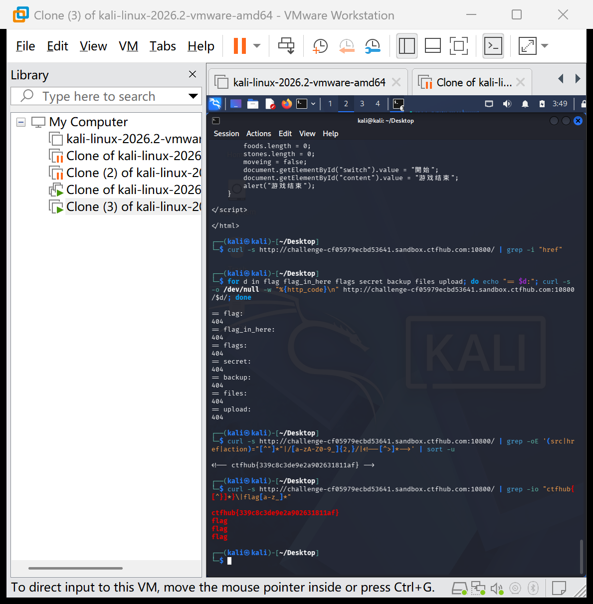

# WP：目录遍历

> **CTFHub 路径**：技能树 → Web → 信息泄露 → 目录遍历
> **任务**：按题目页面提示找到 flag。
> **提示**：注意页面给出的路径和 URL；目录列表本身就是一种信息泄露。只在题目环境内点击和访问，不要使用扫描器扫描其他地址。
> **截图要求**：能看到题目环境地址（或题目名称）、你访问的目录/路径，以及最终的 flag。

---

## 题目信息

| 项目 | 内容 |
| --- | --- |
| 环境地址 | http://challenge-cf05979ecbd53641.sandbox.ctfhub.com:10800 |
| Flag | ctfhub{339c8c3de9e2a902631811af} |

## 解题过程

我用浏览器打开题目环境，页面显示为空白（渲染出来是一个贪吃蛇小游戏的界面），浏览器页面上看不到任何目录列表。于是我改用 curl 直接请求首页查看服务器返回的原始 HTML：响应体是一段 JavaScript 游戏代码，HTML 中没有任何 `href` 链接，猜测常见目录名（flag、flag_in_here 等）也全部返回 404。说明目录列表并没有暴露在明面上，flag 可能直接藏在页面源代码里。接着我用 `curl -s <URL> | grep -io "ctfhub{[^}]*}"` 在首页 HTML 源码中直接搜索 flag 格式的字符串，一次性命中了 flag。

## 关键请求/响应

```http
$ curl -s http://challenge-cf05979ecbd53641.sandbox.ctfhub.com:10800/ | grep -io "ctfhub{[^}]*}"

ctfhub{339c8c3de9e2a902631811af}
```

（本题不需要修改请求，curl 原样 GET 即可；关键是用 grep 检索页面源代码）

## 原理与复盘

这道题对应 HTTP 报文的响应体部分：服务器返回的 HTML 源代码会原样到达客户端，即使浏览器把它渲染成空白页面或小游戏，源代码中的内容对任何查看者都是公开的。把敏感信息（如 flag、注释、调试数据）写在页面源码里，任何人用 curl 或「查看源代码」都能拿到。目录列表泄露也是同类问题——服务端把不该暴露的文件结构展示给了客户端。教训：响应体中的所有内容都应视为可被用户任意读取的公开信息。

---

## 截图



> 可以在这份 WP 中另加过程截图；检查时只看指定图片，额外图片不检查。
