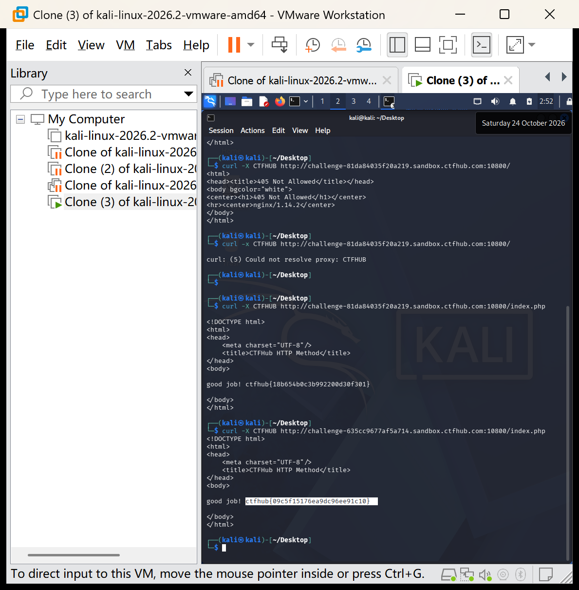

# WP：请求方式

> **CTFHub 路径**：技能树 → Web → Web 前置技能 → HTTP 协议 → 请求方式
> **任务**：按题目要求使用指定的 HTTP 方法访问目标，拿到 flag。
> **提示**：浏览器地址栏默认发送 GET 请求。用 Burp Repeater 修改请求行中的方法，或者用 `curl -X` 复现。
> **截图要求**：优先使用 Burp Repeater，截图中要能看到修改后的请求行（方法 + 路径）和响应中的 flag；如果 Burp 无法启动，可以用 `curl -X` 的方法修改截图代替，并在 WP 中说明原因。只有浏览器普通 GET 访问不算完成。

---

## 题目信息

| 项目 | 内容 |
| --- | --- |
| 环境地址 | http://challenge-635cc9677af5a714.sandbox.ctfhub.com:10800 |
| Flag | ctfhub{09c5f15176ea9dc96ee91c10} |

## 解题过程

我用浏览器访问题目环境，页面提示「Use CTF**B Method, I will give you flag」，说明服务器要求使用一种自定义的 HTTP 方法。根据被码住的 `CTF**B` 字样和平台名称，我猜出完整方法名是 CTFHUB。由于浏览器地址栏只能发送 GET 请求，我改用终端的 curl，加上 `-X` 参数指定方法。第一次执行时我没有在地址后面加上 `/index.php`，服务器返回 405 Not Allowed；想起题目提示要求请求 index.php，补上路径后再次执行，服务器返回「good job!」和 flag。

注：本次使用 `curl -X` 方式完成（截图即 curl 命令与响应），未使用 Burp Repeater。

## 关键请求/响应

```http
$ curl -X CTFHUB http://challenge-635cc9677af5a714.sandbox.ctfhub.com:10800/index.php

<!DOCTYPE html>
<html>
<head>
    <meta charset="UTF-8"/>
    <title>CTFHub HTTP Method</title>
</head>
<body>

good job! ctfhub{09c5f15176ea9dc96ee91c10}

</body>
</html>
```

## 原理与复盘

HTTP 请求行由「方法 + 路径 + 协议版本」三部分组成，方法位于请求行的最前面。`curl -X` 可以指定任意请求方法（包括 CTFHUB 这类自定义方法），而浏览器地址栏只能发送 GET。本题说明服务端可以对请求行中的方法字段做校验，客户端工具可以突破浏览器的限制发送任意方法。

---

## 截图



> 可以在这份 WP 中另加过程截图；检查时只看指定图片，额外图片不检查。
