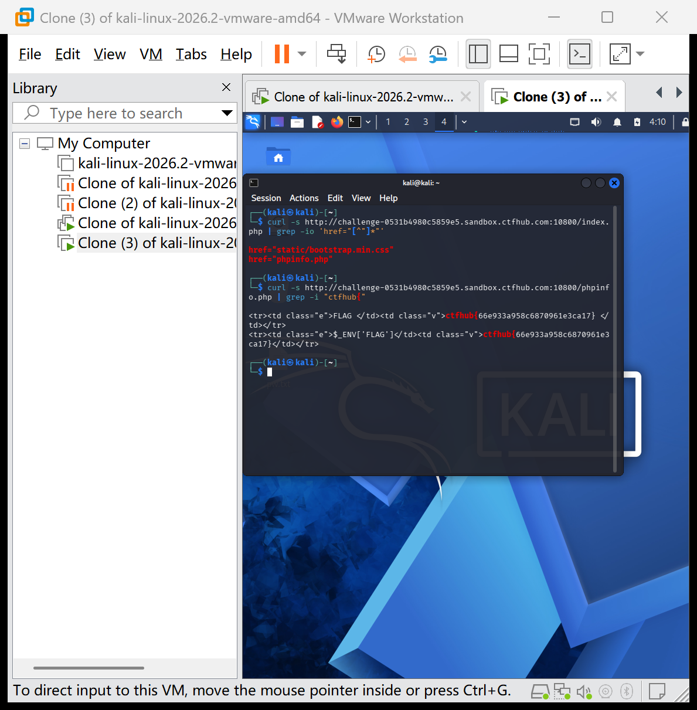

# WP：PHPINFO

> **CTFHub 路径**：技能树 → Web → 信息泄露 → PHPINFO
> **任务**：在 phpinfo 页面中找到 flag，并观察它泄露了哪些信息。
> **提示**：phpinfo 会输出大量 PHP 和服务器配置。用浏览器的查找功能搜索关键字，同时留意页面暴露的路径、版本、环境变量等信息。
> **截图要求**：能看到 phpinfo 页面、你搜索/定位到的 flag，以及至少一处敏感信息。

---

## 题目信息

| 项目 | 内容 |
| --- | --- |
| 环境地址 | http://challenge-0531b4980c5859e5.sandbox.ctfhub.com:10800 |
| Flag | ctfhub{66e933a958c6870961e3ca17} |

## 解题过程

打开题目环境后页面显示 phpinfo 信息页（PHP Version 7.3.14，大量紫白相间的配置表格）。我先在浏览器里用页内查找搜索关键字，没有直接定位到；于是改用终端 `curl -s <URL> | grep -i "ctfhub{"` 在页面源码中直接检索，一次命中。flag 位于 `Environment` 部分，环境变量 `FLAG` 的值就是 flag，同时出现在 `$_ENV['FLAG']` 中。除此之外，phpinfo 页面还暴露了 PHP 版本（7.3.14）、服务器架构、已加载模块、绝对路径、`$_SERVER` 变量等大量敏感信息。

## 关键请求/响应

```http
$ curl -s http://challenge-0531b4980c5859e5.sandbox.ctfhub.com:10800/index.php | grep -i "ctfhub{"

... FLAG ctfhub{66e933a958c6870961e3ca17} ...
... $_ENV['FLAG']  ctfhub{66e933a958c6870961e3ca17} ...
```

## 原理与复盘

phpinfo 页面会集中暴露 PHP 版本、编译选项、加载的扩展、环境变量、`$_SERVER` 请求信息、文件路径等配置细节。这些信息对攻击者价值极大：版本号可查已知漏洞（CVE），环境变量可能含密钥或 flag，绝对路径可辅助路径穿越/文件包含攻击。教训：生产环境绝不应部署 phpinfo 页面或调用 `phpinfo()` 函数，并应及时清理调试接口。

---

## 截图



> 可以在这份 WP 中另加过程截图；检查时只看指定图片，额外图片不检查。
