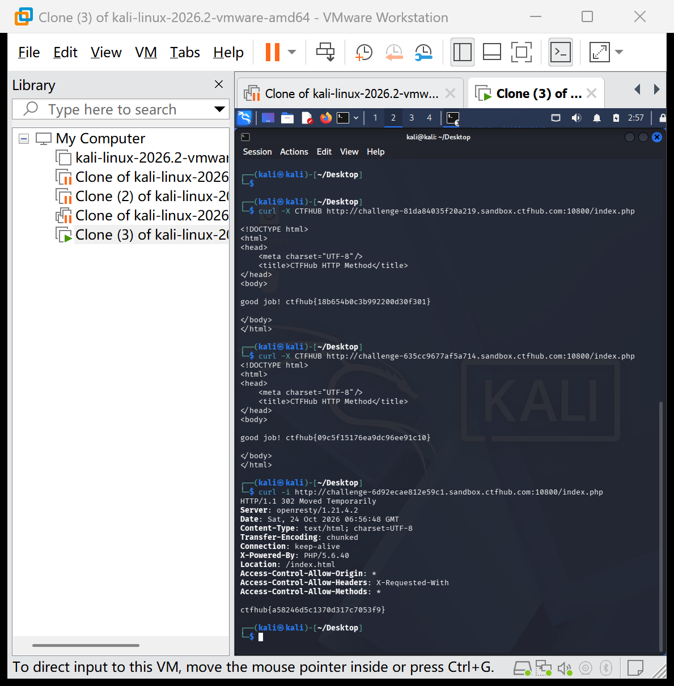

# WP：302 跳转

> **CTFHub 路径**：技能树 → Web → Web 前置技能 → HTTP 协议 → 302 跳转
> **任务**：观察 302 重定向，按题目提示找到 flag。
> **提示**：浏览器通常会自动跟随 302，所以你可能只看到最终页面。打开 DevTools 的 Network 面板（勾选 Preserve log）或 Burp，查看原始响应中的 `302` 状态码和 `Location` 响应头。
> **截图要求**：能看到 302 状态码和/或 `Location` 响应头，以及最终的 flag。只截最终页面、没有 302 证据的截图不合格。

---

## 题目信息

| 项目 | 内容 |
| --- | --- |
| 环境地址 | http://challenge-6d92ecae812e59c1.sandbox.ctfhub.com:10800 |
| Flag | ctfhub{a58246d5c1370d317c7053f9} |

## 解题过程

考虑到浏览器会自动跟随 302 跳转、在地址栏里看不到中间过程，我直接使用 curl 并加上 `-i` 参数访问题目环境，让服务器返回的响应头原样显示出来。响应第一行是 `HTTP/1.1 302 Moved Temporarily`，响应头中有一行 `Location: /index.html`，说明当前地址临时跳转到 index.html。在响应正文的末尾我直接看到了 flag，说明本题的 flag 就藏在 302 响应里，只要能看到原始响应就能拿到。

## 关键请求/响应

```http
$ curl -i http://challenge-6d92ecae812e59c1.sandbox.ctfhub.com:10800/index.php

HTTP/1.1 302 Moved Temporarily
Server: openresty/1.21.4.2
Content-Type: text/html; charset=UTF-8
Location: /index.html
Access-Control-Allow-Origin: *
Access-Control-Allow-Headers: X-Requested-With
Access-Control-Allow-Methods: *

ctfhub{a58246d5c1370d317c7053f9}
```

## 原理与复盘

302 是「临时重定向」状态码：服务器在响应头里用 `Location` 字段告诉客户端新地址。浏览器收到 302 会自动跳转到 Location 指向的页面，用户只看到最终页面（状态码 200）；而 curl 不自动跟随跳转，配合 `-i` 就能看到 302 状态码、Location 头和响应正文。

---

## 截图



> 可以在这份 WP 中另加过程截图；检查时只看指定图片，额外图片不检查。
