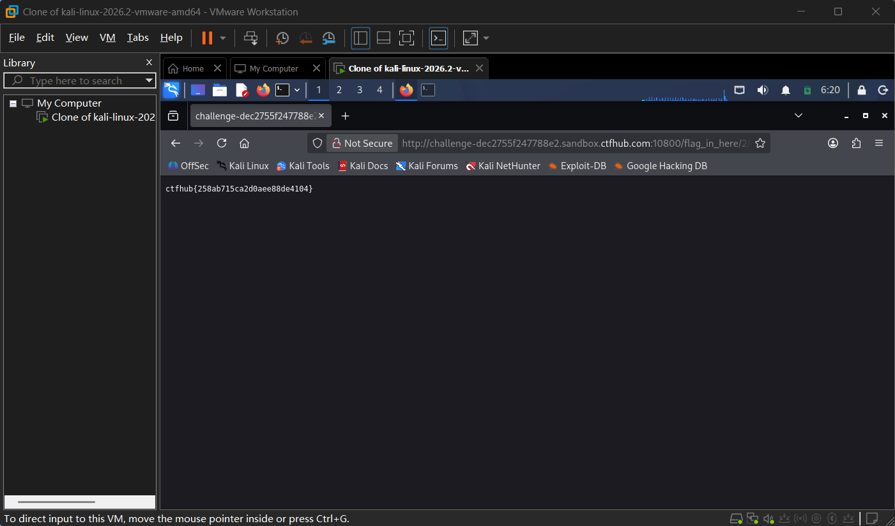

# WP：目录遍历

> **CTFHub 路径**：技能树 → Web → 信息泄露 → 目录遍历
> **任务**：按题目页面提示找到 flag。
> **提示**：注意页面给出的路径和 URL；目录列表本身就是一种信息泄露。只在题目环境内点击和访问，不要使用扫描器扫描其他地址。
> **截图要求**：能看到题目环境地址（或题目名称）、你访问的目录/路径，以及最终的 flag。

---

## 题目信息

| 项目 | 内容 |
| --- | --- |
| 环境地址 | http://challenge-dec2755f247788e2.sandbox.ctfhub.com:10800 |
| Flag | ctfhub{258ab715ca2d0aee88de4104} |

## 解题过程

开启题目后用 curl 访问环境地址，返回的 HTML 里有一个"点击开始寻找 flag"的链接，指向 `/flag_in_here/`。访问该路径看到 `Index of /flag_in_here` 目录列表，下面有 `1/ 2/ 3/ 4/` 四个子目录，每个子目录里还有更深的层级。我在 Kali 的 Firefox 里逐层点进目录列表，最终在 `/flag_in_here/2/1/` 下发现了 `flag.txt`，点开得到明文 flag `ctfhub{258ab715ca2d0aee88de4104}`，在 CTFHub 页面提交，平台提示正确。

## 关键请求/响应

```http
GET /flag_in_here/2/1/flag.txt HTTP/1.1
Host: challenge-dec2755f247788e2.sandbox.ctfhub.com:10800

HTTP/1.1 200 OK
Content-Type: text/plain

ctfhub{258ab715ca2d0aee88de4104}
```

（中间过程是逐层访问目录列表，例如 `GET /flag_in_here/` 返回 `Index of /flag_in_here`，其中列出 `1/ 2/ 3/ 4/` 子目录链接，逐层进入直到 `2/1/` 下出现 `flag.txt`；本题不需要改包，直接 GET 目录与 flag 文件即可。用 `curl -i` 可以看到上述原始请求/响应。）

## 原理与复盘

目录遍历/目录列表泄露对应 HTTP 的「响应体（目录列表内容）」和「URL 路径」。当 Web 服务器在目录下没有默认索引页时，可能把整个目录的文件列出来（autoindex），攻击者可借此发现备份、源码、配置文件，甚至直接找到 flag 文件。它的本质是“不该被看见的文件被列出来了”，属于信息泄露。

---

## 截图



> 可以在这份 WP 中另加过程截图；检查时只看指定图片，额外图片不检查。
