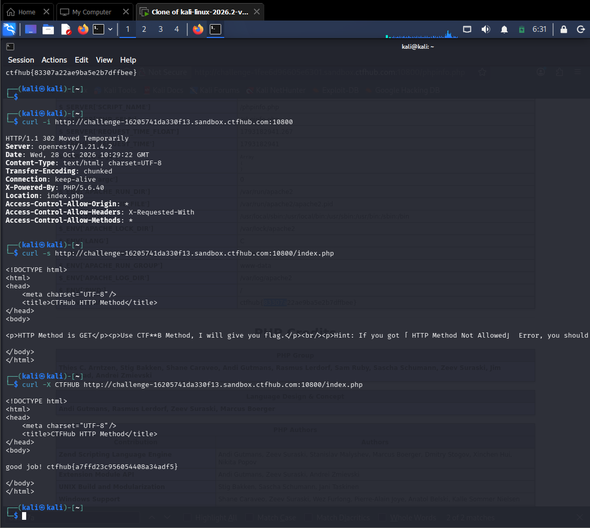

# WP：请求方式

> **CTFHub 路径**：技能树 → Web → Web 前置技能 → HTTP 协议 → 请求方式
> **任务**：按题目要求使用指定的 HTTP 方法访问目标，拿到 flag。
> **提示**：浏览器地址栏默认发送 GET 请求。用 Burp Repeater 修改请求行中的方法，或者用 `curl -X` 复现。
> **截图要求**：优先使用 Burp Repeater，截图中要能看到修改后的请求行（方法 + 路径）和响应中的 flag；如果 Burp 无法启动，可以用 `curl -X` 的方法修改截图代替，并在 WP 中说明原因。只有浏览器普通 GET 访问不算完成。

---

## 题目信息

| 项目 | 内容 |
| --- | --- |
| 环境地址 | http://challenge-16205741da330f13.sandbox.ctfhub.com:10800 |
| Flag | ctfhub{a7ffd23c956054408a34adf5} |

## 解题过程

用 `curl -i` 访问环境地址，返回 302 和 `Location: index.php`，说明实际内容在 `/index.php`。再用 `curl -s` 访问 `/index.php`，页面提示 "HTTP Method is GET" 和 "Use CTF\*B Method, I will give you flag."，即需要用自定义方法 `CTFHUB` 请求。浏览器地址栏只能发 GET，于是我在 Kali 终端用 `curl -X CTFHUB <环境地址>/index.php` 改变请求行的方法重放（本题未用 Burp，curl 的 `-X` 参数同样能修改请求行方法，效果与 Burp Repeater 一致），响应体返回 "good job! ctfhub{a7ffd23c956054408a34adf5}"，复制提交后平台提示正确。

## 关键请求/响应

```http
CTFHUB /index.php HTTP/1.1
Host: challenge-16205741da330f13.sandbox.ctfhub.com:10800

HTTP/1.1 200 OK
Content-Type: text/html

good job! ctfhub{a7ffd23c956054408a34adf5}
```

（对比：GET /index.php 时响应体只给出提示 "HTTP Method is GET / Use CTF\*B Method"；把请求行方法改成 CTFHUB 后才返回 flag。命令：`curl -X CTFHUB http://challenge-16205741da330f13.sandbox.ctfhub.com:10800/index.php`）

## 原理与复盘

请求行由「方法 + 路径 + HTTP 版本」组成，方法位于请求行最前面。HTTP 方法不只有 GET/POST，服务器可以只接受某个特定方法（包括自定义方法），用错方法（如默认 GET）就会拿不到内容。本题训练的是“请求行的第一字段是可以被改的”，对应 HTTP 的「请求行（方法）」。

---

## 截图



> 可以在这份 WP 中另加过程截图；检查时只看指定图片，额外图片不检查。
