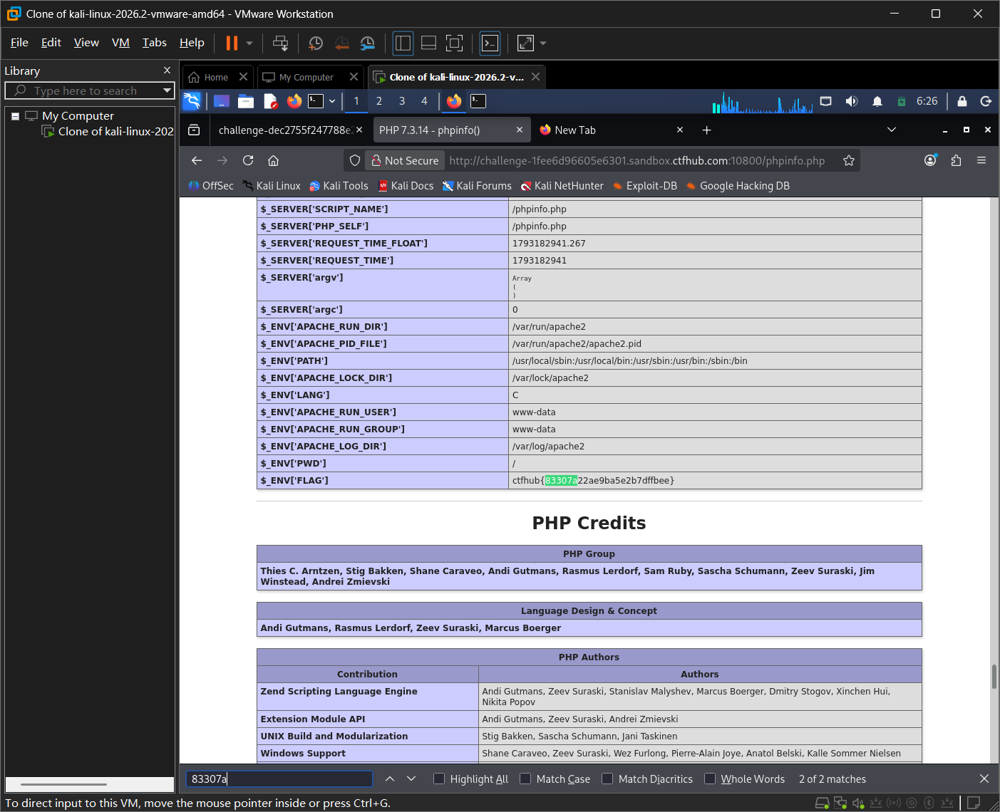

# WP：PHPINFO

> **CTFHub 路径**：技能树 → Web → 信息泄露 → PHPINFO
> **任务**：在 phpinfo 页面中找到 flag，并观察它泄露了哪些信息。
> **提示**：phpinfo 会输出大量 PHP 和服务器配置。用浏览器的查找功能搜索关键字，同时留意页面暴露的路径、版本、环境变量等信息。
> **截图要求**：能看到 phpinfo 页面、你搜索/定位到的 flag，以及至少一处敏感信息。

---

## 题目信息

| 项目 | 内容 |
| --- | --- |
| 环境地址 | http://challenge-1fee6d96605e6301.sandbox.ctfhub.com:10800 |
| Flag | ctfhub{83307a22ae9ba5e2b7dffbee} |

## 解题过程

访问题目环境地址后进入 phpinfo 页面（`/phpinfo.php`），页面输出大量 PHP 与服务器配置信息。我先在页面里按 `Ctrl+F` 搜索 `ctfhub`，命中的多是域名 `ctfhub.com`；于是改用 curl 把页面源码抓下来并过滤，精确定位到 flag：`curl -s http://challenge-1fee6d96605e6301.sandbox.ctfhub.com:10800/phpinfo.php | grep -oE "ctfhub\{[^}]*\}"`，得到 `ctfhub{83307a22ae9ba5e2b7dffbee}`。回到页面上用该关键字定位，发现 flag 存放在 `$ENV["FLAG"]` 这一环境变量字段里（页面高亮确认）。同时我注意到页面还泄露了敏感信息：PHP 版本 7.3.14、System 里的内核版本与主机名、`$_SERVER["DOCUMENT_ROOT"]` 绝对路径、`SERVER_ADDR` 内网 IP（10.233.108.10）、加载的扩展、环境变量等。把 flag 提交后平台提示正确。

## 关键请求/响应

```http
GET /phpinfo.php HTTP/1.1
Host: challenge-1fee6d96605e6301.sandbox.ctfhub.com:10800

HTTP/1.1 200 OK
Content-Type: text/html

...
<tr><td class="e">$_ENV["FLAG"] </td><td class="v">ctfhub{83307a22ae9ba5e2b7dffbee}</td></tr>
...
```

（flag 位于响应体 Environment 段的 `$_ENV["FLAG"]` 字段；用 `curl -s <环境地址>/phpinfo.php | grep -oE "ctfhub\{[^}]*\}"` 也可直接从源码中提取。）

## 原理与复盘

phpinfo() 对应 HTTP 的「响应体」。它会把服务器的 PHP 版本、绝对路径、环境变量、加载模块等大量敏感信息直接打印出来。这些信息对攻击者的价值在于：绝对路径可用于文件包含/写入，版本与扩展可用于找已知漏洞，环境变量可能泄露密钥——属于典型的信息泄露。

---

## 截图



> 可以在这份 WP 中另加过程截图；检查时只看指定图片，额外图片不检查。
