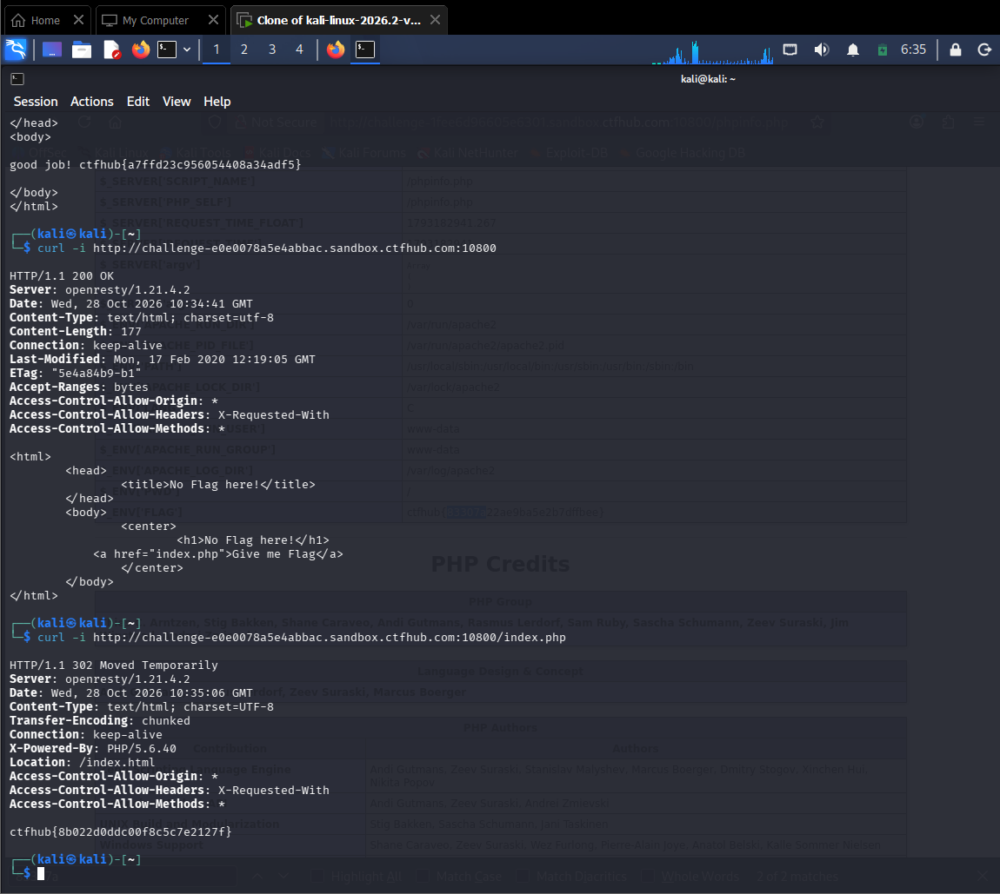

# WP：302 跳转

> **CTFHub 路径**：技能树 → Web → Web 前置技能 → HTTP 协议 → 302 跳转
> **任务**：观察 302 重定向，按题目提示找到 flag。
> **提示**：浏览器通常会自动跟随 302，所以你可能只看到最终页面。打开 DevTools 的 Network 面板（勾选 Preserve log）或 Burp，查看原始响应中的 `302` 状态码和 `Location` 响应头。
> **截图要求**：能看到 302 状态码和/或 `Location` 响应头，以及最终的 flag。只截最终页面、没有 302 证据的截图不合格。

---

## 题目信息

| 项目 | 内容 |
| --- | --- |
| 环境地址 | http://challenge-e0e0078a5e4abbac.sandbox.ctfhub.com:10800 |
| Flag | ctfhub{8b022d0ddc00f8c5c77e2127f} |

## 解题过程

我全程用 `curl -i` 在 Kali 终端观察原始响应。先访问根路径 `/`，返回 200，页面标题 "No Flag here!"，只有一个链接指向 `index.php`，说明内容不在根页面。再访问 `/index.php`（不加 `-L`、不让 curl 跟随跳转），看到原始响应：状态行是 `HTTP/1.1 302 Moved Temporarily`，响应头 `Location: /index.html` 指向跳转目标，而 flag `ctfhub{8b022d0ddc00f8c5c77e2127f}` 就藏在这次 302 响应的响应体里。浏览器会自动跟随 302 直接落到最终页，一闪而过看不到这个中间响应；用 curl 不跟随跳转才能截获它。复制 flag 提交后平台提示正确。

## 关键请求/响应

```http
GET /index.php HTTP/1.1
Host: challenge-e0e0078a5e4abbac.sandbox.ctfhub.com:10800

HTTP/1.1 302 Moved Temporarily
Location: /index.html
Content-Type: text/html; charset=UTF-8

ctfhub{8b022d0ddc00f8c5c77e2127f}
```

（用 `curl -i http://challenge-e0e0078a5e4abbac.sandbox.ctfhub.com:10800/index.php` 可复现上述原始响应；若加 `-L` 会自动跟随跳转，只看到最终页而错过 302 中间响应。）

## 原理与复盘

200 表示成功并直接返回内容、浏览器直接展示；302 表示临时重定向，浏览器默认自动跟随 `Location` 到新页面。正因浏览器自动跟随，只看最终页会错过中间的 302 状态码和 Location 头——而本题的 flag 恰恰在 302 响应里。对应 HTTP 的「状态行 / 响应头（Location）」。

---

## 截图



> 可以在这份 WP 中另加过程截图；检查时只看指定图片，额外图片不检查。
