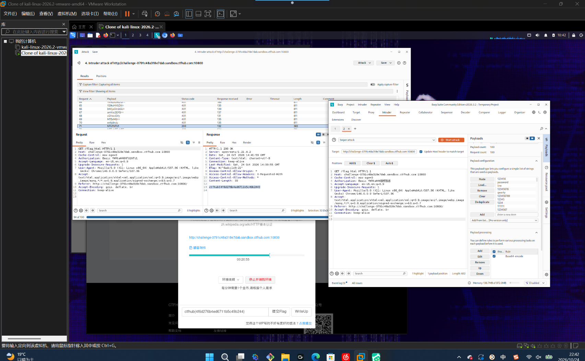

# WP：基础认证

> **CTFHub 路径**：技能树 → Web → Web 前置技能 → HTTP 协议 → 基础认证
> **任务**：按题目提示完成 HTTP Basic 认证，拿到 flag。
> **提示**：观察 `401 Unauthorized` 响应和 `WWW-Authenticate: Basic` 响应头。Basic 认证把 `用户名:密码` 做 Base64 编码后放在 `Authorization` 请求头里，Base64 不是加密。
> **截图要求**：能看到 `Authorization: Basic ...` 请求头，以及认证成功后的 flag 或页面。

---

## 题目信息

| 项目 | 内容 |
| --- | --- |
| 环境地址 | http://challenge-0791c48a318e7dab.sandbox.ctfhub.com:10800 |
| Flag | ctfhub{4f6d276b4ed6711b5c49b244} |

## 解题过程

第一次访问靶场，浏览器直接弹出一个用户名/密码的登录框，抓包看响应是 `401 Unauthorized`，响应头里带着 `WWW-Authenticate: Basic realm="..."`，说明这是 HTTP Basic 认证而不是表单登录。题目提示用户名是 admin，密码是弱口令，需要自己试。我把请求发到 Burp 的 Intruder，把 `Authorization` 头里的 Base64 部分设为 payload 位置，选一个常见弱口令字典跑，结果 `admin:111111` 这一条返回了 200 并且响应里出现 flag。确认后我用 Repeater 单独重放了一次 `Authorization: Basic YWRtaW46MTExMTEx`（就是 `admin:111111` 的 Base64），页面直接返回 `ctfhub{4f6d276b4ed6711b5c49b244}`。提交到题目页面后本题已解出。

## 关键请求/响应

```http
GET /flag.html HTTP/1.1
Host: challenge-0791c48a318e7dab.sandbox.ctfhub.com:10800
Cache-Control: max-age=0
Authorization: Basic YWRtaW46MTExMTEx
Accept-Language: en-US,en;q=0.9
Upgrade-Insecure-Requests: 1
User-Agent: Mozilla/5.0 (X11; Linux x86_64) AppleWebKit/537.36 (KHTML, like Gecko) Chrome/146.0.0.0 Safari/537.36
Accept: text/html,application/xhtml+xml,application/xml;q=0.9,image/avif,image/webp,image/apng,*/*;q=0.8
Connection: keep-alive

HTTP/1.1 200 OK
Content-Type: text/html; charset=UTF-8

ctfhub{4f6d276b4ed6711b5c49b244}
```

## 原理与复盘

`Authorization: Basic YWRtaW46MTExMTEx` 里那串并不是密文，`base64 -d` 一下就是明文 `admin:111111`，所以 Basic 认证只是把 `用户名:密码` 做了编码，属于**请求头**里的明文口令，全程没有加密保护。它的安全性完全依赖 HTTPS：走明文 HTTP 时，任何能抓包的人都能直接读出口令。另外这题能爆破成功，也说明口令强度才是最后一道防线，弱口令字典几分钟就能跑完。

---

## 截图



> 可以在这份 WP 中另加过程截图；检查时只看指定图片，额外图片不检查。
