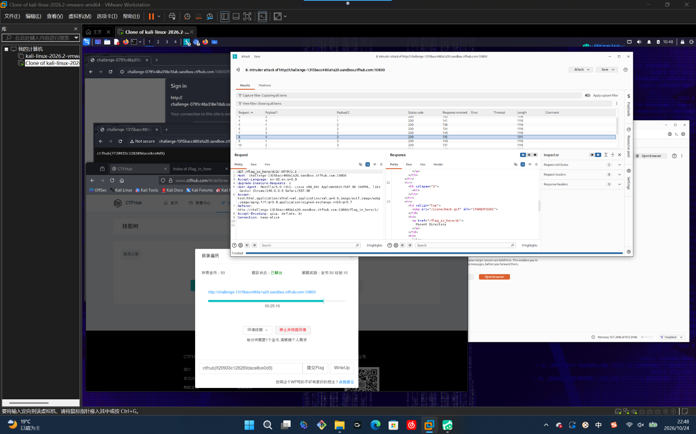

# WP：目录遍历

> **CTFHub 路径**：技能树 → Web → 信息泄露 → 目录遍历
> **任务**：按题目页面提示找到 flag。
> **提示**：注意页面给出的路径和 URL；目录列表本身就是一种信息泄露。只在题目环境内点击和访问，不要使用扫描器扫描其他地址。
> **截图要求**：能看到题目环境地址（或题目名称）、你访问的目录/路径，以及最终的 flag。

---

## 题目信息

| 项目 | 内容 |
| --- | --- |
| 环境地址 | http://challenge-1315bacc480a1a20.sandbox.ctfhub.com:10800 |
| Flag | ctfhub{ff20933c128289dace8ce0d9} |

## 解题过程

开启题目后访问靶场地址，返回的是 Apache 的目录列表页，标题写着 `Index of /flag_in_here/`，下面一行行列着 `1/`、`2/`、`3/`、`4/` 这些子目录和一行 “Parent Directory” 返回链接。我先点进 `1/`，发现里面还是同样的目录列表，于是判断这题是一层套一层的目录，flag 藏在最深处。为了不手点几十下，我直接改地址栏，按 `flag_in_here/4/2/` 这样把路径拼下去逐层试，同时用 Burp 抓 `GET /flag_in_here/4/2/ HTTP/1.1` 看原始响应，确认每一层返回的 HTML 都列出了下一级目录。点到最底层时，目录列表里出现一个 txt 文件，点开就看到了 flag。把 `ctfhub{ff20933c128289dace8ce0d9}` 填进题目页面，平台提示本题已解出。

## 关键请求/响应

```http
GET /flag_in_here/4/2/ HTTP/1.1
Host: challenge-1315bacc480a1a20.sandbox.ctfhub.com:10800
Accept: text/html,application/xhtml+xml,application/xml;q=0.9,image/avif,image/webp,image/apng,*/*;q=0.8
Connection: keep-alive

HTTP/1.1 200 OK
Content-Type: text/html; charset=UTF-8

<tr>
  <td valign="top">
    
  </td>
  <td>
    <a href="/flag_in_here/4/">Parent Directory</a>
  </td>
</tr>
```

## 原理与复盘

这道题的入口在 **URL 路径**：请求 `/flag_in_here/4/2/` 这种以斜杠结尾的地址时，服务器没有返回首页，而是把该目录下的文件条目拼成 HTML 列表回显，属于响应体里的信息泄露。目录列表本身没有“破解”任何东西，但它把服务器上本不该被看到的文件名全列了出来，备份文件、源码、配置、日志都可能因此被直接下载。生产环境应当关掉 Web 服务器的目录浏览功能（如 Nginx 的 `autoindex off`、Apache 的 `Options -Indexes`），更不要把敏感文件放在可浏览目录里。

---

## 截图



> 可以在这份 WP 中另加过程截图；检查时只看指定图片，额外图片不检查。
