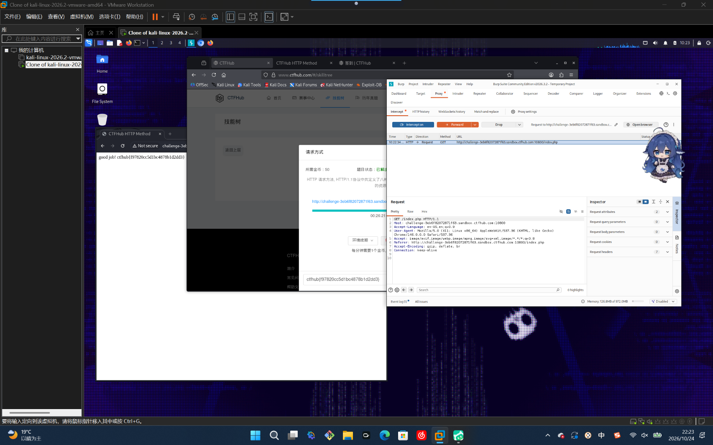

# WP：请求方式

> **CTFHub 路径**：技能树 → Web → Web 前置技能 → HTTP 协议 → 请求方式
> **任务**：按题目要求使用指定的 HTTP 方法访问目标，拿到 flag。
> **提示**：浏览器地址栏默认发送 GET 请求。用 Burp Repeater 修改请求行中的方法，或者用 `curl -X` 复现。
> **截图要求**：优先使用 Burp Repeater，截图中要能看到修改后的请求行（方法 + 路径）和响应中的 flag；如果 Burp 无法启动，可以用 `curl -X` 的方法修改截图代替，并在 WP 中说明原因。只有浏览器普通 GET 访问不算完成。

---

## 题目信息

| 项目 | 内容 |
| --- | --- |
| 环境地址 | http://challenge-3eb6f8207287f163.sandbox.ctfhub.com:10800 |
| Flag | ctfhub{f97820cc5d1bc4878b1d2dd3} |

## 解题过程

打开靶场，页面直接给了提示：需要用 `CTFHUB` 这个非标准方法来请求，普通 GET 只会得到 “No Flag here!”。我先用浏览器直接访问，确认页面返回的是拿不到 flag 的提示，说明问题不在参数而在请求行的方法。接着在 Burp 里把这个请求发到 Repeater，把第一行从 `GET /index.php HTTP/1.1` 改成 `CTFHUB /index.php HTTP/1.1`，点 Send 重新发送。响应从原来的提示页变成了 `HTTP 请求方式: CTFHUB` 加一段 `ctfhub{f97820cc5d1bc4878b1d2dd3}`，说明服务器按方法做了分支。把 flag 提交到题目页面后显示已解出。另外也试过用 Intruder 把方法名当 payload 跑字典，同样能拿到 flag，两种方式结果一致。

## 关键请求/响应

```http
CTFHUB /index.php HTTP/1.1
Host: challenge-3eb6f8207287f163.sandbox.ctfhub.com:10800
User-Agent: Mozilla/5.0 (X11; Linux x86_64) AppleWebKit/537.36 (KHTML, like Gecko) Chrome/146.0.0.0 Safari/537.36
Accept: text/html,application/xhtml+xml,application/xml;q=0.9,image/avif,image/webp,image/apng,*/*;q=0.8
Connection: keep-alive

HTTP/1.1 200 OK
Content-Type: text/html; charset=utf-8

<h1>HTTP 请求方式: CTFHUB</h1>
<p>ctfhub{f97820cc5d1bc4878b1d2dd3}</p>
```

## 原理与复盘

请求行的结构是 `方法 请求目标 协议版本`，方法固定在最前面，所以改方法只需改这一行的第一个词。浏览器地址栏和页面表单默认只发 GET（表单还有 POST），但 HTTP 协议本身允许服务器接受任意自定义方法，本题的靶场就按 `CTFHUB` 这个方法名做了分支，GET 走拒绝分支、`CTFHUB` 走返回 flag 的分支。这说明方法字段属于客户端可控输入，服务端不能用“浏览器只会发 GET/POST”来假设请求的合法性。

---

## 截图



> 可以在这份 WP 中另加过程截图；检查时只看指定图片，额外图片不检查。
