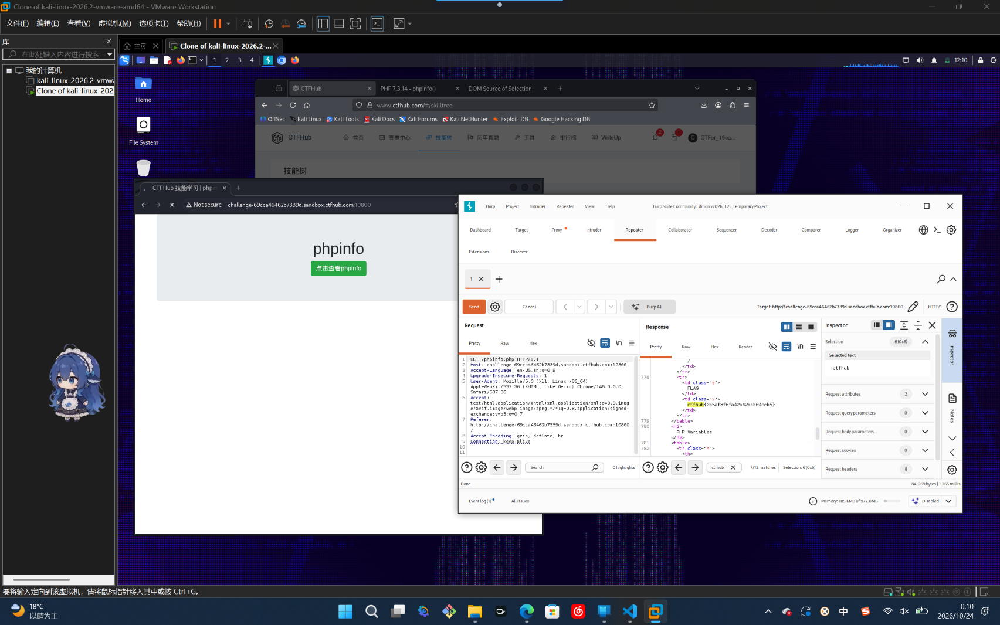

# WP：PHPINFO

> **CTFHub 路径**：技能树 → Web → 信息泄露 → PHPINFO
> **任务**：在 phpinfo 页面中找到 flag，并观察它泄露了哪些信息。
> **提示**：phpinfo 会输出大量 PHP 和服务器配置。用浏览器的查找功能搜索关键字，同时留意页面暴露的路径、版本、环境变量等信息。
> **截图要求**：能看到 phpinfo 页面、你搜索/定位到的 flag，以及至少一处敏感信息。

---

## 题目信息

| 项目 | 内容 |
| --- | --- |
| 环境地址 | http://challenge-69cca46462b7339d.sandbox.ctfhub.com:10800 |
| Flag | ctfhub{0b5af8f61a42b42dbb04ceb5} |

## 解题过程

开启题目后访问靶场地址，页面直接就是一个完整的 phpinfo 输出页，最上面有“phpinfo”标题和本题目录，往下是成百上千行的配置表格。整页太长，肉眼从上往下翻很难找到重点，所以我在页面里用 Ctrl + F 搜了 FLAG 关键字，定位到中间一张两列的小表格，左边单元格写 `FLAG`，右边单元格就是 `ctfhub{0b5af8f61a42b42dbb04ceb5}`。为了同时留下原始报文的证据，我又用 Burp 抓了这个请求，在 Proxy → HTTP history 里把响应发到 Repeater，在 Response 正文里选中同一段 `<td class="e">FLAG</td>` 和 `<td class="v">ctfhub{...}</td>`，确认浏览器里看到的内容和响应体完全一致。把 flag 提交到题目页面，平台提示本题已完成。顺带看到这一页还输出了 `Server: openresty/1.21.4.2`、PHP Variables 等运行环境信息。

## 关键请求/响应

```http
GET / HTTP/1.1
Host: challenge-69cca46462b7339d.sandbox.ctfhub.com:10800
Accept-Encoding: gzip, deflate, br
Connection: keep-alive

HTTP/1.1 200 OK
Content-Type: text/html; charset=UTF-8

<tr>
  <td class="e">FLAG</td>
  <td class="v">ctfhub{0b5af8f61a42b42dbb04ceb5}</td>
</tr>
```

## 原理与复盘

phpinfo 是 `phpinfo()` 函数生成的调试页面，属于**响应体**里的信息泄露：同一个页面会列出 PHP 版本、编译参数、`Server` 软件及版本、网站物理路径、环境变量等一切运行时配置。这些内容本身不直接给权限，但对攻击者是“地图”——从版本号可以找对应 CVE，从绝对路径可以猜目录结构和日志位置，从环境变量里有时还能捞到数据库账号之类的凭据。所以生产环境必须关闭 phpinfo 或限制其访问来源，本题的 flag 也就藏在这样一页默认就该被删掉的调试输出里。

---

## 截图



> 可以在这份 WP 中另加过程截图；检查时只看指定图片，额外图片不检查。
