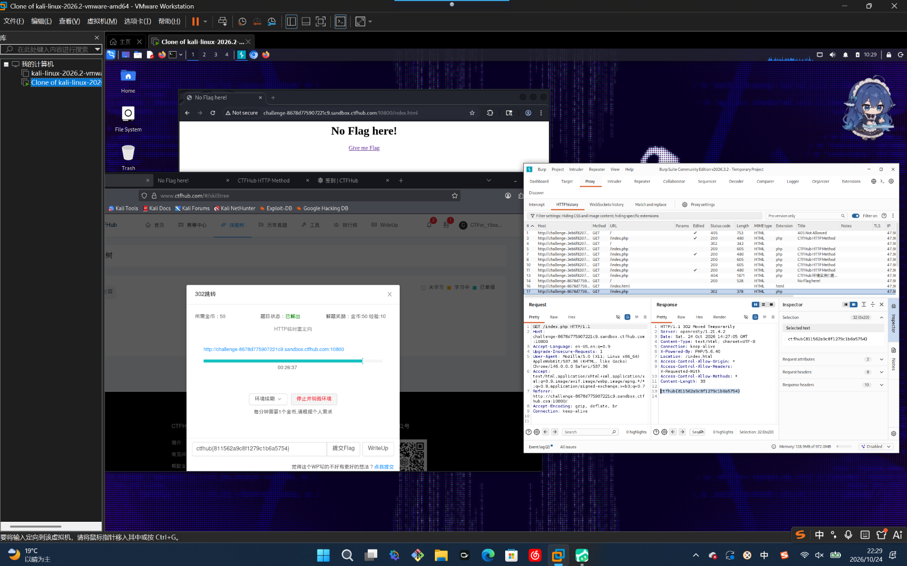

# WP：302 跳转

> **CTFHub 路径**：技能树 → Web → Web 前置技能 → HTTP 协议 → 302 跳转
> **任务**：观察 302 重定向，按题目提示找到 flag。
> **提示**：浏览器通常会自动跟随 302，所以你可能只看到最终页面。打开 DevTools 的 Network 面板（勾选 Preserve log）或 Burp，查看原始响应中的 `302` 状态码和 `Location` 响应头。
> **截图要求**：能看到 302 状态码和/或 `Location` 响应头，以及最终的 flag。只截最终页面、没有 302 证据的截图不合格。

---

## 题目信息

| 项目 | 内容 |
| --- | --- |
| 环境地址 | http://challenge-8678d775907221c9.sandbox.ctfhub.com:10800 |
| Flag | ctfhub{811562a9c8f1279c1b6a5754} |

## 解题过程

第一次在浏览器里访问靶场，只看到一个写着 “No Flag here!” 的页面，页面上还有个 “Give me Flag” 的链接，点了也没直接给出 flag——因为浏览器自动跟随了重定向，302 那一跳在屏幕上根本停不住。我把 Burp 的 Proxy 打开，让 Kali 的浏览器走 `127.0.0.1:8080`，重新访问一次，在 HTTP history 里就看到了两条记录：服务端返回 302，紧接着是 `Location` 指向的下一跳。点开那条 302 看 Response，状态行是 `HTTP/1.1 302 Moved Temporarily`，`Location: /index.html`，而响应正文里直接就是 flag。把 `ctfhub{811562a9c8f1279c1b6a5754}` 提交后本题已解出。

## 关键请求/响应

```http
GET /index.php HTTP/1.1
Host: challenge-8678d775907221c9.sandbox.ctfhub.com:10800
User-Agent: Mozilla/5.0 (X11; Linux x86_64) AppleWebKit/537.36 (KHTML, like Gecko) Chrome/146.0.0.0 Safari/537.36
Accept: text/html,application/xhtml+xml,application/xml;q=0.9,image/avif,image/webp,image/apng,*/*;q=0.8
Connection: keep-alive

HTTP/1.1 302 Moved Temporarily
Server: openresty/1.21.4.2
Date: Sat, 24 Oct 2026 14:27:05 GMT
Content-Type: text/html; charset=UTF-8
Connection: keep-alive
X-Powered-By: PHP/5.6.40
Location: /index.html
Access-Control-Allow-Origin: *
Access-Control-Allow-Methods: *
Content-Length: 38

ctfhub{811562a9c8f1279c1b6a5754}
```

## 原理与复盘

差别在状态行：200 表示“内容就在这次响应里”，浏览器直接把响应体渲染出来；302 表示“东西不在这儿，去 `Location` 指的地址拿”，浏览器会自动发起第二次请求，用户看不到中间那一跳。所以判断一次跳转是否发生过，不能看页面，要看原始响应的状态行和 `Location` 响应头——DevTools 里要勾 Preserve log，否则跳转前的记录会被冲掉。这题还有个小陷阱：flag 其实就写在 302 那个响应体里，如果只盯着跳转后的页面反而会漏掉。

---

## 截图



> 可以在这份 WP 中另加过程截图；检查时只看指定图片，额外图片不检查。
