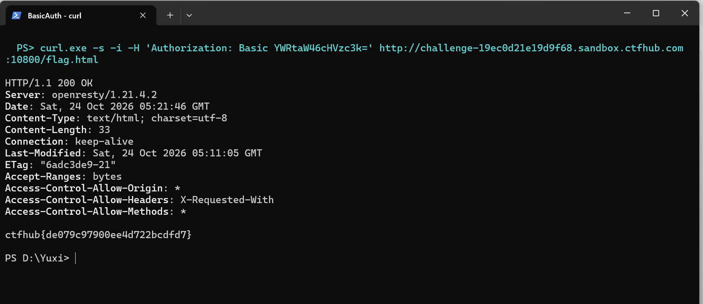

# WP：基础认证

> **CTFHub 路径**：技能树 → Web → Web 前置技能 → HTTP 协议 → 基础认证
> **任务**：按题目提示完成 HTTP Basic 认证，拿到 flag。
> **提示**：观察 `401 Unauthorized` 响应和 `WWW-Authenticate: Basic` 响应头。Basic 认证把 `用户名:密码` 做 Base64 编码后放在 `Authorization` 请求头里，Base64 不是加密。
> **截图要求**：能看到 `Authorization: Basic ...` 请求头，以及认证成功后的 flag 或页面。

---

## 题目信息

| 项目 | 内容 |
| --- | --- |
| 环境地址 | http://challenge-19ec0d21e19d9f68.sandbox.ctfhub.com:10800 |
| Flag | ctfhub{de079c97900ee4d722bcdfd7} |

## 解题过程

打开靶场首页，页面标题是 `Basic Auth`，正文写着「Here is your flag: click」，链接指向 `/flag.html`；但直接访问 `/flag.html` 会被拦下来，返回 `401 Authorization Required`，响应头里是 `WWW-Authenticate: Basic realm="Do u know admin ?"` —— 服务器要求的是 HTTP Basic 认证，用户名就是 realm 里提示的 `admin`。
题目附件 `10_million_password_list_top_100.txt` 是一份 100 条的常用密码字典（`123456`、`password`、`12345`……），说明密码要爆破。我把 `/flag.html` 的请求放进 Burp Intruder，在 `Authorization: Basic` 后面那段 Base64 上设 payload 位置、导入这份字典跑了一遍，按响应长度筛出唯一一条 200 的请求；把它的 Base64 解出来就是 `admin:` 加字典里的某个密码。
用这组账号再访问 `/flag.html`，状态码变成 200，响应体就是 flag。为了留证据我又用 `curl -i -H 'Authorization: Basic ...'` 复现了一次，结果一致。提交后平台提示正确。

## 关键请求/响应

```http
GET /flag.html HTTP/1.1
Host: challenge-19ec0d21e19d9f68.sandbox.ctfhub.com:10800
User-Agent: curl/8.11.1
Accept: */*

HTTP/1.1 401 Unauthorized
Server: openresty/1.21.4.2
WWW-Authenticate: Basic realm="Do u know admin ?"
Content-Type: text/html; charset=UTF-8
```

```http
GET /flag.html HTTP/1.1
Host: challenge-19ec0d21e19d9f68.sandbox.ctfhub.com:10800
Authorization: Basic YWRtaW46cHVzc3k=
User-Agent: curl/8.11.1
Accept: */*

HTTP/1.1 200 OK
Server: openresty/1.21.4.2
Content-Type: text/html; charset=UTF-8
Content-Length: 33

ctfhub{de079c97900ee4d722bcdfd7}
```

## 原理与复盘

Basic 认证的凭据放在请求头 `Authorization` 里，格式是 `Basic ` 加 `base64(用户名:密码)`；上面那串 `YWRtaW46cHVzc3k=` 解出来就是 `admin:` 加字典里的那个密码，也就是说它只是编码、不是加密，任何人抓到包都能直接解出账号密码，而且每个请求都要重复带一遍。
所以它对字典爆破几乎没有抵抗力：服务器只判断这串 Base64 对不对，没有验证码、没有失败锁定。实际系统里 Basic 认证必须叠在 HTTPS 上，并且要限速、限制失败次数。

---

## 截图



> 可以在这份 WP 中另加过程截图；检查时只看指定图片，额外图片不检查。
