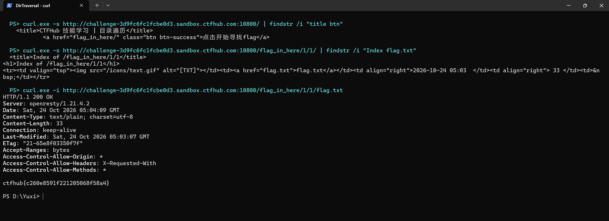

# WP：目录遍历

> **CTFHub 路径**：技能树 → Web → 信息泄露 → 目录遍历
> **任务**：按题目页面提示找到 flag。
> **提示**：注意页面给出的路径和 URL；目录列表本身就是一种信息泄露。只在题目环境内点击和访问，不要使用扫描器扫描其他地址。
> **截图要求**：能看到题目环境地址（或题目名称）、你访问的目录/路径，以及最终的 flag。

---

## 题目信息

| 项目 | 内容 |
| --- | --- |
| 环境地址 | http://challenge-3d9fc6fc1fcbe0d3.sandbox.ctfhub.com:10800 |
| Flag | ctfhub{c260e8591f221205068f58a4} |

## 解题过程

打开靶场首页，页面标题是「CTFHub 技能学习 | 目录遍历」，正文只有一个按钮「点击开始寻找flag」，对应的链接是 `flag_in_here/`，说明 flag 就藏在这个目录下面。
点进去后服务器没有返回网页，而是直接把目录列了出来：`Index of /flag_in_here`，里面有 `1/ 2/ 3/ 4/` 四个子目录，页脚还写着 `Apache/2.4.38 (Debian)` —— 这是 Apache 的目录列表（autoindex）开着，属于典型的信息泄露。
四个目录里又是同样的四层结构，我顺着链接一层层点下去，在 `/flag_in_here/1/1/` 这一层看到了 `flag.txt`，打开它页面正文就是 flag。
把 flag 提交到题目页面后平台提示正确。整个过程只在题目环境里点链接，没有用扫描器去扫别的地址。

## 关键请求/响应

```http
GET /flag_in_here/1/1/ HTTP/1.1
Host: challenge-3d9fc6fc1fcbe0d3.sandbox.ctfhub.com:10800
User-Agent: curl/8.11.1
Accept: */*

HTTP/1.1 200 OK
Content-Type: text/html;charset=UTF-8

<title>Index of /flag_in_here/1/1</title>
<h1>Index of /flag_in_here/1/1</h1>
...
<a href="flag.txt">flag.txt</a>
```

```http
GET /flag_in_here/1/1/flag.txt HTTP/1.1
Host: challenge-3d9fc6fc1fcbe0d3.sandbox.ctfhub.com:10800
User-Agent: curl/8.11.1
Accept: */*

HTTP/1.1 200 OK
Content-Type: text/plain; charset=utf-8
Content-Length: 33

ctfhub{c260e8591f221205068f58a4}
```

## 原理与复盘

目录遍历/目录列表是响应体和 URL 路径的问题：请求行里的路径指向一个目录时，服务器本来应该拒绝或返回默认页，这里却把目录下的文件名、子目录和服务器版本直接列在 HTML 里，等于把站点结构主动交出去。
有了目录列表，攻击者就能顺着它找备份文件、源码、配置和日志；这题里 flag 就是被放在一个普通目录下的 txt 文件。实际部署时 Nginx 的 `autoindex off`、Apache 的 `Options -Indexes` 都该关掉，目录里也不该放敏感文件。

---

## 截图



> 可以在这份 WP 中另加过程截图；检查时只看指定图片，额外图片不检查。
