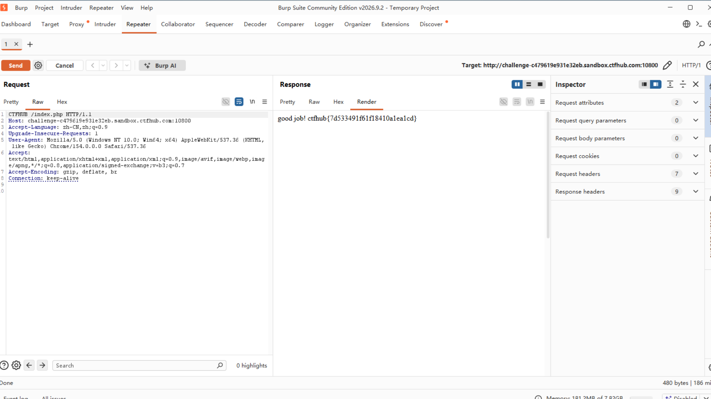

# WP：请求方式

> **CTFHub 路径**：技能树 → Web → Web 前置技能 → HTTP 协议 → 请求方式
> **任务**：按题目要求使用指定的 HTTP 方法访问目标，拿到 flag。
> **提示**：浏览器地址栏默认发送 GET 请求。用 Burp Repeater 修改请求行中的方法，或者用 `curl -X` 复现。
> **截图要求**：优先使用 Burp Repeater，截图中要能看到修改后的请求行（方法 + 路径）和响应中的 flag；如果 Burp 无法启动，可以用 `curl -X` 的方法修改截图代替，并在 WP 中说明原因。只有浏览器普通 GET 访问不算完成。

---

## 题目信息

| 项目 | 内容 |
| --- | --- |
| 环境地址 | http://challenge-c479619e931e32eb.sandbox.ctfhub.com:10800/index.php |
| Flag | ctfhub{7d533491f61f18410a1ea1cd} |

## 解题过程

在 Kali 里打开靶场首页 `index.php`，页面提示本题要按指定的 HTTP 方法访问，直接用浏览器地址栏访问（默认是 GET）只能看到提示，拿不到 flag，因为浏览器只会发 GET 和 POST，没有办法自己指定别的方法。
我把 Kali 浏览器代理指到 Burp（`127.0.0.1:8080`），在 Proxy → HTTP history 里找到对 `/index.php` 的 GET 请求，右键 Send to Repeater。在 Repeater 里把请求行最前面的 `GET` 改成 `CTFHub`，点 Send，响应体就变成了 `good job! ctfhub{...}`。
把 flag 提交到题目页面后平台提示正确。

## 关键请求/响应

```http
CTFHub /index.php HTTP/1.1
Host: challenge-c479619e931e32eb.sandbox.ctfhub.com:10800
User-Agent: Mozilla/5.0 (Windows NT 10.0; Win64; x64) AppleWebKit/537.36 (KHTML, like Gecko) Chrome/154.0.0.0 Safari/537.36
Accept: text/html,application/xhtml+xml,application/xml;q=0.9,image/avif,image/webp,*/*;q=0.8
Accept-Language: zh-CN,zh;q=0.9
Connection: keep-alive

HTTP/1.1 200 OK
Content-Type: text/html; charset=utf-8

good job! ctfhub{7d533491f61f18410a1ea1cd}
```

## 原理与复盘

请求行由「方法 + 空格 + 路径 + 空格 + HTTP 版本」三部分组成，方法就在最前面，所以改方法只动请求行第一个单词，路径和版本都不用变。
服务端很可能是按 `$_SERVER['REQUEST_METHOD']` 做分支判断的：只有方法等于题目要求的值才返回 flag，GET 只返回提示。这题让我记住，请求行里每一个字段客户端都能改，服务端不能把"浏览器只会发 GET/POST"当成限制。

---

## 截图



> 可以在这份 WP 中另加过程截图；检查时只看指定图片，额外图片不检查。
