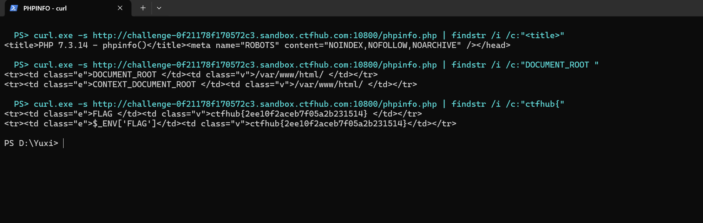

# WP：PHPINFO

> **CTFHub 路径**：技能树 → Web → 信息泄露 → PHPINFO
> **任务**：在 phpinfo 页面中找到 flag，并观察它泄露了哪些信息。
> **提示**：phpinfo 会输出大量 PHP 和服务器配置。用浏览器的查找功能搜索关键字，同时留意页面暴露的路径、版本、环境变量等信息。
> **截图要求**：能看到 phpinfo 页面、你搜索/定位到的 flag，以及至少一处敏感信息。

---

## 题目信息

| 项目 | 内容 |
| --- | --- |
| 环境地址 | http://challenge-0f21178f170572c3.sandbox.ctfhub.com:10800 |
| Flag | ctfhub{2ee10f2aceb7f05a2b231514} |

## 解题过程

打开靶场首页，页面只有一个标题 `phpinfo` 和一个按钮「点击查看phpinfo」，点进去是 `phpinfo.php`，也就是一张 PHP 7.3.14 的 phpinfo 输出页。
这张页面很长，从上到下列着 PHP 版本、编译参数、Apache 模块、Environment、PHP Variables 等表格，一屏一屏翻不现实，所以我直接用浏览器的查找功能（`Ctrl + F`）搜 `flag`，页面跳到 Environment 段里的 `FLAG` 变量，值就是 flag（`$_ENV['FLAG']` 里也有一份同样的值）。
顺手确认了它泄露的敏感信息：`DOCUMENT_ROOT` 和 `SCRIPT_FILENAME` 直接把网站根目录 `/var/www/html/` 和脚本路径交了出来，页面上还写着 `PHP/7.3.14`、`Apache/2.4.38 (Debian)` 和加载的模块列表，这些对攻击者判断环境和找漏洞都很有用。提交 flag 后平台提示正确。

## 关键请求/响应

```http
GET /phpinfo.php HTTP/1.1
Host: challenge-0f21178f170572c3.sandbox.ctfhub.com:10800
User-Agent: curl/8.11.1
Accept: */*

HTTP/1.1 200 OK
Content-Type: text/html; charset=UTF-8

<title>PHP 7.3.14 - phpinfo()</title>
...
<tr><td class="e">DOCUMENT_ROOT </td><td class="v">/var/www/html/ </td></tr>
<tr><td class="e">SCRIPT_FILENAME </td><td class="v">/var/www/html/phpinfo.php </td></tr>
...
<tr><td class="e">FLAG </td><td class="v">ctfhub{2ee10f2aceb7f05a2b231514} </td></tr>
<tr><td class="e">$_ENV['FLAG']</td><td class="v">ctfhub{2ee10f2aceb7f05a2b231514}</td></tr>
```

## 原理与复盘

phpinfo 是调试页面，返回的响应体里全是运行环境信息：PHP 版本、编译参数、模块、`php.ini` 路径、环境变量和 `$_SERVER` 内容，flag 就是被塞进 Environment 里的一个变量，藏在几万字节的表格中间。
这类页面对攻击者来说是"地图"：知道版本就能找对应的 CVE，知道绝对路径就能猜文件包含、日志位置和上传目录。所以生产环境绝不能把 `phpinfo()` 留在公网，调试页用完就删，`expose_php` 也建议关掉。

---

## 截图



> 可以在这份 WP 中另加过程截图；检查时只看指定图片，额外图片不检查。
